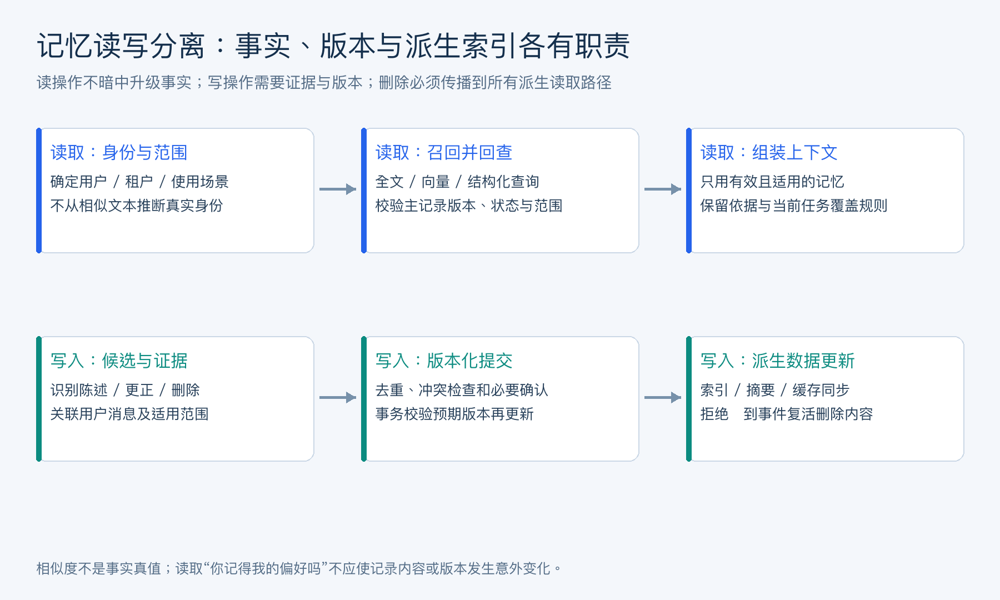

# 目录

[1. 为什么 AI Agent 必须重视记忆与上下文工程？](#q-001)
  - [面试问题：长期任务为什么需要主动管理信息生命周期？](#q-101)
  - [面试问题：Prompt Engineering 和 Context Engineering 有什么区别？](#q-002)
  - [面试问题：Agent Memory 和普通聊天历史有什么区别？](#q-003)
  - [面试问题：为什么长上下文模型不能完全替代记忆系统？](#q-004)
[2. AI Agent 的 Memory 通常分为哪些类型？](#q-005)
  - [面试问题：不同记忆类型如何按用途与时效组织？](#q-102)
  - [面试问题：短期记忆、工作记忆、长期记忆、情景记忆如何区分？](#q-006)
  - [面试问题：个人记忆、任务记忆、工具记忆分别解决什么问题？](#q-007)
  - [面试问题：Memory 和 RAG 的本质区别是什么？](#q-008)
  - [面试问题：Memory 与 RAG 如何组合使用？](#q-009)
  - [面试问题：完整聊天记录怎么保存？调用模型时，怎么选取最近的对话？](#q-029)
[3. Agent Memory 的完整生命周期是什么？](#q-010)
  - [面试问题：记忆从候选事实到失效删除要经过哪些阶段？](#q-103)
  - [面试问题：如何判断一条信息是否应该写入长期记忆？](#q-011)
  - [面试问题：Memory CRUD 在 Agent 系统中如何设计？](#q-012)
  - [面试问题：记忆检索有哪些主流策略？](#q-013)
  - [面试问题：记忆冲突、过期和遗忘机制如何处理？](#q-014)
  - [面试问题：长期记忆中的 Active、Outdated、Conflicted、Deleted 分别表示什么？](#q-030)
  - [面试问题：用户问“你知道我偏好什么吗”，为什么可能被误当成记忆写入？你怎么解决？](#q-031)
  - [面试问题：Agent 怎么通过定期总结，把历史记录转化为长期记忆？](#q-032)
[4. Agent 出现上下文窗口溢出时如何处理？](#q-015)
  - [面试问题：上下文预算不足时有哪些处理层次？](#q-104)
  - [面试问题：滑动窗口、摘要压缩、语义压缩如何对比？](#q-016)
  - [面试问题：选择性保留和内容裁剪适合哪些场景？](#q-017)
  - [面试问题：Context Engine 的 assemble / compact / retrieve 如何协同？](#q-018)
  - [面试问题：编码 Agent 的上下文工程有哪些特殊难点？](#q-019)
[5. 长期记忆系统应该选择什么存储架构？](#q-020)
  - [面试问题：记忆持久化与索引应该如何解耦？](#q-105)
  - [面试问题：向量数据库、关系数据库、图数据库、事件日志如何分工？](#q-021)
  - [面试问题：跨 Agent 记忆复用如何设计？](#q-022)
  - [面试问题：记忆污染和隐私泄露有哪些风险？](#q-023)
  - [面试问题：企业级 Memory 系统需要哪些工程能力？](#q-024)
[6. Skills 为什么属于上下文工程的重要组成？](#q-025)
  - [面试问题：渐进式能力加载如何减少无关上下文？](#q-106)
  - [面试问题：Skill、Tool、Memory、RAG 有什么区别？](#q-026)
  - [面试问题：项目记忆文件如何帮助编码 Agent 理解仓库？](#q-027)
  - [面试问题：如何设计一个可长期运行的个人助理记忆系统？](#q-028)

---

<h1 id="q-001">1. 为什么 AI Agent 必须重视记忆与上下文工程？</h1>


<h2 id="q-101">面试问题：长期任务为什么需要主动管理信息生命周期？</h2>

**难度评分：⭐⭐⭐ (3/5)  |  考察频率：⭐⭐⭐⭐ (4/5)**

标准大模型本质上是无状态的。每次请求只能看到当前输入窗口中的内容，无法天然记住长期偏好、历史任务、工具经验、项目规则和多轮进展。AI Agent 之所以需要记忆与上下文工程，是因为它要完成的任务往往具备连续性：

- 多轮对话需要知道前文。
- 长任务需要记住当前进度。
- 个人助手需要记住用户偏好。
- 编码 Agent 需要记住项目规则和已修改文件。
- 工具型 Agent 需要知道哪些工具过去有效。
- 多 Agent 系统需要避免重复探索和重复犯错。

记忆系统解决“哪些信息应该长期保留、如何检索、如何更新、如何遗忘”的问题；上下文工程解决“当前这一轮模型到底应该看到什么”的问题。二者合起来，决定 Agent 能否从一次性问答走向长期可靠工作。

可以用一个公式理解：

```math
\text{Agent Quality} \approx f(\text{Model}, \text{Tools}, \text{Memory}, \text{Context Assembly}, \text{Feedback})
```
模型能力很重要，但如果上下文拼错、记忆污染或关键信息丢失，强模型也会做出错误决策。

<h2 id="q-002">面试问题：Prompt Engineering 和 Context Engineering 有什么区别？</h2>

**难度评分：⭐⭐⭐ (3/5)  |  考察频率：⭐⭐⭐⭐ (4/5)**

**面试追问：提示词工程、上下文工程和 Harness Engineering 有什么区别？**

提示词工程处理“如何给模型表达任务”；上下文工程处理“这次调用应提供哪些信息、如何组织以及何时移除”；Harness Engineering 处理“模型如何在一个受控环境中持续完成任务”。三者分别作用于指令、信息和执行环境，存在交集，但不能相互替代。

例如要求引用证据属于提示词设计；按身份过滤文档、裁剪检索结果、保留未完成计划属于上下文工程；工具执行、工作目录、权限校验、循环控制、超时恢复和测试验收属于运行 Harness。评测 Harness 则侧重固定任务、环境、运行器和判分器，不能将所有 Harness 都缩成 benchmark 脚本。

改好提示词不能解决重复扣款，扩大上下文不能解决目录越权。应先定位故障发生在哪一层，再决定修改指令、检索策略还是执行约束。Rocky认为，Agent 工程的长期价值就在于把语言决策接入可验证的执行链路。

<h2 id="q-003">面试问题：Agent Memory 和普通聊天历史有什么区别？</h2>

**难度评分：⭐⭐⭐ (3/5)  |  考察频率：⭐⭐⭐⭐ (4/5)**

普通聊天历史通常只是按时间顺序保存消息；Agent Memory 是经过筛选、结构化、检索和治理的长期信息资产。

<div align="center">

| 维度 | 聊天历史 | Agent Memory |
| --- | --- | --- |
| 存储方式 | 原始消息列表 | 结构化记录、向量、图、事件、摘要 |
| 写入策略 | 默认保存全部 | 选择性写入 |
| 检索方式 | 最近 N 轮或全文搜索 | 语义检索、时间检索、任务检索、规则检索 |
| 更新机制 | 很少更新 | 可增删改、合并、衰减、遗忘 |
| 风险控制 | 弱 | 隐私、权限、来源、过期、污染治理 |
| 作用 | 维持对话连续 | 支撑个性化、任务状态、经验复用、工具优化 |

</div>

例如“用户喜欢科幻电影”如果只存在聊天历史里，过几周后很难被准确找回；如果被提取为个人记忆，就可以在推荐电影、礼物或活动时被检索和使用。

<h2 id="q-004">面试问题：为什么长上下文模型不能完全替代记忆系统？</h2>

**难度评分：⭐⭐⭐ (3/5)  |  考察频率：⭐⭐⭐⭐ (4/5)**

**面试追问：上下文工程具体要做哪些事？为什么不能把所有历史信息直接交给模型？**

上下文工程包括信息采集、信任分层、相关性检索、权限过滤、去重、摘要、排序、Token 预算分配与版本记录。目标是让模型在当前步骤拿到足够且有效的证据，而不是把已有文本全部发送出去。

完整历史可能超过窗口，增加预填充耗时与费用；旧偏好、错误工具结果和重复日志还会与当前目标竞争注意力。长上下文能力提升了容量，并不保证模型准确使用每一段内容，更没有自动实现隐私隔离和知识更新。

优先保留当前目标、约束、未完成动作、工具调用与结果配对；把已完成步骤压成带证据位置的摘要，按需取回原文。输出预算和工具响应空间应预留，超预算时按信息价值裁剪，而不是从消息列表任意截断。

<h1 id="q-005">2. AI Agent 的 Memory 通常分为哪些类型？</h1>


<h2 id="q-102">面试问题：不同记忆类型如何按用途与时效组织？</h2>

**难度评分：⭐⭐⭐ (3/5)  |  考察频率：⭐⭐⭐⭐ (4/5)**

Agent Memory 可以从时间、功能和来源三个角度划分。

按时间划分：

- 短期记忆：当前对话窗口内的信息。
- 工作记忆：当前任务状态、计划、待办、工具结果摘要。
- 中期记忆：会话摘要、阶段性任务总结、近期项目上下文。
- 长期记忆：跨会话保留的用户偏好、稳定事实、经验和知识。

按功能划分：

- 个人记忆：用户画像、偏好、习惯、约束。
- 任务记忆：任务轨迹、成功策略、失败经验、SOP。
- 工具记忆：工具成功率、参数偏好、失败原因、成本和延迟。
- 项目记忆：仓库规则、团队规范、构建命令、架构约束。
- 安全记忆：用户撤回、禁止记录、敏感信息策略、权限边界。

按数据结构划分：

- 原始事件日志。
- 对话摘要。
- Key-Value 记忆。
- 向量记忆。
- 图记忆。
- 表格化用户画像。
- 文件或项目级记忆文档。

不同类型的记忆不应混在一个大向量库里粗暴检索。高质量 Memory 系统通常会分层、分域、分权限管理。

<h2 id="q-006">面试问题：短期记忆、工作记忆、长期记忆、情景记忆如何区分？</h2>

**难度评分：⭐⭐ (2/5)  |  考察频率：⭐⭐⭐⭐ (4/5)**

**面试追问：你为什么要把记忆分成短期、中期、长期偏好和跨对话语义记忆？**

分层是为了分别管理信息的使用频率、生命周期、查询方式和隐私范围。短期层保存最近消息与当前工具交互；中期层保存会话摘要、阶段结果和未完成任务；长期偏好层保存相对稳定且有适用范围的用户设定；跨对话语义记忆保存可按意义检索的历史事实或经验。

这些层是工程设计选项，不是 Agent 的统一标准。工作记忆强调正在执行的目标与状态；情景记忆强调某次经历的时间和背景；语义记忆强调可复用事实。它们可以落在同一数据库的不同结构中，无需为每层购买一种数据库。

例如“我一直偏好中文解释”可成为长期偏好，“这次用英文”只约束当前任务，“等待用户确认 19 点的课程”属于任务状态。身份和权限仍来自业务系统，不应藏在语义记忆中。分层成效看连续任务成功率、错误记忆率、删除一致性和上下文成本。

<h2 id="q-007">面试问题：个人记忆、任务记忆、工具记忆分别解决什么问题？</h2>

**难度评分：⭐⭐⭐ (3/5)  |  考察频率：⭐⭐⭐⭐ (4/5)**

<div align="center">

| 记忆类型 | 核心问题 | 示例 |
| --- | --- | --- |
| 个人记忆 | Agent 如何更懂用户 | 偏好正式语气、喜欢科幻、对坚果过敏 |
| 任务记忆 | Agent 如何从任务经验中复用策略 | 某类 bug 修复先跑单测，再改 mock |
| 工具记忆 | Agent 如何更好地选择和使用工具 | 某搜索工具对中文文档命中率低，某 API 经常超时 |

</div>

个人记忆提升个性化；任务记忆提升复用和自我改进；工具记忆提升工具选择效率和稳定性。

一个成熟系统会把它们分开存储：

- 个人记忆按 user_id 隔离。
- 任务记忆按 task_type、domain、project、agent_role 分类。
- 工具记忆按 tool_id、参数模式、调用环境记录。

不要把工具失败记录写进用户个人画像，也不要把用户隐私写进全局任务记忆库。

<h2 id="q-008">面试问题：Memory 和 RAG 的本质区别是什么？</h2>

**难度评分：⭐⭐⭐ (3/5)  |  考察频率：⭐⭐⭐⭐ (4/5)**

<div align="center">

| 维度 | Memory | RAG |
| --- | --- | --- |
| 核心目的 | 保持连续性、个性化、状态和经验 | 检索外部知识，增强事实性 |
| 数据来源 | 对话、行为、任务轨迹、偏好、工具使用 | 文档、网页、知识库、数据库、手册 |
| 更新频率 | 高频、增量、交互驱动 | 低到中频，常为批量更新 |
| 检索方式 | Context / State-driven | Query-driven |
| 数据形态 | 事件、画像、摘要、向量、图、状态 | 文档块、向量索引、倒排索引、知识条目 |
| 风险 | 记忆污染、隐私泄露、跨用户串线 | 文档过期、检索不准、来源不可信 |

</div>

Memory 解决“这个 Agent 记得什么”；RAG 解决“这个问题需要查什么知识”。

例子：

- 用户说“我不吃香菜”，应进入个人 Memory。
- 企业产品手册、API 文档、报销制度，应进入 RAG 知识库。
- 某次任务失败原因“上次部署失败是因为 staging 环境缺少 env”，可进入任务 Memory。

检索实现的完整链路见 [Agent RAG 与混合检索工程](10_Agent_RAG与混合检索工程高频考点.md)，涵盖切分、索引、排序、过滤与质量诊断。

<h2 id="q-009">面试问题：Memory 与 RAG 如何组合使用？</h2>

**难度评分：⭐⭐⭐ (3/5)  |  考察频率：⭐⭐⭐⭐ (4/5)**

一个完整 Agent 往往同时使用 Memory 和 RAG：

1. **先理解用户和任务状态**

   从 Memory 中取用户偏好、当前任务进度、历史约束。

2. **再检索外部知识**

   用 RAG 查企业文档、技术资料、产品政策、实时信息。

3. **合并上下文**

   将用户目标、相关记忆、检索证据、工具结果和当前状态按优先级拼装。

4. **生成答案或行动**

   模型基于合并上下文推理。

5. **写回记忆**

   任务结束后提取新的偏好、经验或状态更新。

典型场景：

- 个人旅行助手：Memory 记住预算和偏好，RAG 查航班酒店政策。
- 企业客服：Memory 记住客户历史问题，RAG 查产品知识库。
- 编码 Agent：Memory 记住项目规范，RAG/代码检索查当前实现。

关键是来源标注。模型要知道哪些信息来自长期记忆，哪些来自文档检索，哪些来自当前用户指令，避免把不可信内容当成高优先级规则。

---

<h2 id="q-029">面试问题：完整聊天记录怎么保存？调用模型时，怎么选取最近的对话？</h2>

**难度评分：⭐⭐⭐ (3/5)  |  考察频率：⭐⭐⭐⭐ (4/5)**

完整聊天记录作为可审计的事件或消息序列持久化，包含会话、角色、时间、消息顺序、工具调用关联、附件引用及必要版本。保存范围与期限遵循产品约定；完整留存不意味着每轮都发送给模型。

调用时按 Token 预算选取最近的完整交互单元，并保留当前目标、未完成操作和关键确认。不能只取最后 N 条消息就截断工具调用与结果之间的配对。被压缩的原始内容保留可取回引用，模型需要细节时再查询。

消息写入采用稳定 ID 与顺序控制，重试不重复追加；并发分支应有独立 run 或分支标识。密钥、访问令牌和大体积工具输出不宜直接进入普通聊天存储或日志，附件采用受控引用与独立访问权限。

<h1 id="q-010">3. Agent Memory 的完整生命周期是什么？</h1>


<h2 id="q-103">面试问题：记忆从候选事实到失效删除要经过哪些阶段？</h2>

**难度评分：⭐⭐⭐ (3/5)  |  考察频率：⭐⭐⭐⭐ (4/5)**

Agent Memory 不是简单的“保存一句话”，而是一个生命周期：

```math
\text{Ingest} \rightarrow \text{Filter} \rightarrow \text{Extract} \rightarrow \text{Normalize} \rightarrow \text{Store} \rightarrow \text{Retrieve} \rightarrow \text{Use} \rightarrow \text{Update / Forget}
```
1. **Ingest**

   接收用户消息、工具结果、任务状态、反馈和外部事件。

2. **Filter**

   判断是否有记忆价值，过滤闲聊、临时信息、敏感信息和不可信内容。

3. **Extract**

   提取结构化记忆，例如偏好、事实、约束、任务经验。

4. **Normalize**

   标准化格式，添加 user_id、source、timestamp、confidence、scope、ttl、topic。

5. **Store**

   写入合适存储：关系库、向量库、图数据库、事件日志等。

6. **Retrieve**

   根据当前任务检索相关记忆。

7. **Use**

   将记忆以有边界的方式注入上下文。

8. **Update / Forget**

   合并、修改、降权、归档或删除记忆。

高质量 Memory 系统最重要的是“选择性”。不是所有内容都值得记住，错误记忆比没有记忆更危险。

<h2 id="q-011">面试问题：如何判断一条信息是否应该写入长期记忆？</h2>

**难度评分：⭐⭐⭐ (3/5)  |  考察频率：⭐⭐⭐⭐ (4/5)**

**面试追问：怎么从对话里提取用户偏好？怎么区分长期偏好和一次性的描述？**

先判断是否存在明确可记忆事实，以及用户是否表达了跨任务持续有效的偏好。语言、时区、沟通风格等可能长期有效；“今晚想吃辣”“这次把答案写短”通常只适用于当前场景，不应立即覆盖长期设定。

抽取结果应包括主体、字段、值、适用范围、有效期、证据消息和候选状态。系统再进行权限、敏感性、冲突和持久化策略检查，必要时请用户确认。模型给出的置信度只能作为线索，不能取代写入依据。

多次出现的信息仍可能是引用别人、假设情景或测试文本；需要识别说话者与语气。用户更正应能更新或撤回记忆。评测既看有价值偏好的召回，也看误写率、跨用户污染和删除后的再次出现。

<h2 id="q-012">面试问题：Memory CRUD 在 Agent 系统中如何设计？</h2>

**难度评分：⭐⭐⭐⭐ (4/5)  |  考察频率：⭐⭐⭐⭐ (4/5)**

**面试追问：记忆读取和记忆写入的处理流程分别是什么？为什么要分开设计？**

读取链路是认证与范围确认 → 查询/向量召回 → 有效性与冲突过滤 → 排序 → 组装上下文；写入链路是候选抽取 → 主体和来源判断 → 敏感性与权限检查 → 去重冲突处理 → 确认或提交 → 更新索引。两条链路的风险和延迟目标不同。

读取应尽量无副作用、低延迟；写入需要版本、可撤销性和审计，可以异步执行，但不能让异步任务覆盖已经更新的记录。采用比较版本或事务检查，区分重复提交与真正的新偏好。

读取工具不应暗中触发持久化，检索结果也不自动升级为记忆。删除、确认和纠错作为明确事件处理。这样才能定位“系统记错了”来自抽取、冲突合并、索引延迟还是读取策略，并防止问一次偏好就改变偏好。

<div align="center">



</div>

图 4：读取路径与写入路径共享身份、范围和版本约束，但读取结果不直接成为新的事实。删除与纠错应影响所有派生读取路径。

可用 `memory_id、subject_id、scope、version、status、evidence_message_ids、valid_until` 描述一条记录。写入时附预期版本，事务提交成功后产生索引更新事件；消费端按版本忽略重复或迟到事件。若索引暂时落后，返回候选后回查主记录的状态与版本，避免把过期内容直接送进上下文。

数据库提交和索引可查之间通常存在窗口。系统需要决定是同步等待、短暂回源，还是向用户说明偏好已保存但检索尚未更新，并测量这一窗口。不能仅因为两边最终会一致，就忽略刚刚纠错后仍读出旧事实的体验。

<h2 id="q-013">面试问题：记忆检索有哪些主流策略？</h2>

**难度评分：⭐⭐⭐⭐ (4/5)  |  考察频率：⭐⭐⭐⭐ (4/5)**

**面试追问：跨对话语义记忆怎么做去重、相似归并和召回降权？**

先在相同用户、权限和事实范围内做精确去重，再用语义相似度找“可能相同”的候选，由结构化字段或受约束判断决定归并。相似度高只说明表达接近，“喜欢辣”和“不喜欢辣”仍可能很相似，不能据此直接合并。

归并时保留事实主键、版本、适用场景和证据，不把临时偏好覆盖成永久偏好。召回可综合相关性、时效、可信度和频次，但重复出现次数容易被日志复制放大，需要按独立证据计数。

过期和冲突记忆可排除或降权，已删除、未授权记忆必须排除，不能只把分数调低。降权策略要避免长期稳定偏好被纯时间衰减抹掉。用冲突对、否定句、同义改写、不同用户相似事实和重复导入等样本验证。

<h2 id="q-014">面试问题：记忆冲突、过期和遗忘机制如何处理？</h2>

**难度评分：⭐⭐⭐⭐ (4/5)  |  考察频率：⭐⭐⭐⭐ (4/5)**

**面试追问：当前用户输入和历史记忆发生冲突时，以哪个为准？为什么？**

在同一任务范围内，当前明确用户输入通常比旧偏好更能表达意图，但不能覆盖更高优先级的系统约束、身份认证、权限或客观业务事实。历史记忆是可修订的辅助信息，不是永久生效的最高指令。

例如旧记忆写“偏好晚课”，用户这次明确要上午课，应按当前请求查上午场次；这并不自动说明永久偏好已经改变。用户说“以后都选上午”才可能形成长期更新。作用范围不明确或出现高风险冲突时，应澄清。

记录被替换条目的版本、原因和有效期，避免简单采用“最后一条文本获胜”。召回时排除过期信息，对冲突事实降低自动使用程度，并保留证据追踪；记忆清理要同步处理摘要、索引和缓存。

<h2 id="q-030">面试问题：长期记忆中的 Active、Outdated、Conflicted、Deleted 分别表示什么？</h2>

**难度评分：⭐⭐⭐⭐ (4/5)  |  考察频率：⭐⭐⭐ (3/5)**

Active、Outdated、Conflicted、Deleted 可以作为项目自定义的记忆生命周期状态，不能把它们说成所有框架通用的内置枚举。

<div align="center">

| 状态 | 含义 | 默认读取与处理 |
| --- | --- | --- |
| Active | 当前有效，满足适用条件 | 在授权与相关性过滤后使用 |
| Outdated | 被新版本替换或已过有效期 | 从普通召回排除，按保留策略供历史核对 |
| Conflicted | 存在尚未解决的不一致证据 | 不自动选一个当真，必要时澄清 |
| Deleted | 用户删除或策略要求移除 | 禁止普通召回，并推进实际清理 |

</div>

状态变化应带版本、操作者、时间、证据和替代关系。逻辑删除只是第一步，还需删除或隔离全文/向量索引、摘要副本、缓存与导出，备份按保留策略到期清理。保留审计不等于无限保留原始敏感文本，也不能让后台总结重新写回已删除信息。

**删除需要一条能验证的传播链。** 主记录先停止被普通读取，再清理检索索引、摘要副本和缓存；异步任务提交前检查删除代次或拒绝写回标记，防止用旧快照重新生成原内容。用于阻止重建的最小标记不必保留被删除的原文，保留范围应符合系统的数据约定。

清理任务应可重试，并记录各派生存储是否已经处理。只测主表查不到是不够的：还要检查全文匹配、向量召回、缓存命中、历史摘要和备份恢复后的再索引。删除期间若无法确认派生数据有效性，应按既定策略停止使用相关记忆。

<h2 id="q-031">面试问题：用户问“你知道我偏好什么吗”，为什么可能被误当成记忆写入？你怎么解决？</h2>

**难度评分：⭐⭐⭐ (3/5)  |  考察频率：⭐⭐⭐ (3/5)**

“你知道我偏好什么吗”是在请求读取已有记忆，没有提供新的偏好值。若提取器只根据“我、偏好”等关键词触发写入，就会把查询、猜测或模型自己的回答误存为事实。

先分类言语行为：询问、陈述、更正、临时约束、删除或引用，再决定是否进入写入流程。读取意图只能调用当前用户范围内的只读接口；模型回答“你可能喜欢晚课”不能作为新的用户证据回写。

把写入设计为显式候选事件：必须携带事实主体、值、范围和用户消息证据，再由独立写入策略审核。测试“我是不是喜欢晚课”“假设我喜欢晚课”“删除我的偏好”和转述他人等反例，检查记录版本是否意外改变。

<h2 id="q-032">面试问题：Agent 怎么通过定期总结，把历史记录转化为长期记忆？</h2>

**难度评分：⭐⭐⭐⭐ (4/5)  |  考察频率：⭐⭐⭐⭐ (4/5)**

周期性总结可以把大量历史记录压缩为候选事实、决策、稳定偏好和可复用经验。流程宜为：选择尚未总结的范围，提取候选，关联证据，检查主体与权限，去重和冲突处理，审核后提交，再推进处理水位。

原始日志、阶段摘要和长期记忆应分开。一次失败、临时决定或模型自己的猜测不应直接成为稳定事实。总结任务需要读取已删除与已否决标记，防止从旧日志重新生成用户已经撤回的信息。

增量执行采用版本或消息水位，使重试不会重复写入；写入前比较当前记忆版本，避免覆盖更新。评估总结覆盖率、误提升率和删除一致性，而不只看压缩比例。记忆整理任务可定期触发，也可在上下文压缩前触发，具体机制由系统实现决定。

<h1 id="q-015">4. Agent 出现上下文窗口溢出时如何处理？</h1>


<h2 id="q-104">面试问题：上下文预算不足时有哪些处理层次？</h2>

**难度评分：⭐⭐⭐ (3/5)  |  考察频率：⭐⭐⭐⭐ (4/5)**

上下文窗口溢出是 Agent 的高频工程问题。典型来源包括：

- 长时间对话。
- 多步骤 ReAct。
- 大量工具返回。
- 浏览器 DOM / AXTree。
- 代码仓库文件。
- 日志和测试输出。
- 多 Agent 汇报。

解决思路不是单一“换长上下文模型”，而是组合治理：

- 滑动窗口。
- 摘要压缩。
- 语义压缩。
- 选择性保留。
- 内容裁剪。
- 外部记忆。
- 分层上下文。
- 子 Agent 汇总。
- 长上下文模型。
- 混合模型策略。

目标是保证模型看到的不是“最多信息”，而是“对当前决策最有用的信息”。

<h2 id="q-016">面试问题：滑动窗口、摘要压缩、语义压缩如何对比？</h2>

**难度评分：⭐⭐⭐⭐ (4/5)  |  考察频率：⭐⭐⭐⭐ (4/5)**

**面试追问：滑动窗口和增量摘要怎么配合，避免上下文越来越长？**

滑动窗口保留最近的原始对话，增量摘要压缩窗口外已处理内容，二者共同控制上下文增长。摘要应记录目标、已确认事实、决策、未完成事项、约束和证据位置，不需要保存所有措辞。

维护 `summarized_through_message_id` 和摘要版本，成功保存摘要后再推进水位，避免重复摘要或漏消息。摘要与新增消息写入需要原子性或可恢复协议；同时保留最近若干完整工具交互。不能把仍待执行的调用压缩成“已经完成”。

反复压缩会积累遗漏与事实漂移，关键金额、日期、身份和确认记录应保留结构化值或回查原始消息。为摘要预留预算并抽样检查覆盖率，测试跨窗口追问和错误修正；“摘要更短”不等于连续性更好。

**摘要水位必须和摘要内容一起提交。** 两个后台任务同时读取旧水位，一个总结到第 100 条，另一个总结到第 120 条；若较慢任务最后覆盖写入，就可能把摘要和水位一起倒退。可使用版本比较更新，或串行化同一会话的摘要提交；失败任务重新读取新版本再计算。

同时记录摘要覆盖的消息区间和排除事项。仍待确认的预约应保持为“待确认”，不能因摘要措辞简化变成“已经预约”。更正旧事实时，应使旧摘要失效或补充结构化覆盖规则，否则新窗口即使包含正确消息，旧摘要仍可能反复误导模型。

<h2 id="q-017">面试问题：选择性保留和内容裁剪适合哪些场景？</h2>

**难度评分：⭐⭐⭐ (3/5)  |  考察频率：⭐⭐⭐⭐ (4/5)**

选择性保留是按重要性决定哪些消息进入上下文；内容裁剪是对单条内容删除无关部分。

适合选择性保留的场景：

- 多工具调用中只保留成功结果和关键错误。
- 研究任务中只保留高置信证据。
- 长对话中保留用户明确约束和最终决策。
- 多 Agent 协作中只保留子 Agent 结论，而不是完整对话。

适合内容裁剪的场景：

- 测试日志只保留失败堆栈附近内容。
- 浏览器 DOM 只保留可见区域和相关节点。
- 代码文件只保留相关函数和导入。
- 搜索结果只保留标题、摘要、URL 和关键片段。

工程建议：

- 工具返回结果先结构化再入上下文。
- 日志、网页、代码优先裁剪再摘要。
- 高风险任务保留原始引用位置，方便复查。
- 裁剪规则要可观测，避免重要信息被静默丢弃。

<h2 id="q-018">面试问题：Context Engine 的 assemble / compact / retrieve 如何协同？</h2>

**难度评分：⭐⭐⭐⭐ (4/5)  |  考察频率：⭐⭐⭐⭐ (4/5)**

**面试追问：系统提示词、用户偏好、会话摘要、最近对话和检索结果，怎么组装成上下文？**

上下文应按信任等级和用途组织：受信任的系统约束、当前任务与用户输入、适用的用户偏好、任务状态与摘要、最近交互、经授权的检索证据及工具结果。逻辑优先级由系统规则决定，不能指望改变文本先后顺序就建立权限边界。

把外部文档和历史记忆标记为数据，附上范围、时间和引用；文档中的“忽略所有规则”不成为新指令。检索结果只应帮助回答，其内容不授予工具权限。用户偏好与当前任务冲突时，根据范围和新旧关系选择，而非盲目全部拼接。

总预算要包括指令、消息、工具定义、证据、预留输出与安全余量。先删重复和低相关内容，再压缩已完成步骤，仍不足则分步处理或取回关键原文。记录组装规则与被裁剪的类别，才能复盘模型为何缺少某条证据。

<h2 id="q-019">面试问题：编码 Agent 的上下文工程有哪些特殊难点？</h2>

**难度评分：⭐⭐⭐ (3/5)  |  考察频率：⭐⭐⭐⭐ (4/5)**

本节只把编码 Agent 作为上下文工程的典型案例，说明“相关性、新鲜度、可验证性”为什么重要；编码 Agent 的工具、权限、IDE/CLI、远程会话和 AgentOS 工程实现，见 [02_编码Agent与AgentOS工程高频考点.md](02_编码Agent与AgentOS工程高频考点.md)。

编码 Agent 的上下文工程更难，因为代码任务需要精确、可验证、跨文件一致。

难点：

- 大仓库文件太多，不能全塞上下文。
- 相关代码分散在多个模块。
- 类型定义、测试、配置、文档都可能关键。
- 用户可能有未提交改动，不能覆盖。
- 命令输出和测试日志很长。
- 代码修改后上下文会过期。
- LSP、搜索、文件读取、Git diff 需要协同。

策略：

- 先用 `rg` / 文件索引定位，再读关键片段。
- 每次写入前检查当前 diff。
- 保留修改文件清单和关键行位置。
- 测试失败只保留错误附近日志。
- 对仓库规则使用 `AGENTS.md` / 项目记忆文件。
- 对长任务定期 compact，保留目标、改动、验证结果和下一步。
- 子 Agent 只返回摘要，不把探索历史全部倒回主上下文。

面试中可以说：编码 Agent 的上下文工程核心是“相关性 + 新鲜度 + 可验证性”。读错旧文件或漏读测试，比上下文少一点更危险。

---

<h1 id="q-020">5. 长期记忆系统应该选择什么存储架构？</h1>


<h2 id="q-105">面试问题：记忆持久化与索引应该如何解耦？</h2>

**难度评分：⭐⭐⭐ (3/5)  |  考察频率：⭐⭐⭐⭐ (4/5)**

长期记忆系统通常不是单一数据库能解决的，而是多存储协同。

常见架构：

```math
\text{Event Log} \rightarrow \text{Memory Extractor} \rightarrow
\begin{cases}
\text{Relational DB} \\
\text{Vector DB} \\
\text{Graph DB} \\
\text{Object Storage}
\end{cases}
\rightarrow \text{Memory Retrieval}
```
核心原则：

- 原始事件日志用于审计和重放。
- 关系数据库存结构化记忆和权限字段。
- 向量数据库做语义检索。
- 图数据库表达实体关系。
- 对象存储保存长文档、摘要和附件。
- 缓存层提升低延迟读取。

不要把所有记忆只存在向量库里。向量库适合语义相似搜索，但不擅长权限、版本、删除、审计和复杂事务。

<h2 id="q-021">面试问题：向量数据库、关系数据库、图数据库、事件日志如何分工？</h2>

**难度评分：⭐⭐⭐ (3/5)  |  考察频率：⭐⭐⭐ (3/5)**

**面试追问：为什么用 Markdown 保存记忆，再用 SQLite 建立索引？FTS5 起什么作用？**

Markdown 便于人读、编辑、版本化和迁移，可作为记忆事实的可维护载体；SQLite 提供本地事务、元数据与检索索引，帮助快速定位文本。FTS5 是 SQLite 的全文检索扩展，用词项索引支持文本匹配和排名，不是向量检索引擎本身。

文件作为主数据时，应记录路径、内容哈希、段落位置及索引版本，文件变化后增量重建。删除必须同时处理全文与向量索引、缓存和引用；索引故障可从文件重建，但并发写与原子替换仍要设计。中文检索也需要适当 tokenizer 或预处理，不能假设 FTS5 默认就完成高质量中文分词。

关系数据库适合明确字段与版本约束，向量索引服务语义检索，图数据库适合关系遍历，事件日志提供变更历史。它们按需求选用，不要求全部堆叠。OpenClaw 文档描述了 SQLite 内置记忆引擎及可选后端，不能把“Markdown 加 SQLite”当作所有配置唯一架构。

**不同检索引擎的分数方向可能相反。** SQLite FTS5 的内置 `bm25()` 排名通常是更小的数值排在前面，PostgreSQL 的 `ts_rank` 则通常按降序使用。统一检索接口应明确 score 表示距离、相关性还是排名，不应只保留一个名叫 `score` 的数值就让下游直接相加。

文件主数据与索引之间也需要版本契约。读到检索命中后，若对应文件哈希已经改变，就不能继续把旧偏移当成当前原文的位置。可以重新定位、回源或等待重建，并记录引用所对应的内容版本。

<h2 id="q-022">面试问题：跨 Agent 记忆复用如何设计？</h2>

**难度评分：⭐⭐⭐⭐ (4/5)  |  考察频率：⭐⭐⭐⭐ (4/5)**

跨 Agent 记忆复用的目标是让多个 Agent 共享经验，但不泄露不该共享的信息。

设计方式：

1. **分域存储**

   按 user、tenant、project、agent_role、task_type 划分记忆空间。

2. **标准 Memory API**

   提供 search、add、update、delete、summarize、merge 等接口。

3. **权限过滤**

   检索前先按用户、租户、项目和 Agent 权限过滤。

4. **来源标注**

   每条记忆标明来自哪个 Agent、哪个任务、何时生成、置信度多少。

5. **共享级别**

   个人偏好默认不共享；任务经验可在同项目或同团队共享；工具记忆可全局共享但需脱敏。

6. **质量审核**

   只有经过验证的成功经验或明确失败教训才能进入共享记忆库。

反例：让所有 Agent 直接读写同一个全局向量库。这会导致隐私泄露、权限串线、记忆污染和错误复用。

<h2 id="q-023">面试问题：记忆污染和隐私泄露有哪些风险？</h2>

**难度评分：⭐⭐⭐ (3/5)  |  考察频率：⭐⭐⭐⭐ (4/5)**

主要风险：

- **错误记忆**：模型把猜测写成事实。
- **过期记忆**：旧偏好、旧规则继续影响决策。
- **恶意记忆**：用户或网页注入“以后忽略安全规则”。
- **跨用户串线**：A 用户记忆被 B 用户检索到。
- **敏感信息长期化**：密码、token、身份证号被写入长期记忆。
- **RAG 与 Memory 混淆**：把外部文档中的描述当成用户偏好。
- **过度个性化**：记忆使用不透明，让用户感到被监视。

治理策略：

- 写入前做敏感信息检测。
- 只有用户明确或高置信信息进入长期记忆。
- 记忆记录必须有 scope、source、confidence、sensitivity。
- 工具输出和网页内容默认不可信。
- 用户可查看、编辑、删除个人记忆。
- 不同用户、租户、Agent 的记忆物理或逻辑隔离。
- 定期清理低价值和过期记忆。
- 高风险记忆写入需要人工确认或策略审批。

面试中可以强调：Agent Memory 是产品体验能力，也是数据安全能力。记忆系统没有治理，越强越危险。

<h2 id="q-024">面试问题：企业级 Memory 系统需要哪些工程能力？</h2>

**难度评分：⭐⭐⭐ (3/5)  |  考察频率：⭐⭐⭐⭐ (4/5)**

本节只讨论 Memory 子系统的工程能力，例如存储、权限、CRUD、TTL、冲突和隐私。企业级 Agent 平台整体架构、Builder、模型网关、Registry 和产品治理，见 [07_企业级Agent平台与产品落地高频考点.md](07_企业级Agent平台与产品落地高频考点.md)。

企业级 Memory 系统需要：

- 多租户隔离。
- user_id / tenant_id / project_id / agent_id 作用域。
- RBAC / ABAC 权限控制。
- 记忆 CRUD API。
- 记忆版本管理。
- 用户可查看和删除。
- PII 检测和脱敏。
- TTL、归档和遗忘机制。
- 向量检索和元数据过滤。
- 记忆质量评分。
- 冲突检测和合并。
- 审计日志。
- 检索命中率、使用率、污染率监控。
- 数据备份和合规删除。
- 与 RAG、Session Store、Tool Trace 解耦。

关键指标：

- 记忆写入准确率。
- 记忆检索命中率。
- 错误记忆率。
- 隐私违规率。
- 平均检索延迟。
- 上下文压缩比。
- 用户编辑/删除请求处理时延。
- 记忆对任务成功率的提升。

---

<h1 id="q-025">6. Skills 为什么属于上下文工程的重要组成？</h1>


<h2 id="q-106">面试问题：渐进式能力加载如何减少无关上下文？</h2>

**难度评分：⭐⭐⭐ (3/5)  |  考察频率：⭐⭐⭐⭐ (4/5)**

本章只从上下文工程角度解释 Skill 如何按需加载、降低 prompt 噪声并和 Memory / RAG / Tool 协同；自进化 Agent 中 Skill 如何被 Curator 评分、合并、归档、回滚和持续维护，见 [09_自进化Agent与多平台运行时高频考点.md](09_自进化Agent与多平台运行时高频考点.md)。

Skills 是一种按需加载的能力包，通常包含任务说明、流程、模板、参考资料和可选脚本。它属于上下文工程，因为它解决的是“不要把所有专业知识永久塞进系统提示词，而是在需要时加载相关能力”。

Skill 常见结构：

```text
my-skill/
├── SKILL.md
├── scripts/
└── references/
```

它的价值：

- 减少系统 prompt 膨胀。
- 让 Agent 渐进式发现能力。
- 把专业流程模块化。
- 在多个 Agent 之间复用方法论。
- 将领域文档、模板、脚本和示例打包。
- 降低上下文噪声。

Skills 与 Memory 的关系：

- Memory 是 Agent 从历史中学到的内容。
- Skill 是开发者或团队预先整理的可复用能力包。
- 二者都可以按需注入上下文，但来源和治理方式不同。

<h2 id="q-026">面试问题：Skill、Tool、Memory、RAG 有什么区别？</h2>

**难度评分：⭐⭐⭐ (3/5)  |  考察频率：⭐⭐⭐⭐ (4/5)**

**面试追问：Skill 为什么采用按需加载？名称、描述、正文和脚本分别什么时候加载？**

按需加载减少不相关说明占用上下文。典型渐进式流程是先提供名称和描述帮助发现能力；确定要使用后读取 `SKILL.md` 正文；执行到具体步骤再读取相关参考或调用脚本。脚本文件不必全文进入模型上下文，运行方式由宿主与任务需要决定。

名称和描述因此要写清适用场景与触发边界；正文组织流程；长说明拆到参考；确定性转换交给脚本。具体加载时机由平台实现控制，不能宣称所有产品都具有相同的自动加载行为。

Skill 提供程序化经验与资源，Tool 提供动作，Memory 提供可持续的信息，RAG 为当前问题检索证据。四者可以配合：加载报表 Skill，读取用户偏好，检索业务规则，再调用查询工具。任何资源都不能绕过宿主权限，技能内的文字也不能提高自身信任等级。

<h2 id="q-027">面试问题：项目记忆文件如何帮助编码 Agent 理解仓库？</h2>

**难度评分：⭐⭐⭐ (3/5)  |  考察频率：⭐⭐⭐⭐ (4/5)**

这里从上下文工程视角解释项目记忆文件的作用，重点是如何被加载、作用域如何管理、如何避免过期污染；在真实编码 Agent 中如何配合 `rg`、LSP、Git diff、测试日志和仓库权限，见 [02_编码Agent与AgentOS工程高频考点.md](02_编码Agent与AgentOS工程高频考点.md)。

项目记忆文件包括 `AGENTS.md`、特定生态的项目说明文件、团队约定文档等。它们为编码 Agent 提供仓库级上下文。

常见内容：

- 项目简介。
- 目录结构。
- 构建命令。
- 测试命令。
- 代码风格。
- 模块边界。
- 禁止操作。
- 安全要求。
- 常见坑。
- 提交流程。

价值：

- 减少每次重新探索项目。
- 避免运行错误命令。
- 帮助 Agent 遵守团队规范。
- 降低覆盖用户改动的风险。
- 让子 Agent 拿到一致规则。

注意：

- 项目记忆文件不是绝对真理，可能过期。
- Agent 执行前仍应通过 README、package、CI、实际测试结果验证。
- 多层目录下的项目记忆要有作用域规则，避免子目录规则被根目录规则覆盖。

<h2 id="q-028">面试问题：如何设计一个可长期运行的个人助理记忆系统？</h2>

**难度评分：⭐⭐⭐ (3/5)  |  考察频率：⭐⭐⭐ (3/5)**

**面试追问：OpenClaw 的短期、中期和长期记忆分别保存什么？**

可以用短期、中期、长期理解个人助手的信息生命周期，但不能假定 OpenClaw 官方实现固定采用这三个命名层。其会话消息、压缩摘要和持久化记忆各有职责，实际注入与检索方式还取决于上下文引擎和记忆插件。

当前会话消息与工具结果支撑短期交互；压缩摘要可以承载较早步骤的工作状态；工作空间中的 `MEMORY.md` 常用于持久事实或决策，`memory/YYYY-MM-DD.md` 用于日常记录。官方文档也描述了可选 `USER.md` 保存稳定用户信息，不应把所有偏好都强行归入单个文件。

文件存在不代表每轮全部进入上下文，摘要也不等于永不丢失的真相。长期事实必须经过筛选，原始记录和摘要应可追溯；敏感或共享会话要检查哪些文件允许加载。记忆模块可以替换，因此具体存储和召回行为要看实际配置。

---

## 高频速记

1. Memory 解决连续性、个性化、状态和经验，Context Engineering 决定模型每轮看到什么。
2. Prompt Engineering 是静态指令优化，Context Engineering 是动态信息调度。
3. 长上下文模型不能替代 Memory，因为成本、注意力、结构化、遗忘和权限问题仍然存在。
4. 短期记忆看最近对话，工作记忆管当前任务，长期记忆跨会话保存稳定信息。
5. Memory 和 RAG 互补：Memory 记住用户和任务，RAG 检索外部知识。
6. 记忆生命周期包括 ingest、filter、extract、normalize、store、retrieve、use、update/forget。
7. 不是所有信息都该记住，错误记忆比没有记忆更危险。
8. 记忆检索不能只靠向量相似度，还要结合 metadata、时间、权限和任务状态。
9. 上下文溢出要组合滑动窗口、摘要、语义压缩、选择性保留、内容裁剪和外部记忆。
10. Context Engine 负责 retrieve、assemble、compact，是 Agent 的上下文调度器。
11. 长期记忆存储常用关系库 + 向量库 + 图数据库 + 事件日志组合。
12. 跨 Agent 记忆复用必须做作用域、权限、来源和质量控制。
13. 记忆污染、隐私泄露、跨用户串线是 Memory 系统的核心安全风险。
14. Skills 是按需加载的能力包，属于渐进式上下文工程。
15. Tool 能做事，Skill 教怎么做，Memory 记住过去，RAG 查外部知识。

## 参考资料

- Park et al., [**Generative Agents: Interactive Simulacra of Human Behavior**](https://arxiv.org/abs/2304.03442), 2023.
- Packer et al., [**MemGPT: Towards LLMs as Operating Systems**](https://arxiv.org/abs/2310.08560), 2023.
- Lewis et al., [**Retrieval-Augmented Generation for Knowledge-Intensive NLP Tasks**](https://arxiv.org/abs/2005.11401), 2020.
- LangChain, [**Memory Documentation**](https://docs.langchain.com/oss/python/langchain/short-term-memory).
- LangChain, [**LangGraph Persistence**](https://docs.langchain.com/oss/python/langgraph/persistence).
- LlamaIndex, [**Agents and Memory Documentation**](https://docs.llamaindex.ai/).
- Mem0, [**Memory for AI Agents**](https://docs.mem0.ai/).
- Letta, [**Agent Memory and Context Management**](https://docs.letta.com/).
- Anthropic, [**Agent Skills Overview**](https://docs.claude.com/en/docs/agents-and-tools/agent-skills/overview).
- [OpenClaw Memory](https://docs.openclaw.ai/concepts/memory)
- [SQLite FTS5](https://www.sqlite.org/fts5.html)
