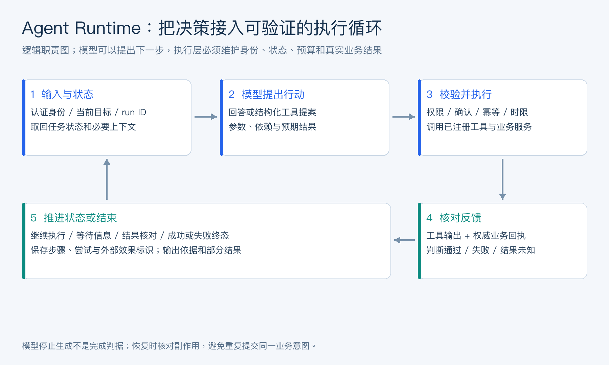
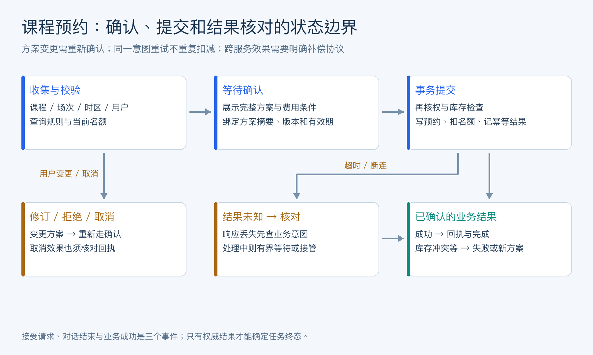

# 目录

[1. 企业级 Agent 平台的本质是什么？](#q-001)
  - [面试问题：平台复用能力与单个应用目标应如何区分？](#q-101)
  - [面试问题：Agent 平台和单个 Agent 应用有什么区别？](#q-002)
  - [面试问题：为什么企业 Agent 平台需要控制平面？](#q-003)
  - [面试问题：AgentOS、Agent Runtime、Agent Builder、AgentOps 如何区分？](#q-004)
[2. 企业级 Agent 平台通常包含哪些核心模块？](#q-005)
  - [面试问题：企业 Agent 平台怎样组织控制面与执行面？](#q-102)
  - [面试问题：Agent Builder 应该提供哪些能力？](#q-006)
  - [面试问题：Tool Registry、MCP Registry、Agent Registry 如何分工？](#q-007)
  - [面试问题：模型网关在 Agent 平台中有什么价值？](#q-008)
  - [面试问题：会话、任务、记忆、知识库为什么要分开管理？](#q-009)
  - [面试问题：用户意图识别怎么做？规则匹配、LLM 判断和混合方案怎么选？](#q-029)
  - [面试问题：意图识别完成后，怎么把请求路由到不同的业务处理器？](#q-030)
  - [面试问题：Agent 怎么调用 Spring Cloud 微服务？统一网关和 Nacos 在链路里分别起什么作用？](#q-031)
[3. 企业 Agent 平台如何做多租户和权限治理？](#q-010)
  - [面试问题：多租户平台应怎样建立身份与资源边界？](#q-103)
  - [面试问题：RBAC、ABAC、租户隔离在 Agent 中如何落地？](#q-011)
  - [面试问题：Agent 身份和用户身份为什么要分开？](#q-012)
  - [面试问题：企业私有化部署需要考虑哪些问题？](#q-013)
  - [面试问题：如何设计 Agent Marketplace / Skill Marketplace？](#q-014)
[4. 企业 Agent 从 PoC 到生产落地有哪些阶段？](#q-015)
  - [面试问题：业务场景从试验到生产需要哪些验收阶段？](#q-104)
  - [面试问题：客服 Agent、数据分析 Agent、编码 Agent、办公 Agent 如何对比？](#q-016)
  - [面试问题：低代码 Agent 平台适合什么场景，不适合什么场景？](#q-017)
  - [面试问题：如何评估一个 Agent 场景是否值得做？](#q-018)
  - [面试问题：Agent 产品如何设计 Human-in-the-loop？](#q-019)
[5. 企业 Agent 平台如何控制成本、延迟和稳定性？](#q-020)
  - [面试问题：平台的性能、费用与可靠性如何共同约束？](#q-105)
  - [面试问题：Agent 平台如何做模型路由和成本治理？](#q-021)
  - [面试问题：Agent 平台如何设计发布、灰度和回滚？](#q-022)
  - [面试问题：Agent 平台如何建设可观测性和审计？](#q-023)
  - [面试问题：Agent 平台如何支持长任务和后台任务？](#q-024)
[6. 当前主流 Agent 平台和框架如何分类选型？](#q-025)
  - [面试问题：企业 Agent 产品与开发框架应如何分类？](#q-106)
  - [面试问题：OpenAI Agents SDK、LangGraph、Semantic Kernel、Google ADK 如何对比？](#q-026)
  - [面试问题：Dify、Coze、Copilot Studio、Vertex AI Agent Builder、Bedrock Agents 适合什么场景？](#q-027)
  - [面试问题：如何回答“请设计一个企业级 Agent 平台”？](#q-028)

---

<h1 id="q-001">1. 企业级 Agent 平台的本质是什么？</h1>


<h2 id="q-101">面试问题：平台复用能力与单个应用目标应如何区分？</h2>

**难度评分：⭐⭐⭐⭐ (4/5)  |  考察频率：⭐⭐⭐⭐ (4/5)**

企业级 Agent 平台不是“做一个聊天机器人”，也不是“给模型接几个工具”。它的本质是为企业内部大量 Agent 应用提供统一的构建、运行、治理和运营基础设施。

它要解决的问题包括：

- 谁可以创建 Agent。
- Agent 可以使用哪些模型。
- Agent 可以调用哪些工具。
- Agent 可以访问哪些数据。
- Agent 的会话、任务、记忆如何保存。
- Agent 如何接入企业系统。
- Agent 如何评测、发布、灰度、回滚。
- Agent 如何被审计、监控、计费。
- Agent 之间如何协作和复用。

可以把企业 Agent 平台理解为：

```math
\text{Agent Platform} = \text{Builder} + \text{Runtime} + \text{Tools} + \text{Data} + \text{Governance} + \text{Ops}
```
面试中可以总结：企业级 Agent 平台的核心目标不是让单个 Agent 更炫，而是让企业能够安全、可控、可复用、可规模化地生产和运营 Agent。

<h2 id="q-002">面试问题：Agent 平台和单个 Agent 应用有什么区别？</h2>

**难度评分：⭐⭐⭐⭐ (4/5)  |  考察频率：⭐⭐⭐⭐ (4/5)**

<div align="center">

| 维度 | 单个 Agent 应用 | 企业级 Agent 平台 |
| --- | --- | --- |
| 目标 | 解决一个具体场景 | 支撑多个团队和多个场景 |
| 工具接入 | 应用内写死 | Tool Registry / MCP Registry |
| 模型调用 | 单应用配置 | 模型网关统一路由和治理 |
| 权限 | 应用自管 | 企业 IAM / RBAC / ABAC |
| 记忆和数据 | 局部存储 | 多租户隔离、统一存储策略 |
| 评测 | 手工或少量脚本 | Eval Harness + 回归门禁 |
| 发布 | 应用部署 | Agent / Prompt / Tool / Policy 联合版本 |
| 监控 | 日志和错误 | Trace、成本、质量、安全、审计全链路 |

</div>

单个 Agent 应用关注“这个 Agent 能不能完成任务”；企业 Agent 平台关注“很多 Agent 能不能持续、合规、稳定地运行”。

<h2 id="q-003">面试问题：为什么企业 Agent 平台需要控制平面？</h2>

**难度评分：⭐⭐⭐⭐ (4/5)  |  考察频率：⭐⭐⭐⭐ (4/5)**

控制平面负责管理 Agent 的入口、配置、权限、路由、版本、状态和治理。没有控制平面，每个 Agent 应用都会各自管理工具、凭证、日志、评测和发布，最终变成不可控的影子 IT。

控制平面通常负责：

- Agent 注册和配置。
- 模型供应商和模型版本管理。
- Tool / MCP Server / Agent 服务注册。
- 用户、租户、角色和权限。
- 会话、任务和后台作业管理。
- 安全策略和审批流程。
- 评测集、发布门禁和灰度策略。
- 成本、限流和配额。
- 全链路 tracing 和审计。

数据平面则负责实际执行：

- 模型推理。
- 工具调用。
- RAG 检索。
- 代码执行。
- 浏览器操作。
- 业务 API 调用。

面试中可以说：控制平面决定“能不能做、用什么做、谁来审计”，数据平面负责“真正去做”。

<h2 id="q-004">面试问题：AgentOS、Agent Runtime、Agent Builder、AgentOps 如何区分？</h2>

**难度评分：⭐⭐⭐ (3/5)  |  考察频率：⭐⭐⭐⭐ (4/5)**

**面试追问：Agent Runtime 的核心职责是什么？**

Agent Runtime 是运行一次 Agent 任务的执行核心，管理输入、会话与 run 状态、上下文构造、模型调用、工具分派、超时重试、取消恢复、预算和事件输出。模型决定候选行动，Runtime 决定如何受控地推进这些行动。

Agent Builder 提供任务配置和流程定义；AgentOS 通常指覆盖入口、文件环境、会话及长期运行能力的更大系统；AgentOps 负责评估、监控、发布与事故治理。这些名称没有唯一标准，但职责边界必须在具体架构中说清楚。

Runtime 宜记录 `running、waiting_tool、waiting_confirmation、completed、failed、cancelled` 等明确状态，给每个 run 建立可追踪标识。并发、断线、进程崩溃和工具副作用不能靠追加一句提示词处理，应由状态存储、执行器和业务接口共同约束。

<div align="center">



</div>

图 1：一次任务的逻辑控制环。反馈可以触发继续执行、澄清或结束；具体部署可以合并模块，但不能省略状态与结果核验。

**一次对话与一次任务不是同一个标识。** `conversation_id` 关联会话，`run_id` 关联一次执行，`step_id` 标记逻辑步骤，`attempt_id` 标记某次尝试，`effect_key` 关联同一个业务意图的外部效果。重试会产生新的 attempt，却应复用相同意图的 effect key；用户确实提出另一笔预约时，则应创建新的业务意图。

这些标识使“同一步失败两次”和“提交了两笔不同业务”能够区分。日志、状态快照和工具回执应通过它们关联；单靠时间戳或整段 prompt 的哈希，难以可靠恢复并发任务。

<h1 id="q-005">2. 企业级 Agent 平台通常包含哪些核心模块？</h1>


<h2 id="q-102">面试问题：企业 Agent 平台怎样组织控制面与执行面？</h2>

**难度评分：⭐⭐⭐⭐ (4/5)  |  考察频率：⭐⭐⭐⭐ (4/5)**

企业级 Agent 平台通常包括：

1. **Agent Builder**

   创建和配置 Agent、prompt、工具、知识库、工作流和测试样例。

2. **Agent Runtime**

   负责模型调用、工具调用、上下文、状态、streaming、重试、handoff。

3. **Model Gateway**

   统一接入 OpenAI、Anthropic、Google、本地模型、企业私有模型。

4. **Tool / MCP Registry**

   管理工具、MCP Server、OpenAPI、数据库连接器、浏览器、代码执行器。

5. **Agent Registry**

   管理可被复用或 A2A 调用的 Agent 服务。

6. **Knowledge / RAG Platform**

   管理文档、索引、切片、向量、重排、权限过滤。

7. **Memory / Session Store**

   管理会话、任务状态、长期记忆、用户画像和项目记忆。

8. **Workflow Engine**

   支持状态机、DAG、审批、人机协作、重试、补偿、长任务。

9. **Governance**

   IAM、RBAC、ABAC、审计、数据分级、敏感信息脱敏、安全策略。

10. **AgentOps**

   评测、tracing、监控、灰度、回滚、成本治理、失败样本回流。

<h2 id="q-006">面试问题：Agent Builder 应该提供哪些能力？</h2>

**难度评分：⭐⭐⭐ (3/5)  |  考察频率：⭐⭐⭐⭐ (4/5)**

Agent Builder 是给开发者、业务专家或运营人员构建 Agent 的界面或工具。

核心能力：

- Agent 角色和系统指令配置。
- 模型选择和模型路由配置。
- 工具选择和权限配置。
- MCP Server / API 连接。
- 知识库绑定。
- Memory 策略配置。
- Workflow / 多 Agent 编排。
- 输入输出模板。
- 测试样例和模拟运行。
- Trace 调试。
- 发布、版本、回滚。
- 权限审批和分享。

高级能力：

- 自动生成工具 Schema。
- 从 OpenAPI 生成 Tool。
- 从文档生成知识库。
- 从历史工单生成测试集。
- Prompt 版本对比。
- 多模型 A/B 测试。
- 安全策略预检。

面试中要注意：Builder 不应该让业务人员绕过治理。所有工具、模型、知识库和发布都要经过平台权限和评测门禁。

<h2 id="q-007">面试问题：Tool Registry、MCP Registry、Agent Registry 如何分工？</h2>

**难度评分：⭐⭐⭐ (3/5)  |  考察频率：⭐⭐⭐⭐ (4/5)**

本节关注 Registry 在企业平台里的资产管理和权限治理；MCP / A2A 的协议字段、能力协商、传输和调用语义，见 [04_MCP与A2A协议高频考点.md](04_MCP与A2A协议高频考点.md)。

<div align="center">

| Registry | 管理对象 | 典型字段 |
| --- | --- | --- |
| Tool Registry | 应用内函数、OpenAPI 工具、内置工具 | 工具名、Schema、风险等级、owner、版本 |
| MCP Registry | MCP Server 和其暴露能力 | server 地址、transport、tools/resources/prompts、认证方式 |
| Agent Registry | 可被复用或远程调用的 Agent | Agent Card、能力、输入输出、SLA、权限、版本 |

</div>

分工原则：

- Tool Registry 管“函数级能力”。
- MCP Registry 管“标准工具服务器”。
- Agent Registry 管“能独立完成任务的 Agent 服务”。

企业场景中，这些 registry 需要统一治理：

- owner 和责任人。
- 数据分级。
- 风险等级。
- 权限范围。
- 调用审计。
- 版本管理。
- 可用性监控。
- 下线和回滚机制。

<h2 id="q-008">面试问题：模型网关在 Agent 平台中有什么价值？</h2>

**难度评分：⭐⭐⭐⭐ (4/5)  |  考察频率：⭐⭐⭐⭐ (4/5)**

模型网关是企业统一访问多模型的控制层。

核心价值：

- 统一接入多个模型供应商。
- 按任务类型做模型路由。
- 支持 fallback 和重试。
- 统一鉴权和配额。
- 记录 token、成本、延迟。
- 做数据脱敏和安全过滤。
- 控制模型可见的数据范围。
- 支持私有模型和公有模型混用。
- 对模型版本做灰度和回滚。

模型路由策略：

- 简单问答用低成本模型。
- 复杂规划用强推理模型。
- 敏感数据用私有部署模型。
- 结构化抽取用小模型或专用模型。
- 高价值任务使用多模型验证。

面试中可以说：模型网关让企业避免“每个 Agent 直接连不同模型 API”，从而统一成本、安全、合规和可观测性。

<h2 id="q-009">面试问题：会话、任务、记忆、知识库为什么要分开管理？</h2>

**难度评分：⭐⭐⭐⭐ (4/5)  |  考察频率：⭐⭐⭐⭐ (4/5)**

**面试追问：为什么选择 MongoDB、PostgreSQL、Redis 这样的存储组合？各自保存什么数据？**

这类组合是一种工程选择，不是 Agent 项目的标配。MongoDB 可保存灵活结构的会话事件与工具记录；PostgreSQL 适合事务业务、明确字段、版本约束，也可承载 pgvector 与全文检索；Redis 适合短期缓存、限流、临时会话和有明确恢复语义的协调数据。

会话记录描述发生过什么，任务状态描述执行到哪里，记忆保存可复用信息，知识库保存外部业务证据，预约表保存权威业务结果。应明确每类数据的唯一权威写入点，避免同一事实在三个库里都可修改。

缓存失效、跨库一致性、删除传播、备份与故障恢复会增加成本。早期系统可先使用 PostgreSQL 加必要缓存，只有查询模式、规模或组织能力支持时才拆库。Redis 中的临时确认与锁不能替代持久化预约事务或可靠的幂等记录。

<h2 id="q-029">面试问题：用户意图识别怎么做？规则匹配、LLM 判断和混合方案怎么选？</h2>

**难度评分：⭐⭐⭐ (3/5)  |  考察频率：⭐⭐⭐⭐ (4/5)**

先定义意图集合、槽位和拒识条件，再选识别方法。规则适合明确命令、固定格式和高精度入口；LLM 适合表达多样、隐含意图及上下文依赖；混合方案通常先匹配高精度规则，再让模型处理长尾表达，最后用代码校验结构和业务约束。

输出宜包含 `intent、slots、needs_clarification、evidence`，不要让模型生成任意处理器名称。多意图请求应拆解或澄清；“帮我查一下预约”与“帮我预约”必须区分。模型自报的置信度未经校准，不能直接作为放行写操作的概率。

评测除总体准确率外，还看每类召回、混淆矩阵、未知意图拒识和高风险误路由率。漏掉一次查询与误提交一次订单的代价不同，阈值要按风险配置。真正的用户身份来自认证上下文，不从用户文本中提取后直接信任。

<h2 id="q-030">面试问题：意图识别完成后，怎么把请求路由到不同的业务处理器？</h2>

**难度评分：⭐⭐⭐ (3/5)  |  考察频率：⭐⭐⭐⭐ (4/5)**

将识别结果映射到服务端白名单注册表：意图对应处理器、参数 Schema、所需权限、可重试类型和超时。路由器验证意图枚举和槽位，随后调用已注册处理器；模型生成的字符串不能直接变成类名、脚本或 URL 执行。

例如 `knowledge_query` 进入检索流程，`booking_query` 进入只读业务查询，`booking_create` 进入收集—校验—确认—提交状态机。处理器接收受信任的 `tenant_id、user_id、request_id`，这些字段不能被模型参数覆盖。

未知意图进入澄清，多意图通过明确依赖编排。返回结果用统一状态和错误码区分成功、可重试、待补信息与拒绝。路由 trace 应记录规则/模型版本、选定处理器和执行结果，方便定位“识别对了却调错服务”的问题。

<h2 id="q-031">面试问题：Agent 怎么调用 Spring Cloud 微服务？统一网关和 Nacos 在链路里分别起什么作用？</h2>

**难度评分：⭐⭐⭐⭐ (4/5)  |  考察频率：⭐⭐⭐ (3/5)**

Agent 通过受控工具适配层调用 Spring Cloud 微服务，模型只填写允许的业务参数，适配器注入认证信息、链路标识、超时和幂等键。统一网关可承担路由、认证接入、限流与观测；业务服务仍负责资源级授权和事务，不因请求经过网关就跳过检查。

Nacos 提供服务发现与配置管理能力：服务注册后，客户端或网关可按配置发现可用实例。它通常不承载每次业务请求的数据转发，也不负责模型规划或代替网关执行鉴权。具体链路取决于使用的 Spring Cloud 与服务发现集成方式。

例如预约工具调用预约服务，服务事务校验场次并写入结果；超时后按幂等键查询，不把网关重试和 Runtime 重试叠加成多次提交。对模型可选目标采用服务白名单，禁止它自行生成任意内网 URL。配置更新同样需要版本、灰度和审计。

<h1 id="q-010">3. 企业 Agent 平台如何做多租户和权限治理？</h1>


<h2 id="q-103">面试问题：多租户平台应怎样建立身份与资源边界？</h2>

**难度评分：⭐⭐⭐⭐ (4/5)  |  考察频率：⭐⭐⭐⭐ (4/5)**

企业平台必须支持多租户、多部门、多角色和多数据域。Agent 的权限治理比普通应用更复杂，因为 Agent 既代表用户行动，又有自己的工具、记忆、策略和运行环境。

关键治理对象：

- 用户。
- 租户。
- 部门。
- Agent。
- 工具。
- 数据源。
- 知识库。
- 记忆。
- 会话。
- 工作流。
- 模型。
- 外部系统凭证。

权限判断不应只问“用户有没有权限”，还要问：

- 当前 Agent 有没有权限？
- 当前任务有没有权限？
- 当前工具有没有权限？
- 当前参数是否越界？
- 当前环境是否允许？
- 是否需要审批？

<h2 id="q-011">面试问题：RBAC、ABAC、租户隔离在 Agent 中如何落地？</h2>

**难度评分：⭐⭐⭐ (3/5)  |  考察频率：⭐⭐⭐⭐ (4/5)**

<div align="center">

| 机制 | 作用 | Agent 场景 |
| --- | --- | --- |
| RBAC | 基于角色授权 | 运营可创建客服 Agent，研发可使用代码工具 |
| ABAC | 基于属性授权 | 数据等级、部门、地域、时间、任务风险共同判断 |
| Tenant Isolation | 租户隔离 | 不同客户的数据、记忆、trace、工具配置互不可见 |

</div>

落地建议：

- RBAC 管基础角色和平台操作。
- ABAC 管细粒度数据和工具访问。
- 租户隔离管数据边界。
- 高风险工具加审批流。
- 所有工具调用带 user_id、agent_id、tenant_id、task_id。
- RAG 和 Memory 检索前先做权限过滤。
- Trace 和日志也要按租户隔离。

例子：用户是财务经理，有权查看财务数据；但一个客服 Agent 即使由该用户启动，也不应自动继承全部财务权限，除非任务、工具和审批都满足条件。

<h2 id="q-012">面试问题：Agent 身份和用户身份为什么要分开？</h2>

**难度评分：⭐⭐⭐ (3/5)  |  考察频率：⭐⭐⭐⭐ (4/5)**

用户身份代表“谁发起任务”，Agent 身份代表“哪个自动化主体在执行”。二者必须分开，否则会出现权限放大。

分开的原因：

- 同一用户可以启动不同风险等级的 Agent。
- 同一 Agent 可被多个用户使用。
- Agent 应有自己的工具范围和凭证。
- 审计需要知道是用户手动操作还是 Agent 自动操作。
- 企业需要限制 Agent 不能继承用户所有权限。

推荐做法：

- 每次工具调用携带 user_id 和 agent_id。
- Agent 使用 scoped credential。
- 高风险操作使用 on-behalf-of 模式并要求用户确认。
- 审计日志同时记录用户、Agent、任务和工具。
- Agent 权限默认小于等于用户权限。

一句话：用户授权不等于 Agent 可自动行动，Agent 身份是企业控制自动化风险的关键边界。

<h2 id="q-013">面试问题：企业私有化部署需要考虑哪些问题？</h2>

**难度评分：⭐⭐⭐ (3/5)  |  考察频率：⭐⭐⭐⭐ (4/5)**

私有化部署不仅是“把服务装到客户内网”，还包括数据、模型、工具、运维和合规全链路。

需要考虑：

- 模型部署：公有 API、私有模型、混合路由。
- 数据不出域：文档、代码、数据库、trace、记忆。
- 身份集成：SSO、LDAP、OIDC、企业 IAM。
- 网络边界：内网访问、VPC、专线、代理。
- 工具接入：数据库、工单、知识库、Git、IM、邮件。
- 审计合规：日志保留、脱敏、访问追踪。
- 算力资源：GPU、CPU、队列、弹性伸缩。
- 版本升级：离线包、灰度、回滚、兼容性。
- 安全扫描：镜像、依赖、MCP Server、插件。
- 运维交付：监控、告警、备份、灾备。

私有化场景的难点往往不是模型推理，而是客户系统集成和权限治理。

<h2 id="q-014">面试问题：如何设计 Agent Marketplace / Skill Marketplace？</h2>

**难度评分：⭐⭐⭐⭐ (4/5)  |  考察频率：⭐⭐⭐ (3/5)**

本节从企业平台治理角度讨论 Marketplace 的上架、审核、权限和下架；Skill 在长期运行 Agent 中如何被自动评分、合并、归档和回滚，见 [09_自进化Agent与多平台运行时高频考点.md](09_自进化Agent与多平台运行时高频考点.md)。

Agent Marketplace 管可复用 Agent，Skill Marketplace 管可复用能力包或流程。

核心字段：

- 名称和描述。
- 适用场景。
- owner 和维护团队。
- 输入输出。
- 所需工具和数据权限。
- 风险等级。
- 版本。
- 示例任务。
- 评测结果。
- 安全审核状态。
- SLA 和支持方式。

上架流程：

1. 提交 Agent / Skill。
2. 自动检查元数据、依赖、权限。
3. 运行安全评测和功能评测。
4. 人工审核高风险能力。
5. 灰度给小范围用户。
6. 收集反馈和 trace。
7. 正式发布。

下架机制同样重要：

- owner 失联。
- 工具依赖失效。
- 评测回归。
- 安全风险。
- 成本过高。
- 业务规则过期。

Marketplace 的核心不是数量，而是可信、可评测、可治理。

---

<h1 id="q-015">4. 企业 Agent 从 PoC 到生产落地有哪些阶段？</h1>


<h2 id="q-104">面试问题：业务场景从试验到生产需要哪些验收阶段？</h2>

**难度评分：⭐⭐⭐ (3/5)  |  考察频率：⭐⭐⭐⭐ (4/5)**

推荐阶段：

1. **场景筛选**

   选择高频、低风险、可评估、有明确 ROI 的场景。

2. **PoC**

   用有限数据和工具验证可行性。

3. **Pilot**

   小范围真实用户试用，收集失败样本和反馈。

4. **受控生产**

   接入权限、审计、评测、监控、灰度，限制自动化边界。

5. **规模化**

   扩展到更多团队、更多工具、更多场景。

6. **平台化**

   沉淀工具、知识库、评测、模板、Agent 和 Skill 市场。

每个阶段的目标不同：PoC 验证“能不能做”，Pilot 验证“用户愿不愿用”，生产验证“能不能稳定安全地做”，平台化验证“能不能规模化复用”。

<h2 id="q-016">面试问题：客服 Agent、数据分析 Agent、编码 Agent、办公 Agent 如何对比？</h2>

**难度评分：⭐⭐⭐ (3/5)  |  考察频率：⭐⭐⭐⭐ (4/5)**

<div align="center">

| 场景 | 核心价值 | 主要风险 | 关键能力 |
| --- | --- | --- | --- |
| 客服 Agent | 降低响应成本，提高一致性 | 错误承诺、隐私泄露 | 政策 RAG、工单工具、转人工 |
| 数据分析 Agent | 降低取数和分析门槛 | 越权查询、错误结论 | SQL、BI、数据权限、图表 |
| 编码 Agent | 研发提效 | 改错文件、引入回归 | 仓库理解、测试、diff、CI |
| 办公 Agent | 自动化知识工作 | 误发邮件、日程冲突 | 邮件、日历、文档、审批 |

</div>

落地难度通常取决于：

- 任务是否可验证。
- 工具副作用是否可控。
- 数据权限是否清晰。
- 用户是否能审查结果。
- 失败成本是否可接受。

最适合早期落地的是“只读 + 建议 + 人审”的场景，比如知识库问答、客服回复建议、代码 review、数据报告草稿。

<h2 id="q-017">面试问题：低代码 Agent 平台适合什么场景，不适合什么场景？</h2>

**难度评分：⭐⭐⭐⭐ (4/5)  |  考察频率：⭐⭐⭐⭐ (4/5)**

适合：

- 知识库问答。
- 客服机器人。
- 表单收集和简单流程。
- 内容生成。
- 内部助手。
- 快速 PoC。
- 业务人员维护话术和流程。

不适合：

- 高复杂状态机。
- 深度代码仓库操作。
- 高风险生产写操作。
- 强定制工具链。
- 复杂权限和多租户隔离。
- 需要严格评测和回滚的核心业务。

低代码平台的价值是降低构建门槛，但不能替代工程治理。真正生产级的 Agent 仍然需要权限、安全、评测、观测和版本管理。

<h2 id="q-018">面试问题：如何评估一个 Agent 场景是否值得做？</h2>

**难度评分：⭐⭐⭐ (3/5)  |  考察频率：⭐⭐⭐⭐ (4/5)**

可以从八个维度评估：

<div align="center">

| 维度 | 判断问题 |
| --- | --- |
| 频率 | 任务是否高频重复？ |
| 价值 | 自动化后能节省多少时间或提升多少收入？ |
| 可验证性 | 结果是否容易判断对错？ |
| 风险 | 失败是否可接受、可回滚？ |
| 工具完备性 | Agent 是否能拿到必要工具和数据？ |
| 权限清晰度 | 数据和动作权限是否明确？ |
| 人审成本 | 人类能否快速审核结果？ |
| 数据可用性 | 是否有历史样本和评测集？ |

</div>

优先做：

- 高频、低风险、可验证、工具齐全的任务。
- 人类审核成本低的任务。
- 已有 SOP 的任务。
- 能从历史数据构造评测集的任务。

慎重做：

- 低频高风险任务。
- 结果难验证任务。
- 需要大量主观判断的任务。
- 权限边界不清的任务。

<h2 id="q-019">面试问题：Agent 产品如何设计 Human-in-the-loop？</h2>

**难度评分：⭐⭐⭐⭐ (4/5)  |  考察频率：⭐⭐⭐⭐ (4/5)**

**面试追问：课程预约这类多轮业务怎么设计？信息收集、校验、确认和执行怎么衔接？**

用显式状态机组织多轮业务：收集课程、日期和必要身份信息 → 规范化时区与字段 → 查询规则与名额 → 展示完整方案 → 用户确认 → 重新校验并事务提交 → 返回回执。拒绝、取消、信息变更与异常也必须有明确转移。

确认对象应包含课程、场次、时间、地点、价格或费用条件、用户与方案版本，并有有效期。用户改了时间后，旧确认应失效；“好的”只有在明确且仍有效的待确认上下文中才可解释为提交许可。不要把过去偏好当成这次预约授权。

后端用幂等键防止重试重复写入，通过事务、唯一约束或并发控制保障库存；确认后名额仍可能被抢占，因此提交时需再次检查。响应丢失后先查结果再决定补偿。预约状态、对话状态和工具状态分别核对，模型最终措辞必须依据业务回执。

<div align="center">



</div>

图 6：成功必须由业务回执确认。超时进入结果核对；库存冲突、方案变更和用户取消各有明确后续状态。

**幂等记录和库存变更应一起设计。** 对同一业务意图，服务端保存请求摘要与结果；相同幂等键但不同参数应拒绝。通过唯一约束和事务处理并发请求，保证预约落库、名额扣减及幂等结果在同一业务事务中一致提交，或采用具有等价约束的可靠协议。

若不同服务分别管理支付、名额和通知，就不能再声称一个数据库事务包住全部效果。需要定义预占、提交、释放与补偿规则，并区分业务成功与通知失败。用户取消也不意味着先前的外部操作已经撤销，系统应返回可核验的取消状态。

测试应覆盖两个客户端同时提交同一意图、同键不同参数、名额耗尽、确认过期、提交成功但响应丢失、提交期间取消，以及事务回滚后库存是否恢复。这样的用例验证的是业务边界，LLM 输出流畅与否无法替代它们。

<h1 id="q-020">5. 企业 Agent 平台如何控制成本、延迟和稳定性？</h1>


<h2 id="q-105">面试问题：平台的性能、费用与可靠性如何共同约束？</h2>

**难度评分：⭐⭐⭐⭐ (4/5)  |  考察频率：⭐⭐⭐⭐ (4/5)**

企业 Agent 平台的成本和延迟比普通 LLM 应用更难控制，因为 Agent 会多轮调用模型和工具。

治理手段：

- 模型路由。
- token 预算。
- 工具调用预算。
- 上下文压缩。
- RAG 缓存。
- 工具结果缓存。
- 并行工具调用。
- 任务队列。
- 异步后台任务。
- fallback 模型和工具。
- 超时和熔断。
- 成本看板和租户配额。

平台要为每个 Agent、租户、用户和任务类型统计成本，让业务方知道 ROI。

<h2 id="q-021">面试问题：Agent 平台如何做模型路由和成本治理？</h2>

**难度评分：⭐⭐⭐⭐ (4/5)  |  考察频率：⭐⭐⭐⭐ (4/5)**

**面试追问：大小模型怎么分工？哪些任务适合小模型，哪些需要更强的模型？**

大小模型按任务难度、上下文、风险与可验证性分工。意图分类、字段抽取、规则明确的改写、短摘要等可先评估较小模型；复杂规划、多证据冲突处理、代码修复或长上下文综合可能需要更强模型。规则足够明确的步骤直接用程序。

升级可由缺字段、输出不合法、证据不足、验证失败或任务类别触发。模型自报“很有信心”未经校准，不足以决定是否跳过升级。高风险业务无论使用哪种模型，都要走相同授权和确定性检查。

用同口径任务集测成功率、升级率、端到端成本与延迟，包括小模型失败后再次调用大模型的开销。路由器本身也会出错，保留回退与审计。团队应优化单位成功任务的成本，而不是追求小模型调用占比。

<h2 id="q-022">面试问题：Agent 平台如何设计发布、灰度和回滚？</h2>

**难度评分：⭐⭐⭐⭐ (4/5)  |  考察频率：⭐⭐⭐⭐ (4/5)**

本节关注平台如何把发布能力产品化，例如版本包、灰度维度、回滚开关和状态兼容；AgentOps 视角下的评测门禁、失败回流和事故响应，见 [06_Agent安全评测与AgentOps高频考点.md](06_Agent安全评测与AgentOps高频考点.md)。

Agent 发布对象包括：

- prompt。
- model。
- tool schema。
- MCP Server。
- workflow。
- memory policy。
- guardrail policy。
- skill。
- RAG index。
- permission policy。

发布流程：

1. 版本打包。
2. 运行 smoke eval。
3. 运行 regression eval。
4. 安全策略扫描。
5. 小流量灰度。
6. 指标监控。
7. 扩大灰度或回滚。

灰度维度：

- 用户。
- 租户。
- 团队。
- 场景。
- 工具权限。
- 模型版本。

回滚要求：

- 记录每次任务使用的版本组合。
- 保留旧版本 prompt、工具和策略。
- 工作流状态向前/向后兼容。
- 外部副作用有补偿方案。
- RAG index 和 Memory 策略可版本化。

<h2 id="q-023">面试问题：Agent 平台如何建设可观测性和审计？</h2>

**难度评分：⭐⭐⭐⭐ (4/5)  |  考察频率：⭐⭐⭐⭐ (4/5)**

本节关注企业平台需要提供的可观测性与审计产品能力；trace 里具体应该记录什么、如何定位失败、如何做 LLM-as-Judge 与失败样本回流，见 [06_Agent安全评测与AgentOps高频考点.md](06_Agent安全评测与AgentOps高频考点.md)。

可观测性关注运行质量，审计关注责任追踪。

可观测性：

- 请求量。
- 任务成功率。
- 工具成功率。
- 平均延迟和 P95/P99。
- token 和费用。
- 人工接管率。
- 失败分类。
- guardrail 拦截率。
- 用户满意度。

审计：

- 谁发起任务。
- 哪个 Agent 执行。
- 使用哪个模型和 prompt。
- 调用哪些工具。
- 访问哪些资源。
- 权限如何批准。
- 是否产生外部副作用。
- 最终交付是什么。

企业平台应支持：

- Trace 链路查询。
- 按租户和用户过滤。
- 敏感字段脱敏。
- 日志保留策略。
- 审计导出。
- 安全告警。

<h2 id="q-024">面试问题：Agent 平台如何支持长任务和后台任务？</h2>

**难度评分：⭐⭐⭐⭐ (4/5)  |  考察频率：⭐⭐⭐⭐ (4/5)**

长任务需要任务系统，而不是只依赖同步对话。

核心能力：

- Task id。
- 状态机：queued、running、waiting_approval、succeeded、failed、cancelled、timeout。
- 任务队列。
- 断点恢复。
- 超时和取消。
- 进度事件。
- 后台通知。
- 人工审批。
- 结果归档。
- 幂等 key。

适合后台任务的场景：

- 长文档分析。
- 代码仓库扫描。
- 数据报表生成。
- 多网页调研。
- 批量工单处理。
- 视频、图片、音频处理。

面试中可以说：企业 Agent 平台必须从“请求-响应”架构升级到“任务-事件-状态”架构。

---

<h1 id="q-025">6. 当前主流 Agent 平台和框架如何分类选型？</h1>


<h2 id="q-106">面试问题：企业 Agent 产品与开发框架应如何分类？</h2>

**难度评分：⭐⭐⭐ (3/5)  |  考察频率：⭐⭐⭐⭐ (4/5)**

可以按定位分类：

<div align="center">

| 类型 | 代表 | 适合场景 |
| --- | --- | --- |
| 通用 Agent SDK | OpenAI Agents SDK、Google ADK | 自定义 Agent 应用、多 Agent、工具调用 |
| 工作流 / 状态图 | LangGraph | 复杂流程、长任务、human-in-loop |
| 企业集成框架 | Semantic Kernel | .NET / Java / 企业插件生态 |
| 数据和 RAG Agent | LlamaIndex | 知识库、文档、数据密集型 Agent |
| 多 Agent 协作框架 | AutoGen、CrewAI | 研究探索、角色分工、协作任务 |
| 低代码平台 | Dify、Coze、Copilot Studio | 业务人员快速搭建、客服、知识库 |
| 云厂商 Agent 平台 | Vertex AI Agent Builder、Bedrock Agents、Azure AI Foundry Agent Service | 云上企业集成、托管运行、治理 |

</div>

选型关键不是“哪个最火”，而是：

- 是否满足数据和权限要求。
- 是否支持需要的工具生态。
- 是否能接入企业身份系统。
- 是否能评测和观测。
- 是否支持私有化或混合部署。
- 是否能承载长任务和复杂状态。
- 团队是否有维护能力。

<h2 id="q-026">面试问题：OpenAI Agents SDK、LangGraph、Semantic Kernel、Google ADK 如何对比？</h2>

**难度评分：⭐⭐⭐ (3/5)  |  考察频率：⭐⭐⭐⭐ (4/5)**

<div align="center">

| 框架 | 核心特点 | 更适合 |
| --- | --- | --- |
| OpenAI Agents SDK | Agent、Tool、Handoff、Guardrails、Tracing | 快速构建通用 Agent 和多 Agent handoff |
| LangGraph | 状态图、持久化、人机协作、可恢复流程 | 复杂工作流和长期任务 |
| Semantic Kernel | 企业插件、Planner、与微软生态集成 | 企业系统智能化、.NET/Java 场景 |
| Google ADK | Agent 开发、多 Agent、A2A 生态 | Google/Gemini 生态和服务化 Agent |

</div>

选择建议：

- 需要轻量 Agent SDK 和 tracing：OpenAI Agents SDK。
- 需要复杂状态机和 durable execution：LangGraph。
- 企业微软技术栈：Semantic Kernel / Copilot Studio。
- Google 云和 A2A 生态：Google ADK / Vertex AI Agent Builder。

真实项目中也可以组合使用：用 LangGraph 管状态，用 MCP 接工具，用 A2A 接远程 Agent，用模型网关管理多模型。

<h2 id="q-027">面试问题：Dify、Coze、Copilot Studio、Vertex AI Agent Builder、Bedrock Agents 适合什么场景？</h2>

**难度评分：⭐⭐⭐ (3/5)  |  考察频率：⭐⭐⭐⭐ (4/5)**

<div align="center">

| 平台 | 更适合场景 | 注意点 |
| --- | --- | --- |
| Dify | 私有化、知识库问答、工作流、快速 PoC | 复杂代码 Agent 和强定制需二次开发 |
| Coze | 面向业务和内容场景的 Bot / Agent 快速搭建 | 企业深度治理取决于部署和权限体系 |
| Copilot Studio | 微软 365 / Dynamics / Power Platform 生态 | 适合已在微软生态的企业 |
| Vertex AI Agent Builder | Google Cloud 数据和搜索生态 | 适合 GCP 企业用户 |
| Bedrock Agents | AWS 生态、企业托管 Agent | 适合 AWS 上的业务系统集成 |

</div>

选型时要问：

- 数据是否允许进入云平台。
- 是否支持私有化。
- 是否能接企业 IAM。
- 是否支持现有工具和知识库。
- 是否支持评测、trace 和审计。
- 低代码能力能否覆盖业务复杂度。
- 是否存在平台锁定风险。

<h2 id="q-028">面试问题：如何回答“请设计一个企业级 Agent 平台”？</h2>

**难度评分：⭐⭐⭐ (3/5)  |  考察频率：⭐⭐⭐⭐ (4/5)**

**面试追问：介绍一下你的 Agent 项目：解决什么业务问题，包含哪些核心模块？**

项目介绍先讲用户、业务目标和验收标准，再讲模块及一条完整请求。可使用课程服务助手作为练习场景：回答课程规则、查询实时场次、记住经确认的偏好，并在用户确认后提交预约。实际面试应替换成自己真实做过的业务与职责。

核心模块可包括认证入口、意图路由、知识检索、记忆、上下文组装、运行时/状态图、工具适配、业务服务、事件存储、观测和评测。解释清楚模型决策与确定性检查的分界，例如时间表达由模型理解，名额扣减由数据库事务保障。

准备一条成功轨迹、一条失败恢复轨迹和一组有样本数的指标，说明基线、改进及本人负责部分。没有线上数据就报告离线或实验结果，不虚构并发、准确率或商业收益。平台能力可以从复用需求逐步抽象，不必为单个项目先搭庞大平台。

若进一步讨论企业平台，可按入口、Builder、Runtime、共享能力、编排、治理、AgentOps 七层展开。入口接 Web/IM/API，Builder 配任务，Runtime 执行，共享能力提供模型与工具注册、知识及记忆，编排处理依赖和补偿，治理统一身份与资源权限，AgentOps 承担评测、发布、监控与回滚。Agent 身份与用户身份区分，低代码配置不能绕过平台策略；从高价值、低风险、可验证场景逐步开放写操作。

---

## 高频速记

1. 企业 Agent 平台的核心是规模化构建、运行、治理和运营 Agent。
2. 单个 Agent 解决具体任务，Agent 平台解决多团队、多场景、多工具的治理问题。
3. 控制平面管理配置、权限、路由、版本和审计，数据平面执行模型和工具调用。
4. Builder 是入口，Runtime 是执行器，AgentOS 是基础设施抽象，AgentOps 是运营治理体系。
5. 企业平台核心模块包括 Builder、Runtime、模型网关、工具注册、Agent 注册、知识库、记忆、工作流和治理。
6. Tool Registry 管函数级能力，MCP Registry 管标准工具服务器，Agent Registry 管可复用 Agent 服务。
7. 模型网关统一多模型接入、路由、配额、成本、脱敏和审计。
8. Session、Task、Memory、Knowledge 必须分开管理。
9. Agent 身份和用户身份要分离，避免权限放大。
10. Marketplace 的核心不是数量，而是可信、可评测、可治理。
11. PoC 验证能不能做，Pilot 验证用户愿不愿用，生产验证是否稳定安全，平台化验证是否可复用。
12. 低代码 Agent 平台适合快速 PoC 和标准流程，不适合高风险复杂核心业务的全部治理。
13. 企业 Agent 平台必须从请求响应架构升级到任务、事件、状态架构。
14. 选型要看数据权限、工具生态、身份集成、评测观测、私有化和团队维护能力。

## 参考资料

- OpenAI, [**Agents SDK Documentation**](https://openai.github.io/openai-agents-python/).
- LangChain, [**LangGraph Documentation**](https://docs.langchain.com/oss/python/langgraph/overview).
- Microsoft, [**Semantic Kernel Documentation**](https://learn.microsoft.com/en-us/semantic-kernel/).
- Google, [**Agent Development Kit Documentation**](https://google.github.io/adk-docs/).
- Google Cloud, [**Vertex AI Agent Builder**](https://cloud.google.com/products/agent-builder).
- Microsoft, [**Copilot Studio Documentation**](https://learn.microsoft.com/en-us/microsoft-copilot-studio/).
- AWS, [**Amazon Bedrock Agents Documentation**](https://docs.aws.amazon.com/bedrock/latest/userguide/agents.html).
- Dify, [**Documentation**](https://docs.dify.ai/).
- Coze, [**Documentation**](https://www.coze.com/docs).
- LlamaIndex, [**Documentation**](https://docs.llamaindex.ai/).
- AutoGen, [**Documentation**](https://microsoft.github.io/autogen/).
- CrewAI, [**Documentation**](https://docs.crewai.com/).
- [Spring Cloud Gateway](https://docs.spring.io/spring-cloud-gateway/reference/)
- [Nacos 服务发现与配置概览](https://nacos.io/en/docs/latest/what-is-nacos/)
