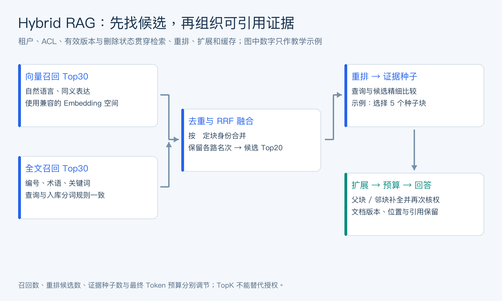
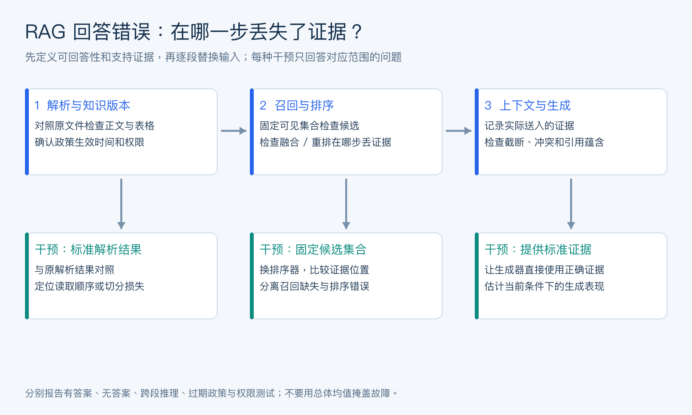

# 目录

[1. RAG 的知识链路与检索选型](#q-101)
  - [面试问题：什么是 RAG？从文档入库到生成回答，完整流程是什么？](#q-001)
  - [面试问题：向量检索和关键词全文检索有什么区别？各自擅长解决什么问题？](#q-002)
  - [面试问题：为什么需要混合检索？只用向量检索会有什么问题？](#q-003)
  - [面试问题：pgvector 和 PostgreSQL FTS 分别负责什么？](#q-004)
  - [面试问题：向量数据库怎么选？你会考虑哪些因素？](#q-005)
  - [面试问题：用户身份、偏好这类明确字段，适合用向量检索吗？](#q-006)
  - [面试问题：Embedding 模型怎么选？调用云端 API 和本地部署有什么取舍？](#q-007)
  - [面试问题：余弦相似度、欧几里得距离和曼哈顿距离有什么区别？](#q-008)
  - [面试问题：RAG 和模型微调有什么区别？什么情况下分别使用？](#q-009)
[2. 文档解析、切分与上下文补全](#q-102)
  - [面试问题：文档切分有哪些常见策略？你在项目里采用了哪一种？](#q-010)
  - [面试问题：递归字符切分是怎么工作的？块大小、重叠大小和分隔符顺序怎么设置？](#q-011)
  - [面试问题：Chunk 太大或太小分别有什么问题？重叠部分主要解决什么问题？](#q-012)
  - [面试问题：Markdown、PDF 和代码文件的切分方式有什么不同？](#q-013)
  - [面试问题：什么是相邻块扩展？为什么召回命中块后，还要补充前后的内容？](#q-014)
  - [面试问题：什么是父子文档检索？它和相邻块扩展有什么区别？](#q-015)
[3. 混合检索、全文索引与候选排序](#q-103)
  - [面试问题：介绍一下你项目里的 Hybrid RAG 流程，双路召回后怎么得到最终的 TopK？](#q-016)
  - [面试问题：PostgreSQL 全文检索怎么实现？tsvector、tsquery 和 GIN 索引分别起什么作用？](#q-017)
  - [面试问题：PostgreSQL 做中文全文检索，需要怎么处理分词？](#q-018)
  - [面试问题：ts_rank 和 ts_rank_cd 在检索中起什么作用？](#q-019)
  - [面试问题：RRF 是什么？为什么不直接把向量分数和全文检索分数相加？](#q-020)
  - [面试问题：Rerank 主要解决什么问题？为什么放在召回和融合之后？](#q-021)
[4. 权限、数据结构与检索质量](#q-104)
  - [面试问题：元数据过滤用来解决什么问题？文档类型和访问权限怎么参与检索？](#q-022)
  - [面试问题：RAG 文档块表怎么设计？为什么要保存原文、元数据、向量和全文检索字段？](#q-023)
  - [面试问题：RAG 回答不准确，你会从哪些环节排查？](#q-024)
  - [面试问题：知识库没有检索到可靠内容时，系统应该怎么处理？](#q-025)
  - [面试问题：什么是大模型幻觉？提示词、RAG 和输出校验分别怎么降低幻觉？](#q-026)
[5. RAG 的性能与成本优化](#q-105)
  - [面试问题：RAG 延迟高时怎么优化？流式输出能不能真正降低处理耗时？](#q-027)

---

<h1 id="q-101">1. RAG 的知识链路与检索选型</h1>


<h2 id="q-001">面试问题：什么是 RAG？从文档入库到生成回答，完整流程是什么？</h2>

**难度评分：⭐⭐ (2/5)  |  考察频率：⭐⭐⭐⭐⭐ (5/5)**

RAG 在生成时检索外部知识，将证据加入上下文帮助模型回答。知识入库链路是解析、清洗、按结构切分、保留文档与权限元数据、计算向量、建立索引、验证版本；查询链路是理解问题、确定过滤条件、召回候选、融合与重排、组装证据、生成及核查引用。

入库和查询必须使用兼容的 Embedding 空间；权限和删除状态在取出正文之前生效。引用需要关联文档版本和段落位置，不能只留一个无法复查的相似度分数。文档更新后应更新相关块及索引，旧块不能继续作为有效证据。

RAG 改善信息可获得性，不保证检索结果正确或模型忠实使用。分别评估召回、排序、证据覆盖和最终回答，才能区分“知识没找到”和“找到却答错”。实时库存、订单状态等动态业务事实通常仍应查询权威业务接口。

<h2 id="q-002">面试问题：向量检索和关键词全文检索有什么区别？各自擅长解决什么问题？</h2>

**难度评分：⭐⭐ (2/5)  |  考察频率：⭐⭐⭐⭐ (4/5)**

向量检索把查询与文档编码到同一表示空间，根据距离寻找语义接近的内容；关键词全文检索通过词项、位置和倒排索引寻找文本匹配。前者擅长同义改写与自然语言表达，后者擅长型号、错误码、专有名词和稀有词。

向量可能把“支持退款”和“不支持退款”召回到一起，也可能忽略编号中的一个字符；词法检索则可能漏掉完全不同表述的同义问题。全文检索不等于简单字符串包含，它可以涉及分词、词形处理、短语、权重和排名。

例如 `ERR_4037` 应优先保证精确词项命中，“怎样取消已经报名的课程”则需要语义匹配“退课流程”。两路都要受相同身份与文档有效期约束。用业务查询集检验各类问题的 Recall@K 和误召回，不能用一个例子判断整体优劣。

<h2 id="q-003">面试问题：为什么需要混合检索？只用向量检索会有什么问题？</h2>

**难度评分：⭐⭐⭐ (3/5)  |  考察频率：⭐⭐⭐⭐ (4/5)**

混合检索利用词法与语义的互补性，分别召回后合并候选。纯向量检索可能漏掉精确标识符、低频术语、否定条件和细粒度数值，尤其在模型没有充分学习行业词汇时；纯关键词又可能漏掉同义表达。

常见流程是并行执行向量 TopN 和全文 TopM，按稳定 chunk_id 去重，使用排名融合得到候选，再用重排模型选择证据。N、M 和最终 K 分别控制召回覆盖、重排成本和上下文规模，通常不是同一个数。

双路并不自动更好：噪声增加、索引维护和查询成本也会上升。比较向量单路、词法单路、融合、融合加重排四个基线，按专有名词、语义改写和无答案问题分组评测。某一路超时时，应明确降级策略并记录其对召回的影响。

<h2 id="q-004">面试问题：pgvector 和 PostgreSQL FTS 分别负责什么？</h2>

**难度评分：⭐⭐ (2/5)  |  考察频率：⭐⭐⭐⭐ (4/5)**

pgvector 是 PostgreSQL 的向量扩展，提供向量类型、距离运算和近邻索引；PostgreSQL FTS 是原生全文检索机制，围绕 `tsvector、tsquery` 和倒排索引处理词法匹配。二者可以放在同一张文档块表中，共享事务、元数据过滤和数据更新流程。

pgvector 可以做精确扫描，也可用 HNSW 或 IVFFlat 等近似索引；FTS 常用 GIN 加速匹配，再计算相关性排名。距离操作符、索引 operator class 和 Embedding 训练方式要一致，不能把余弦距离查询随意换成另一种索引配置。

同库组合降低系统数量，但不意味着向量搜索无限扩展或索引零成本。应压测过滤后的召回率、查询延迟、写入放大、索引构建和备份恢复；大规模或特殊检索需求再考虑专用系统。FTS 评分也不是 pgvector 距离的同量纲替代。

<h2 id="q-005">面试问题：向量数据库怎么选？你会考虑哪些因素？</h2>

**难度评分：⭐⭐⭐⭐ (4/5)  |  考察频率：⭐⭐⭐⭐ (4/5)**

先确定语料规模、向量维度、并发、更新频率、过滤选择性、召回要求与运维能力，再决定是否需要独立向量数据库。已有 PostgreSQL 且规模适中，可以先验证 pgvector；需要独立扩展、分布式检索或特定多向量能力时，再评估专用引擎。

评估项包括 ANN 算法与参数、过滤前后语义、租户隔离、索引重建、删除可见性、备份恢复、冷热存储、监控和总体成本。功能清单相似的产品，在大量权限过滤或持续更新下可能差异很大。

使用自己的向量和查询集，以精确搜索结果作为近似召回基准，同时测 P50/P95、吞吐、内存与磁盘。不要只比较无过滤、静态数据上的宣传结果。平台选型也要考虑团队已有数据库能力和故障处理成本。

<h2 id="q-006">面试问题：用户身份、偏好这类明确字段，适合用向量检索吗？</h2>

**难度评分：⭐⭐ (2/5)  |  考察频率：⭐⭐⭐⭐ (4/5)**

用户身份、租户、角色和明确偏好字段应先用结构化存储和精确查询。身份由认证链路建立，权限由服务端策略验证；相似用户、相似名字或相似偏好都不能作为身份匹配依据。

例如 `user_id=U17` 对应的语言偏好为 `zh-CN`，按主键读取比向量检索更明确、便于更新和删除。带范围与时效的偏好应同时记录版本、适用场景、更新时间和用户确认状态。

向量检索适合召回长文本经历、历史任务中的语义线索，但必须在已确定的用户或租户范围内进行。找到“喜欢周末上课”的相似记忆之后，也应检查它是否仍有效、是否只针对一次活动，以及是否与当前明确输入冲突。

<h2 id="q-007">面试问题：Embedding 模型怎么选？调用云端 API 和本地部署有什么取舍？</h2>

**难度评分：⭐⭐⭐ (3/5)  |  考察频率：⭐⭐⭐⭐ (4/5)**

Embedding 模型要匹配语言、领域、文本长度和检索任务。重点评估中文与专业术语、查询—文档非对称检索、维度、吞吐、成本和许可证。检查模型是否要求查询前缀、特定池化或归一化；错误使用会让评测结果失真。

云端 API 的优势是接入简单、无需维护推理服务，代价包括网络延迟、限流、持续费用及数据传输约束。本地部署可控制数据与容量，但需要承担显存、批处理、升级、监控和闲置算力成本。不要仅按单次调用价格比较。

更换模型后，旧向量与新查询通常不可直接混用，应建立版本化索引、重新编码、双路验证再切换。先用带相关性标注的本地问题集测 Recall@K、MRR/nDCG 与下游答案质量，再结合 P95 和费用选型；排行榜只能用于初筛。

<h2 id="q-008">面试问题：余弦相似度、欧几里得距离和曼哈顿距离有什么区别？</h2>

**难度评分：⭐⭐⭐⭐ (4/5)  |  考察频率：⭐⭐⭐⭐ (4/5)**

余弦相似度衡量方向，欧几里得距离衡量直线距离，曼哈顿距离衡量各坐标绝对差之和。对向量 x、y，可写为：

```math
\begin{aligned}
\mathrm{cos}(x,y)&=\frac{x^\top y}{\lVert x\rVert_2\lVert y\rVert_2},\\
d_2(x,y)&=\sqrt{\sum_i(x_i-y_i)^2},\\
d_1(x,y)&=\sum_i\lvert x_i-y_i\rvert.
\end{aligned}
```
余弦要求非零向量；若向量都已单位归一化，则平方 L2 距离等于 `2 - 2 × 余弦相似度`，两者排序等价。未归一化时，向量长度会改变 L2 和内积的排序，这个等价关系不再成立。L1 的几何性质也不能简单替代模型训练所用的度量。

检索时按模型推荐度量及验证结果选择，并区分相似度越大越好与距离越小越好。pgvector 的余弦距离 `<=>` 通常可由 `1 - distance` 转成余弦相似度；L2 使用 `<->`，L1 使用 `<+>`。索引是否支持所选类型和度量，应按实际扩展版本确认。

**零向量与缺失向量应在入库时显式处理。** 余弦分母为零时没有定义，不能悄悄返回“相似度为 1”。对空文本、编码失败、NaN 和无穷值，应保留失败原因并阻止无效向量进入检索。归一化也应只对范数满足要求的向量进行，且与模型使用契约一致。

单位化后的 L2 与余弦排序等价，是关于相同候选向量和精确数学距离的结论。两种 ANN 索引采用不同参数或近似搜索路径时，实际返回集合未必逐项一致；工程评估需要把度量关系与近似算法误差分开。

<h2 id="q-009">面试问题：RAG 和模型微调有什么区别？什么情况下分别使用？</h2>

**难度评分：⭐⭐ (2/5)  |  考察频率：⭐⭐⭐⭐⭐ (5/5)**

RAG 在推理时提供外部证据，适合知识经常更新、需要引用或按权限检索的任务；微调改变模型参数，更适合稳定行为、输出格式、领域表达或特定能力的学习。把新政策写进微调数据，不等于建立可更新、可删除、可追溯的知识库。

例如企业制度问答优先检索当前有效文档；若模型在有充分证据时仍无法按要求抽取字段或调用工具，可以评估监督微调。领域继续预训练、监督微调与偏好优化的目标也不同，不能统称为“给模型灌知识”。

两者可组合，但要先建立基线，排除解析、召回和上下文问题，再判断是否有训练收益。微调需要训练与测试隔离、数据合规和回归评测；RAG 需要维护索引、文档权限和引用链。选型由故障归因决定。

<h1 id="q-102">2. 文档解析、切分与上下文补全</h1>


<h2 id="q-010">面试问题：文档切分有哪些常见策略？你在项目里采用了哪一种？</h2>

**难度评分：⭐⭐⭐ (3/5)  |  考察频率：⭐⭐⭐⭐ (4/5)**

常见切分策略包括固定长度、按段落或标题、递归分隔符、语义边界，以及按代码语法结构切分。目标是让每个块足够独立、便于召回，同时保留必要的上下文和可定位信息。文档类型不同，不宜强行使用同一切分参数。

项目回答应据实描述，例如“对 Markdown 先按标题分段，过长段落再按 Token 预算递归切分；表格保留表头；每块带标题路径和原文位置”。这是一种可选方案，不代表读者已经实际使用。还应说明选择依据与失败案例。

比较不同策略时固定 Embedding、检索和评测集，观察答案所在证据是否被拆散、重复率与召回质量。既不能只看块数，也不能用同一篇文档相邻块分到训练与测试两边来证明泛化。

<h2 id="q-011">面试问题：递归字符切分是怎么工作的？块大小、重叠大小和分隔符顺序怎么设置？</h2>

**难度评分：⭐⭐⭐ (3/5)  |  考察频率：⭐⭐⭐⭐ (4/5)**

递归字符切分按照由粗到细的分隔符尝试拆分。先用段落边界；仍超长的片段再用换行、句末或更细粒度分隔符；将较小片段按预算合并为块，必要时保留前一块末尾的一部分作为重叠。

块大小必须明确计量单位：字符数与 Token 数并不等价，中文、代码和英文的比例不同。可从数百 Token 的块及较小重叠作为实验起点，但最终要按答案跨度、Embedding 限制和检索预算调参。分隔符次序应适配中文标点、Markdown 标题与代码边界。

检查单个极长段落、没有分隔符的文本、表格、代码围栏及 Unicode 字符。重叠不能导致重复候选无限占用 TopK，合并阶段还要去重。明确保留分隔符和位置偏移的规则，才能将检索结果映射回原文。

<h2 id="q-012">面试问题：Chunk 太大或太小分别有什么问题？重叠部分主要解决什么问题？</h2>

**难度评分：⭐⭐⭐ (3/5)  |  考察频率：⭐⭐⭐⭐ (4/5)**

块太大时，多个主题混在一个向量中，相关部分可能被无关内容稀释，重排与上下文成本也更高；块太小时，标题、限定条件和结论容易分离，单块无法支持完整回答。最优粒度取决于问题和文档结构。

重叠主要缓解答案跨切分边界的问题，例如定义在前一块末尾、例外条件在下一块开头。但重叠不会自动修复表格结构、指代关系或错误解析，也不是越多越好。

可以采用小块召回、父段或邻块补全，在召回精度和生成上下文之间做分工。评测同时记录证据覆盖、重复占比、平均上下文 Token 和端到端质量，避免仅靠扩大块与重叠掩盖检索问题。

<h2 id="q-013">面试问题：Markdown、PDF 和代码文件的切分方式有什么不同？</h2>

**难度评分：⭐⭐⭐ (3/5)  |  考察频率：⭐⭐⭐⭐ (4/5)**

Markdown 宜按标题层级、段落、列表、表格和代码围栏处理，保留标题路径；PDF 要先确认读取顺序、分页、双栏、页眉页脚、OCR 与表格是否正确；代码则更适合按文件、类、函数或 AST 节点切分，并关联符号、注释和依赖信息。

PDF 的视觉相邻不一定代表语义相邻，解析错误发生在切分之前，调整 chunk size 无法修复被打乱的双栏文字。跨页表格需要关联表头，扫描件要保留 OCR 置信度和页码。代码不能把函数签名与主体随意分离。

统一输出可以包含 `doc_id、version、section_path、page_or_lines、chunk_index、parent_id`，但不同类型的结构不能被强行抹平。抽样比较原文件和解析结果，再开展检索评测，才能定位是解析损失还是召回失败。

<h2 id="q-014">面试问题：什么是相邻块扩展？为什么召回命中块后，还要补充前后的内容？</h2>

**难度评分：⭐⭐⭐ (3/5)  |  考察频率：⭐⭐⭐⭐ (4/5)**

相邻块扩展是在某个块命中后，沿同一文档版本内的顺序位置读取前后若干块，补充指代、条件和连续论证。它利用局部连续性，适合答案跨块或需要前文定义的内容。

扩展必须限制文档、版本、章节和权限，不能把排序上相邻但来自不同文件的块拼起来。多个命中窗口相交时先合并去重，再按 Token 预算裁剪，保留原始命中位置和引用信息。

补充内容属于证据扩展，不应伪装为又一次高相关召回。可以先重排确定种子块再扩展，或扩展后再做相关性筛选；两种顺序各有成本，需要验证。测试扩展是否提高跨块问题的证据覆盖，同时观察噪声和延迟。

<h2 id="q-015">面试问题：什么是父子文档检索？它和相邻块扩展有什么区别？</h2>

**难度评分：⭐⭐⭐ (3/5)  |  考察频率：⭐⭐⭐⭐ (4/5)**

父子文档检索将较小子块用于索引和召回，再按 `parent_id` 取回更完整的父段、章节或文档区域作为生成上下文。小块负责匹配，父块负责语义完整性；父块大小必须受预算约束。

相邻块扩展按线性位置取前后内容，父子检索按结构层级取父对象。一个标题下的几个非相邻子块可以共享父段；一个邻接窗口则可能跨越主题边界。两者可组合，但不能将“多取几个块”都叫父子检索。

父段有版本和权限时，必须重新核验其可见范围；不能因一个公开子块命中就返回含受限段落的整个父文档。多个子块映射同一父段要去重，并保留具体命中证据，避免宽泛父段稀释答案。

<h1 id="q-103">3. 混合检索、全文索引与候选排序</h1>


<h2 id="q-016">面试问题：介绍一下你项目里的 Hybrid RAG 流程，双路召回后怎么得到最终的 TopK？</h2>

**难度评分：⭐⭐⭐⭐ (4/5)  |  考察频率：⭐⭐⭐⭐ (4/5)**

可按“查询理解—权限过滤—双路召回—去重融合—重排—扩展—预算裁剪—生成引用”的链路讲 Hybrid RAG。项目中实际用了哪一路、哪个参数和哪种模型要据实填写；没有验证的组合应表述为设计方案。

例如向量与 FTS 各取 30 个候选，按 chunk_id 合并，用 RRF 融合后保留前 20 个给重排器，再取 5 个种子块并补必要上下文。这些数字只是教学示例，应在相同延迟预算下调参。最终 K 不是越大越好，生成上下文还受 Token 和证据去重限制。

两路必须使用相同的租户、文档状态和 ACL 边界；重排前不得把未授权正文送给外部模型。记录两路排名、融合分、重排分和选中原因，便于判断某条证据在哪个阶段被丢掉。实时业务状态另外查询，不用旧知识块代替。

<div align="center">



</div>

图 2：双路召回共享同一身份与有效版本约束。排序分数决定优先看什么，授权和文档有效性决定能不能使用；二者不能互相替代。

**先定义证据身份，再谈 TopK。** 可以用 `(tenant_id, doc_id, doc_version, chunk_id)` 唯一定位一个块。两个版本文字高度相似，也可能具有不同政策效力；不能仅按文本相似度去重后保留任意一份。父块扩展应保留命中的子块位置，引用才能解释答案依据。

调参时固定总延迟和上下文预算，记录各阶段候选数及丢弃原因。若重排前已有足够候选而答案证据仍被挤掉，应检查相关性与去重；若权限过滤后只有两个候选，则先检查可见集合和检索计划，盲目扩大最终 K 无法制造新的证据。

<h2 id="q-017">面试问题：PostgreSQL 全文检索怎么实现？tsvector、tsquery 和 GIN 索引分别起什么作用？</h2>

**难度评分：⭐⭐⭐ (3/5)  |  考察频率：⭐⭐⭐⭐ (4/5)**

`tsvector` 保存经配置解析、词典处理后的词项及可选位置；`tsquery` 表达匹配条件；`@@` 判断文档是否满足查询；GIN 索引加速候选匹配。相关性排序通常在匹配后计算，GIN 并不直接给出最终语义排序。

```sql
CREATE INDEX chunks_fts_gin ON chunks USING GIN (fts);

SELECT chunk_id, content,
       ts_rank_cd(fts, websearch_to_tsquery('simple', $1)) AS score
FROM chunks
WHERE tenant_id = $2
  AND visibility = 'public'
  AND is_active = true
  AND fts @@ websearch_to_tsquery('simple', $1)
ORDER BY score DESC, chunk_id
LIMIT $3;
```

上例只展示租户内公开块的检索，不代表完整 ACL。SQL 中的位置占位符使用绑定参数；中文查询须先执行与入库一致的分词或使用合适配置。`websearch_to_tsquery` 对普通搜索输入较友好，`to_tsquery` 则要求理解查询语法；不要把任意用户字符串直接拼成 SQL。

写入时同步更新全文字段，修改分词配置后重建相应数据。标题与正文可用 `setweight` 区分权重，实际索引使用情况以 `EXPLAIN (ANALYZE, BUFFERS)` 为准。

<h2 id="q-018">面试问题：PostgreSQL 做中文全文检索，需要怎么处理分词？</h2>

**难度评分：⭐⭐⭐⭐ (4/5)  |  考察频率：⭐⭐⭐ (3/5)**

PostgreSQL 默认全文配置不应被假定为高质量中文分词器。中文缺少显式空格边界，需要评估分词扩展、自定义解析配置，或在应用层分词后以一致规则写入和查询。拼接空格只是表示分词结果，不能替代分词质量。

应用层方案可先对标题、正文分词，再交给 `simple` 配置建立词项；查询也走同一分词、词典和归一化版本。扩展方案则需考虑安装权限、部署兼容性、词典维护和备份恢复。不要声称所有托管数据库都允许安装任意中文扩展。

测试行业词、课程名、人名、英文缩写、数字和错误码，记录漏分与过分。索引字段与查询字段使用不同词典会系统性漏召回；切换分词器后应重建全文字段和索引，并验证旧查询回归。

<h2 id="q-019">面试问题：ts_rank 和 ts_rank_cd 在检索中起什么作用？</h2>

**难度评分：⭐⭐⭐ (3/5)  |  考察频率：⭐⭐⭐ (3/5)**

`ts_rank` 根据匹配词项频率、权重等信息计算相关性；`ts_rank_cd` 采用 cover density 思路，进一步考虑匹配词项之间的位置接近程度。它们用于匹配候选排序，不负责向量语义理解，也不是可直接解释为答案正确率的概率。

`ts_rank_cd` 需要位置数据；被 `strip` 去掉位置的词项无法正常贡献其位置相关计算。标题权重、词项频率、查询结构和归一化选项都会影响分值，因此不能拿另一套索引的绝对分数直接套阈值。

若短语或邻近关系重要，可测试 `ts_rank_cd`；若只是代码、编号精确匹配，可能应另设精确优先规则。用真实查询比较排序指标及错误案例。PostgreSQL 内置 rank 不应未经说明就被称为标准 BM25。

<h2 id="q-020">面试问题：RRF 是什么？为什么不直接把向量分数和全文检索分数相加？</h2>

**难度评分：⭐⭐⭐⭐ (4/5)  |  考察频率：⭐⭐⭐⭐ (4/5)**

RRF（Reciprocal Rank Fusion）按各检索列表中的名次融合候选，避免直接混合量纲不同的原始分值。对候选 d，可定义：

```math
\mathrm{RRF}(d)=\sum_{j:d\in L_j}\frac{w_j}{c+\mathrm{rank}_j(d)}.
```
名次从 1 开始，未出现在某一路的候选在该路贡献为零，c 为平滑常数，w 为可选权重。常见的 c=60 只是经验设置，并非普适最优值。c 较大时高低名次差异被压缩，权重也应通过验证集调整。

向量距离通常越小越好，全文 rank 通常越大越好，而且分布随查询变化，直接相加既可能方向错，也可能被某一路数值范围支配。经过校准的加权分数也可使用，但必须解释校准方法。融合前在每一路按文档块标识去重，保持稳定的并列排序，防止重复条目虚增投票。

**一个可直接运行的等权 RRF 实现。** 下面只处理已经按相关性排序的字符串块 ID。每一路先去重，再从 1 开始计数；同分时按 ID 排序，保证重放稳定。教学实现采用等权融合，不读取原始相似度分数。

```python
from collections import defaultdict
import math


def rrf(rankings, c=60.0):
    if isinstance(c, bool) or not isinstance(c, (int, float)):
        raise ValueError("c must be a finite nonnegative number")
    try:
        c = float(c)
    except OverflowError as exc:
        raise ValueError("c is too large") from exc
    if not math.isfinite(c) or c < 0:
        raise ValueError("c must be finite and nonnegative")
    scores = defaultdict(float)
    for ranking in rankings:
        if isinstance(ranking, (str, bytes)):
            raise ValueError("each ranking must contain document IDs")
        seen = set()
        rank = 0
        for doc_id in ranking:
            if not isinstance(doc_id, str) or not doc_id:
                raise ValueError("document IDs must be nonempty strings")
            if doc_id in seen:
                continue
            seen.add(doc_id)
            rank += 1
            scores[doc_id] += 1.0 / (c + rank)
    return sorted(scores.items(), key=lambda item: (-item[1], item[0]))
```

例如 `rrf([["A", "B", "B"], ["B", "C"]])` 中，B 得到两路有效投票，不会因为第一路重复出现而额外加分；A 在第一路排第 1，C 在第二路排第 2，所以 A 排在 C 前；若两个候选的累计浮点分值完全相同，再用 ID 打破平局。浮点运算可能让数学上极接近的分值出现微小误差，稳定排序不等于消除数值误差。

设输入列表元素总数为 N、候选并集大小为 U，累计开销约为 O(N)，完整排序为 O(U log U)，额外存储为 O(U)。只需前 K 个时可以使用堆减少排序开销，但多数检索流水线应先测重排和网络耗时，再判断融合是否值得优化。这里没有实现 ACL；调用前必须完成相应候选与数据访问控制。

<h2 id="q-021">面试问题：Rerank 主要解决什么问题？为什么放在召回和融合之后？</h2>

**难度评分：⭐⭐⭐ (3/5)  |  考察频率：⭐⭐⭐⭐ (4/5)**

Rerank 用更精细的相关性模型重新比较查询与候选，例如 cross-encoder 同时编码查询和文档，或受约束的模型判别。它解决的是“候选已召回，但前排不够相关”的问题，无法恢复完全未召回的证据。

放在召回与融合之后，是为了先用低成本检索缩小候选范围，再将较昂贵的成对判断用于少量文本。候选上限、截断长度、批处理、缓存和超时降级会影响质量与延迟。

重排得分不天然跨查询可比，也不等于证据可靠性。排序后仍需处理文档版本、冲突、多样性和上下文预算。若重排器是外部服务，送入正文之前先完成授权与必要脱敏；不能把重排后的权限过滤当作安全边界。

<h1 id="q-104">4. 权限、数据结构与检索质量</h1>


<h2 id="q-022">面试问题：元数据过滤用来解决什么问题？文档类型和访问权限怎么参与检索？</h2>

**难度评分：⭐⭐⭐⭐ (4/5)  |  考察频率：⭐⭐⭐⭐ (4/5)**

元数据过滤将检索限定到与业务相关且允许访问的集合，例如租户、用户、文档类型、语言、版本、生效时间与删除状态。文档类型是相关性约束；访问权限是安全约束，二者失败的后果不同。

身份和 ACL 来自可信认证与授权系统，查询、重排、邻块扩展、父文档展开及缓存命中都必须保持同一约束。授权过滤至少要在未授权正文进入模型或外部重排器之前完成，并在证据读取时再次核验可能变化的权限。

ANN 的执行计划可能先找近邻再过滤，造成可见候选不足；这既要保证不泄露，也要测过滤后的召回。可增加候选、使用支持的迭代扫描、分区或对强过滤集合做精确搜索。性能优化不能通过取消 ACL 达成。

**权限变化会让缓存从性能问题变成正确性问题。** 用户昨天能读的文档，今天可能已撤权。仅以查询文本作为缓存键，会让不同用户共享同一答案或证据。缓存至少需要反映身份范围、授权版本、文档版本和检索配置；取回正文或复用答案前仍应执行适用的授权校验。

“先过滤”是逻辑上的授权要求，不是对数据库内部算子顺序的承诺。允许数据库内部扫描再过滤，不等于允许应用先取出全部未授权正文交给重排器。排查 ANN 召回时，以同一授权集合上的精确检索为基准，才知道差异来自近似搜索还是可见集合本身。

<h2 id="q-023">面试问题：RAG 文档块表怎么设计？为什么要保存原文、元数据、向量和全文检索字段？</h2>

**难度评分：⭐⭐⭐⭐ (4/5)  |  考察频率：⭐⭐⭐⭐ (4/5)**

文档块表同时服务召回、生成、引用、更新和授权。原文用于回答与引用，向量用于语义召回，全文字段用于词法匹配，元数据关联文档结构、版本、租户与权限。只存向量无法还原证据，也难以处理删除和审计。

```sql
CREATE TABLE chunks (
    chunk_id bigint GENERATED ALWAYS AS IDENTITY PRIMARY KEY,
    tenant_id text NOT NULL,
    doc_id text NOT NULL,
    doc_version integer NOT NULL,
    chunk_index integer NOT NULL,
    parent_id text,
    content text NOT NULL,
    metadata jsonb NOT NULL DEFAULT '{}'::jsonb,
    visibility text NOT NULL,
    is_active boolean NOT NULL DEFAULT true,
    embedding_model text NOT NULL,
    embedding vector(3),
    fts tsvector NOT NULL,
    UNIQUE (tenant_id, doc_id, doc_version, chunk_index)
);
```

这是需要先安装 pgvector 扩展的教学表，`vector(3)` 只示意维度，实际应与 Embedding 模型一致。完整系统还需文档表、成员/ACL 关系、时间字段、内容哈希及事务更新策略；`visibility` 一个字段不足以表达企业权限。

把模型版本、分词版本和文档版本纳入重建流程，写入成功与索引可查之间的延迟要可观测。关键过滤字段宜用有类型的列和索引，不能把所有字段塞入 JSON 后再假定性能不会下降。

<h2 id="q-024">面试问题：RAG 回答不准确，你会从哪些环节排查？</h2>

**难度评分：⭐⭐⭐⭐ (4/5)  |  考察频率：⭐⭐⭐⭐ (4/5)**

沿证据链逐层定位：原文件是否正确解析，切分是否保留限定条件，索引是否更新，权限是否误过滤，查询是否表达正确，相关块是否召回，融合与重排是否保留它，组装时是否被截断，模型是否忠实使用，引用是否指向对应版本。

建立分阶段基线：给模型直接提供标准证据，测生成上限；绕过重排检查召回集；给固定候选比较排序；再端到端评测。这样可避免生成不好时盲目更换向量库，也能发现根因其实是文档没有答案。

指标至少包含可回答性、证据 Recall@K、排序质量、答案事实一致性、引用正确性及权限违规。对数字、日期、否定条件和跨段推理单独抽样。错误样本应附 trace 和原始证据，模型自述原因不能单独作为归因结论。

<div align="center">



</div>

图 3：逐段替换输入，定位错误从哪一步进入系统。离线干预实验帮助归因，但不自动证明上线收益。

**评测分母决定了指标的含义。** 对有答案问题，可统计至少命中一条支持证据的比例；若标注了全部相关块，才适合进一步解释块级 Recall@K。对于需要两段证据联合支持的问题，命中其中一段不应被当成答案证据完整。无答案问题、跨租户问题和过期政策问题还应单独计数，不能混进一个总体正确率后消失。

同一份政策的旧版、新版和相邻块通常高度相关，随机拆分可能泄漏文档模板与答案。可按文档族、业务主题和时间划分留出集，再保留一组固定回归题。模型评审需要与人工抽样校准，尤其检查引用是否真的蕴含结论，而不只是与问题同主题。

<h2 id="q-025">面试问题：知识库没有检索到可靠内容时，系统应该怎么处理？</h2>

**难度评分：⭐⭐⭐ (3/5)  |  考察频率：⭐⭐⭐⭐ (4/5)**

先判断是问题缺条件、检索失败、权限不可见，还是知识库确实缺少答案。缺条件时澄清；检索不稳时可进行受预算约束的改写或词法补检；证据不足时明确说明不能根据现有资料确定，并给出可执行的下一步。

若业务允许，可以调用权威实时接口、查询经批准的外部渠道或转人工，但应标明证据适用范围。不能因为向量库总能返回“最近”的几段文本，就强制生成一个确定答案。最近邻只说明相对相似，不说明足以支持问题。

无答案阈值需要独立验证集，结合召回与重排分、证据覆盖和冲突检测，不能套用固定相似度常数。对预约、退款等业务，知识缺失时不执行未经验证的操作，也不泄露受限文档是否存在。

<h2 id="q-026">面试问题：什么是大模型幻觉？提示词、RAG 和输出校验分别怎么降低幻觉？</h2>

**难度评分：⭐⭐⭐ (3/5)  |  考察频率：⭐⭐⭐⭐ (4/5)**

大模型幻觉指输出看似合理、却缺乏事实或给定证据支持的内容，包括虚构事实、错误引用和无依据的确定性判断。它可能来自知识缺失、上下文干扰、解码偏差，也可能由错误工具数据诱发。

提示词可以要求基于证据作答、区分未知和推断；RAG 提供可更新证据；输出校验检查结构、引用、数字与业务约束。三者作用不同：JSON 合法不代表事实正确，检索命中不代表文档可靠，模型自我检查也不能保证消除错误。

高价值事实应由权威数据或确定性逻辑核验，例如价格、库存、日期、计算与预约状态。将回答拆成可核查断言，检查它们是否被对应证据支持；证据冲突时保留不确定性。把无依据回答率与合理拒答率一起评估，避免通过一律拒答掩盖能力不足。

<h1 id="q-105">5. RAG 的性能与成本优化</h1>


<h2 id="q-027">面试问题：RAG 延迟高时怎么优化？流式输出能不能真正降低处理耗时？</h2>

**难度评分：⭐⭐⭐⭐ (4/5)  |  考察频率：⭐⭐⭐⭐ (4/5)**

先用 trace 拆分查询改写、Embedding、检索、重排、上下文组装、模型首 Token 和完整生成耗时，再优化占比最大的瓶颈。可并行双路召回、减少无效模型步骤、批处理重排、控制候选与上下文长度，并按身份及版本缓存。

流式输出通常改善首字可见时间和感知等待，不会自动缩短检索、重排或完整生成耗时；若模型必须等证据齐全才开始输出，前置阶段仍在关键路径上。不能为抢首字先编造结论，等证据回来再改口。

同时报告 TTFT、端到端 P50/P95、超时率、Token 与成功率。查询向量缓存适合相同模型和预处理版本；答案缓存还需用户权限、文档版本和失效规则。降低 TopK、换小模型或减少重排候选后，必须复测证据覆盖和答案质量。

**用关键路径解释延迟。** 假设两路召回分别耗时 40 ms 和 70 ms，并行召回阶段约取两者最大值，再加合并开销；随后重排 100 ms、上下文组装 10 ms，则到生成开始前约需 180 ms 加上未计入的排队与调度成本。这只是教学算例，不能当作任何项目实测值。

真实请求的 P95 不能简单由各阶段 P95 相加得到：排队、长文本、重试和模型负载可能相关。应在同一条 trace 上记录阶段跨度，再统计整条链路的分布。流式输出改善首个可见结果的等待时间；若证据还没准备好就提前生成，可能引入撤回或重写，不能只为了更短的首字延迟破坏答案一致性。

## 延伸阅读

- [记忆与上下文工程](05_Agent记忆与上下文工程高频考点.md)：说明知识如何进入会话和任务上下文。
- [Agent 安全评测与 AgentOps](06_Agent安全评测与AgentOps高频考点.md)：讨论授权、追踪和上线验收。
- [基础80问学习AI Agent 实战教程](../热门AI学习核心课程与教程/16_AI_Agent工程实战：基础80问学习AI%20Agent.md)：将检索与记忆、工具及业务状态连成可执行练习。

## 参考资料

- [pgvector 官方说明](https://github.com/pgvector/pgvector)：向量距离、近邻索引、过滤与混合检索。
- [PostgreSQL 全文检索控制](https://www.postgresql.org/docs/current/textsearch-controls.html)：tsvector、tsquery 与相关性排名。
- [PostgreSQL 全文检索索引](https://www.postgresql.org/docs/current/textsearch-indexes.html)：GIN 与 GiST 的适用范围。
