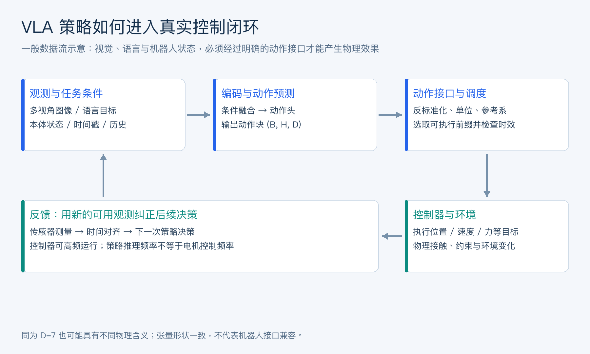
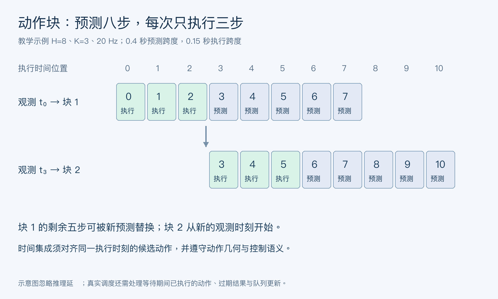
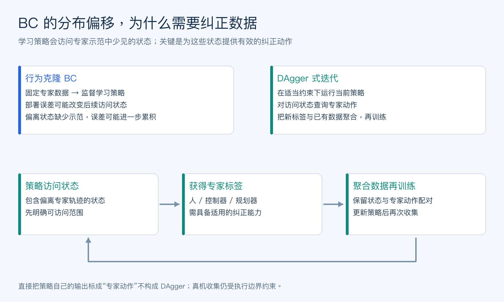
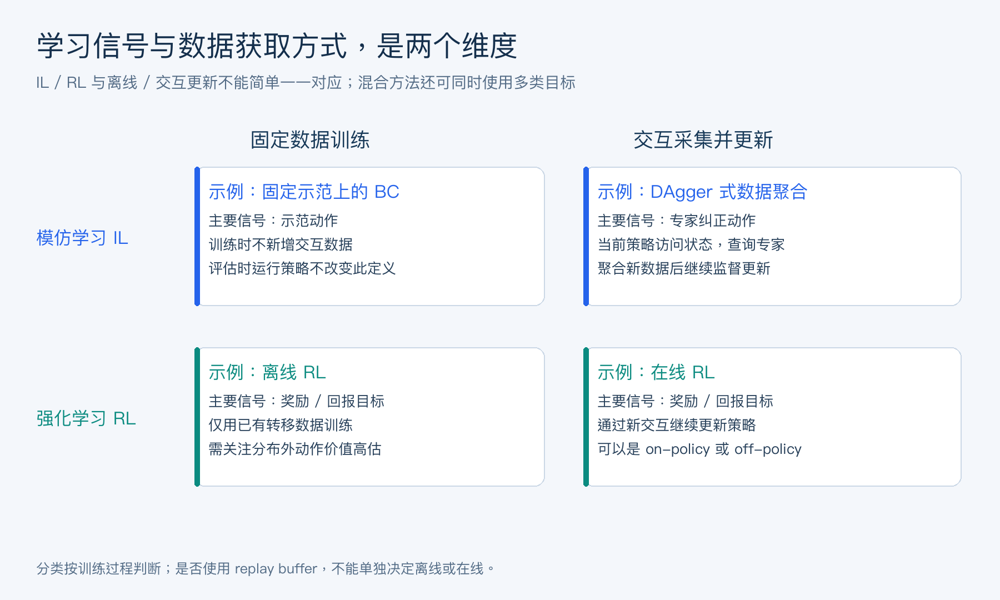

# 原力灵机高频面试题

## 面经目录

- [2026-10-13_原力灵机具身智能算法工程师面经](#yuanlilingji-embodied-20261013-939528346956726272)

<a id="yuanlilingji-embodied-20261013-939528346956726272"></a>
## 2026-10-13_原力灵机具身智能算法工程师面经

## 目录

- [项目深挖，会从简历里的项目出发持续追问，包括：](#yuanlilingji-embodied-20261013-939528346956726272-group1)
    - [项目的整体思路](#yuanlilingji-embodied-20261013-939528346956726272-q01)
    - [模型为什么这么设计](#yuanlilingji-embodied-20261013-939528346956726272-q02)
    - [数据怎么构建](#yuanlilingji-embodied-20261013-939528346956726272-q03)
    - [训练和推理细节](#yuanlilingji-embodied-20261013-939528346956726272-q04)
    - [实际效果以及失败 case](#yuanlilingji-embodied-20261013-939528346956726272-q05)
    - [如果继续优化会怎么做](#yuanlilingji-embodied-20261013-939528346956726272-q06)
- [论文讨论：会围绕自己做过 / 看过的论文展开讨论，不只是问论文结论，也会追问：](#yuanlilingji-embodied-20261013-939528346956726272-group2)
    - [核心 motivation](#yuanlilingji-embodied-20261013-939528346956726272-q07)
    - [方法设计](#yuanlilingji-embodied-20261013-939528346956726272-q08)
    - [为什么这样设计](#yuanlilingji-embodied-20261013-939528346956726272-q09)
    - [相比已有方法的优势和局限](#yuanlilingji-embodied-20261013-939528346956726272-q10)
    - [如果让你改进会怎么做](#yuanlilingji-embodied-20261013-939528346956726272-q11)
- [VLA 基础：具身智能大模型相关的基础知识也会考察，比如：](#yuanlilingji-embodied-20261013-939528346956726272-group3)
    - [VLA 的基本架构](#yuanlilingji-embodied-20261013-939528346956726272-q12)
    - [observation / action 如何建模](#yuanlilingji-embodied-20261013-939528346956726272-q13)
    - [action chunking](#yuanlilingji-embodied-20261013-939528346956726272-q14)
    - [autoregressive policy / diffusion policy](#yuanlilingji-embodied-20261013-939528346956726272-q15)
    - [VLM 和 VLA 的区别](#yuanlilingji-embodied-20261013-939528346956726272-q16)
    - [VLA 在真实机器人部署中的问题](#yuanlilingji-embodied-20261013-939528346956726272-q17)
- [IL / RL：Imitation Learning 和 Reinforcement Learning 也会问，包括一些经典概念和在机器人任务里的实际应用。比如：](#yuanlilingji-embodied-20261013-939528346956726272-group4)
    - [Behavior Cloning](#yuanlilingji-embodied-20261013-939528346956726272-q18)
    - [distribution shift](#yuanlilingji-embodied-20261013-939528346956726272-q19)
    - [imitation learning 和 RL 的区别](#yuanlilingji-embodied-20261013-939528346956726272-q20)
    - [offline / online learning](#yuanlilingji-embodied-20261013-939528346956726272-q21)
    - [为什么现在很多 manipulation 工作还是以 IL 为主](#yuanlilingji-embodied-20261013-939528346956726272-q22)
- [手撕代码：有手撕代码环节，算法题建议认真准备。](#yuanlilingji-embodied-20261013-939528346956726272-group5)
    - [个人感觉 LeetCode Hot 100 是比较合适的准备范围，常见的数据结构和算法最好都能比较熟练地写出来。](#yuanlilingji-embodied-20261013-939528346956726272-q23)
    - [此外，也建议准备 Python / PyTorch 的基础实操，例如张量操作、训练流程和轨迹数据处理。JD 中要求 C++ 的话，STL、智能指针、内存管理和并发基础也最好过一遍。](#yuanlilingji-embodied-20261013-939528346956726272-q24)

<a id="yuanlilingji-embodied-20261013-939528346956726272-group1"></a>
## 项目深挖，会从简历里的项目出发持续追问，包括：

<a id="yuanlilingji-embodied-20261013-939528346956726272-q01"></a>
### 项目的整体思路

**回答：**

从任务、观测、动作、学习目标、部署和评测六个环节讲项目，让面试官能沿着一次真实执行追问。自己的机器人平台、模型、数据规模和效果必须据实填写。

可以这样组织：“项目面向【操作任务】，机器人接收【相机、本体状态、语言指令】，输出【关节/末端动作及夹爪控制】。主要难点是【泛化、精度、长时序或接触控制】。我负责【具体模块】，使用【训练方式】学习策略，并在【明确测试划分】下验证。”

```text
任务与成功标准 → 示教/交互数据 → 对齐与质量检查
    → 观测编码与策略学习 → 动作解码和控制接口
    → 闭环执行与保护 → 成功率、失败归因与数据迭代
```

如果是多模态研究向机器人迁移，应说明已有能力与尚未验证的环节。离线动作误差小、仿真成功、真实机器人成功是不同证据，不能相互替代。

准备讲清一次具体轨迹：输入是什么、决策多久更新一次、动作参考系是什么、机器人实际发生了什么，以及失败后如何定位。自己的模块边界和团队整体成果也要区分。

**把项目压缩成一个可检验的技术判断。** 例如“在观测存在遮挡、动作有多种可行解的条件下，加入腕部视角和生成式动作头能否改善闭环表现”，比“做了一个具身大模型”更容易展开讨论。前者能继续追问传感器同步、数据覆盖、推理预算与消融；后者只说明技术标签。Rocky认为，具身项目的价值要沿着信息进入系统、动作影响环境、反馈纠正偏差的链路判断。架构、数据、控制和评测应当服务于同一个任务目标。

<a id="yuanlilingji-embodied-20261013-939528346956726272-q02"></a>
### 模型为什么这么设计

**回答：**

把模型选择对应到明确的任务约束。语言指令歧义大，需要语义与视觉对齐；动作具有多个合理解，需要表达多模态分布；连续控制要求平滑和实时性；接触任务还需要精确本体感知及控制反馈。

<div align="center">

| 设计选择 | 解决的问题 | 代价与验证 |
| --- | --- | --- |
| 预训练视觉/语言骨干 | 复用语义、物体和场景表示 | 可能缺少空间与控制精度，需下游验证 |
| 动作块预测 | 表达一段连贯操作，减少逐步决策开销 | 开环段变长会减弱反馈，需测扰动恢复 |
| 离散动作 token | 复用自回归序列建模 | 量化误差与解码延迟取决于编码方式 |
| 连续生成动作头 | 表达连续、多峰的动作分布 | 采样开销、训练目标和控制接口需配合 |
| 本体状态与历史观测 | 补足遮挡、速度和执行状态 | 需时间同步，历史信息增加成本 |

</div>

回答时给出真实对照，例如固定数据、控制频率和训练预算，比较单步与动作块策略。若多个因素同时改变，不能把全部收益归因于其中一个结构。

也要说明为什么更简单的视觉策略、行为克隆或规划器不足以满足目标。VLA 并非所有固定工位任务的最优选择，结构复杂度应由任务效果和维护成本支持。

<a id="yuanlilingji-embodied-20261013-939528346956726272-q03"></a>
### 数据怎么构建

**回答：**

机器人数据以带时间关系的 episode 为基本单位，至少关联观测、动作、任务说明、机器人配置与终止状态。示教可来自遥操作、动捕、脚本、仿真或已有数据集，但不同采集方式的分布和控制语义不能直接等同。

<div align="center">

| 处理阶段 | 需要检查的内容 |
| --- | --- |
| 采集 | 相机视角、频率、动作接口、示教成功与失败标签 |
| 时间对齐 | 观测时间戳、命令发送与执行延迟，避免未来信息泄漏 |
| 动作统一 | 绝对/增量、参考系、单位、旋转表示和夹爪约定 |
| 质量筛选 | 丢帧、无效动作、传感器异常、重复片段与错误指令 |
| 数据划分 | 按轨迹、对象、场景、日期或任务分组，而非随机拆相邻帧 |
| 采样 | 平衡任务、机器人和成功/失败模式，避免长轨迹主导 |

</div>

标准化统计只从训练集计算，验证和部署复用同一版本。跨机器人数据需要保留形态与控制元数据，必要时做特定动作头或适配，不能只把动作向量补成相同长度。

失败轨迹可以用于价值学习、失败检测或恢复策略；若直接把所有失败动作当作 BC 的正示教，可能学会重复失败。数据量应同时报告 episode、有效时长、任务与环境覆盖，帧数并不等于独立样本数。

**时间对齐要按“决策时实际可用的信息”检查。** 相机曝光、帧到达进程、策略开始计算、命令发送与控制器执行是不同时间点。即使两条数据的文件时间戳相同，也不说明策略决策时已经拿到该帧。对每条训练样本，应说明动作标签是待执行目标、控制器参考值还是实际测量状态；不能将实际执行后的状态变化未经定义就当成决策时的命令。

一个实用的 episode 清单可记录 `episode_id、task_id、robot_id、camera_calibration_version、controller_mode、observation_timestamp、action_timestamp、terminated、truncated`。跨机器人数据可统一存储格式，但参考系、控制频率与夹爪语义仍需显式适配。任务完成与采集超时也应区分；它们在构造价值学习的终止掩码时可能有不同语义，不能一律当作相同终态。

抽样回放对齐后的轨迹，检查“手开始移动前，相应命令是否已经出现”“接触状态是否与图像一致”，往往比直接扩大数据量更有诊断价值。训练集与测试集应按需要验证的泛化维度隔离；从同一条轨迹随机分帧得到的高分，无法证明对新任务或新环境的泛化。

<a id="yuanlilingji-embodied-20261013-939528346956726272-q04"></a>
### 训练和推理细节

**回答：**

训练部分先固定数据契约和损失，再说明哪些参数更新、采样方式、优化器、学习率、batch、精度和随机种子。若使用冻结骨干、LoRA 或全量微调，应说明选择依据与对照结果。

动作块训练通常输入当前观测及允许的历史，预测后续 H 步动作。轨迹尾部不足 H 步时可以截断或填充，但损失必须屏蔽无效位置；不同 episode 不能拼成一个动作块，未来帧不能误入观测。

离散动作头常采用 token 交叉熵；连续回归头可用回归或似然目标；扩散或流匹配头采用各自的去噪/速度场训练目标。不能将这些方法都称为同一种监督损失。

推理流程包括同步取观测、预处理、模型前向/采样、动作反标准化、坐标变换、限幅和控制器执行。必须测整个链路的时延，GPU 前向时间不等于传感到执行的总延迟。

验证训练 loss 之外的闭环表现：成功率、任务耗时、动作抖动、碰撞或越界、扰动后恢复，以及未见物体/场景上的效果。最终部署使用的历史窗口、动作语义和归一化应与训练一致，推理中的异步延迟也要纳入测试。

<a id="yuanlilingji-embodied-20261013-939528346956726272-q05"></a>
### 实际效果以及失败 case

**回答：**

用预先定义的成功标准说明效果，并同时报告样本数、测试条件、随机性和人工干预。一次抓取成功或挑选的视频不能代表总体成功率。

<div align="center">

| 维度 | 示例指标 | 容易遗漏的条件 |
| --- | --- | --- |
| 任务效果 | 完成率、阶段成功率、最终状态误差 | 任务是否全部完成，而非只完成抓取 |
| 效率 | 完成时间、决策时延、控制频率 | 是否计入重试、复位和人工等待 |
| 泛化 | 未见物体、位置、背景、指令表现 | 哪些因素变化，哪些仍在训练分布内 |
| 稳定与风险 | 干预次数、越界、碰撞、动作抖动 | 低成功率是否被人工接管掩盖 |

</div>

报告成功次数 k 与总次数 n，可给二项比例置信区间；同一场景重复运行之间可能相关，必要时按场景/任务进行分组统计。比较方法时尽量使用相同初始条件、预算和评估协议。

失败可拆为感知错误、语义错误、动作选择错误、控制跟踪误差、延迟和分布外状态。回放相机、本体状态、命令及实际执行动作，通过替换模块或控制变量实验归因。

口述示例应填入真实记录：“在【n】次【条件】测试中成功【k】次；主要失败发生在【阶段】，证据是【日志/消融】。”没有真机评测就明确停留在离线或仿真阶段。

**小样本成功率要带上不确定性。** 假设某次教学评估在 20 次独立、同分布试验中成功 16 次，点估计是 80%，但 Wilson 95% 区间约为 58.4%—91.9%。这不是任何真实项目的成绩，只说明少量试验不能支持过于精确的排名。若多次运行共享场景、物体或复位过程，独立同分布假设可能不成立，还应按任务/场景分组报告或采用合适的分组重采样。

失败归因最好提出可排除的解释。例如同一观测下换用已验证控制器能否恢复，人工校正目标位姿后是否仍然失败，降低端到端延迟后接触任务是否改善。仅凭模型输出“我没看清”不能确认感知就是根因。

<a id="yuanlilingji-embodied-20261013-939528346956726272-q06"></a>
### 如果继续优化会怎么做

**回答：**

先按失败频率、任务影响和修复成本排序，选择最有证据的瓶颈。继续优化不必等同于加大模型，标定、动作接口或数据分布的问题可能比容量更关键。

如果是遮挡或空间定位错误，可补充视角、状态估计和相关数据；若进入错误状态后不会恢复，可采集恢复示教、做数据聚合或受约束的在线改进；若动作不稳，检查单位、归一化、块衔接、延迟和控制器，而非直接平滑所有输出。

长任务失败需要检查子目标分解、进度判断、终止与重规划；接触阶段可考虑触觉、力反馈或更适合的低层控制。新增模块也会带来标定、数据与算力成本，应评估是否值得。

制定单变量实验：冻结评测集和任务配置，每次改变一项，用闭环成功率、恢复能力、时延与风险指标验收，保留退化检查。训练样本与最终验收样本要分开，避免用刚加入的失败样本证明泛化改善。

<a id="yuanlilingji-embodied-20261013-939528346956726272-group2"></a>
## 论文讨论：会围绕自己做过 / 看过的论文展开讨论，不只是问论文结论，也会追问：

<a id="yuanlilingji-embodied-20261013-939528346956726272-q07"></a>
### 核心 motivation

**回答：**

论文的 motivation 应表述为一个可以检验的问题：已有方法在什么条件下出现什么限制，为什么值得解决。避免只复述“提升泛化、降低成本”这样的宽泛目标。

可以按“现象—已有方法缺口—关键假设—预期证据”讲述。例如示教很少、动作有多种可行方式时，单一回归可能产生不可执行的平均动作；相应工作会研究更合适的条件分布建模。这是一般性例子，具体论证要回到所讨论论文。

区分作者明确报告的事实、你对机制的理解和尚未验证的推测。motivation 强并不代表方法已解决所有问题，应核对实验是否真的覆盖了声称的难点。

准备一个反例：如果任务是确定性、短时、固定场景，论文的复杂设计是否还有必要。能说明适用边界，才表明理解了研究问题。

<a id="yuanlilingji-embodied-20261013-939528346956726272-q08"></a>
### 方法设计

**回答：**

按输入、表示、模块、训练目标和推理过程讲方法，使听者能据此画出数据流。对 VLA 论文，需要说明图像、语言、本体状态怎样进入网络，动作怎样编码与生成，以及控制器实际接收什么。

可选择一条张量路径展开：多相机图像经编码器得到视觉特征，与语言和状态条件融合，动作头输出 H 步、每步 d 维的动作块。不同论文可能采用自回归 token、扩散、流匹配或回归头，不能在解释时混成一套结构。

训练时明确监督来自示教、交互奖励还是混合数据；哪些参数初始化自预训练模型，哪些从头训练，损失掩码和数据权重如何设置。推理时则说明生成步骤数、执行多少动作、何时重新观测。

最后复述一项关键实现细节和一个消融实验。仅凭模块名和最终结果无法证明理解方法，尤其要能回答去掉某模块后会发生什么。

<a id="yuanlilingji-embodied-20261013-939528346956726272-q09"></a>
### 为什么这样设计

**回答：**

把关键设计看成假设，而不是天然正确的组件。对每一项选择回答：它改变了什么信息或归纳偏置，预期解决哪种错误，采用什么实验能排除其他解释。

例如动作块可利用相邻控制命令的相关性，并减少逐步决策的调用开销；但收益也可能来自更强动作头或更多训练计算，需要控制这些因素。扩散动作头表达多峰分布，也可能引入采样时延，不能只比较平均成功率。

有价值的消融包括模块有无、动作表示、预测与执行长度、是否使用本体状态、训练数据混合与推理计算预算。比较时保持数据划分、骨干、控制频率和评测协议尽量一致。

若论文缺少足够消融，可以明确说该设计有合理解释，但因果证据有限。面试中的严谨性来自清楚区分“设计动机”和“实验已经支持的结论”。

<a id="yuanlilingji-embodied-20261013-939528346956726272-q10"></a>
### 相比已有方法的优势和局限

**回答：**

比较方法时先统一任务、机器人、数据、预训练资源和评测协议。跨论文表格的成功率往往不可直接相减，尤其不同复位条件、人工干预与测试物体会改变难度。

<div align="center">

| 维度 | 应比较的内容 |
| --- | --- |
| 能力 | 语义泛化、操作精度、长任务与恢复能力 |
| 数据 | 示教量、预训练数据、机器人与任务覆盖 |
| 计算 | 训练预算、参数量、推理步数及端到端时延 |
| 接口 | 动作空间、相机、本体状态、硬件适配 |
| 证据 | 消融、样本数、方差、失败分析、复现条件 |

</div>

例如大规模视觉语言预训练可能改善语义理解，但不能直接证明其接触控制优于专用策略；动作分布建模更灵活，也不保证低延迟部署更容易。

指出至少一个有证据的优势和一个具体局限，再给适用场景。无法从公开结果确定的内容，表述为待验证问题，不补充不存在的性能数字。

<a id="yuanlilingji-embodied-20261013-939528346956726272-q11"></a>
### 如果让你改进会怎么做

**回答：**

从论文已经暴露的失败模式出发，提出最小而可证伪的改进。应同时给出机制、实验与代价，避免泛泛地说“更多数据、更大模型、加 RL”。

例如对遮挡导致的抓取失败，可提出加入腕部视角或历史状态，并通过视角消融、同预算训练和遮挡分组评测验证；对动作块执行过长导致的误差，可缩短执行长度并重规划，测成功率与时延的折中。

对需要恢复行为的策略，可以设计失败状态附近的示教采集、DAgger 式数据聚合，或在清晰奖励和执行约束下微调。哪种方式更合适取决于专家可用性、试错成本和奖励质量。

明确预计改进哪些样本，哪些不应受到影响；保留未参与设计的测试集检查泛化。若资源不允许真机实验，可以先做仿真和离线诊断，但要承认这些证据对真实接触和延迟问题有限。

<a id="yuanlilingji-embodied-20261013-939528346956726272-group3"></a>
## VLA 基础：具身智能大模型相关的基础知识也会考察，比如：

<a id="yuanlilingji-embodied-20261013-939528346956726272-q12"></a>
### VLA 的基本架构

**回答：**

VLA（Vision-Language-Action）把视觉、语言及可选的机器人状态映射到行动决策。常见目标是学习条件策略，而不只是生成关于动作的文字描述。

```math
A_t\sim\pi_\theta(\,\cdot\mid o_{\leq t},l,s_t),\qquad A_t=(a_t,\ldots,a_{t+H-1})
```

其中 o 表示可用视觉/历史观测，l 是语言任务，s 是本体状态，H 是预测动作长度；具体模型不一定用全历史，也不一定预测动作块。

常见结构包括视觉编码器、语言/多模态融合骨干和动作生成头。有的工作把动作离散为 token 并自回归生成，有的将预训练 VLM 与连续扩散或流匹配动作头结合。OpenVLA、RT-2 与 π0 展示了不同实现路径，不能把某一种头部形式当成 VLA 的唯一定义。

训练通常利用带语言条件的机器人数据，并可能复用视觉语言预训练；部署还需反标准化、参考系转换、控制器、限幅和停止机制。高层策略的决策频率与底层控制环频率可以不同，模型输出也不必直接是关节力矩。

评价必须回到任务闭环：是否按指令完成操作、是否泛化、是否稳定，以及计算和执行成本。

<div align="center">



</div>

图 1：VLA 的一般数据流。动作头只是策略的一部分，动作反标准化、物理接口与反馈环决定输出如何作用于机器人；图中没有假定任何特定论文的隐藏结构。

**一条张量路径应能解释到物理含义。** 假设输入图像为 `(B, V, C, h, w)`，B 是 batch，V 是相机视角数；编码后得到每个视角的视觉 token，再与语言及本体状态结合。动作头输出 `(B, H, D)`，H 表示未来时间长度，D 表示每步控制量的维度。这些符号属于示意契约，实际模型也可能把历史帧合并到其他维度。

不能仅凭输出张量形状确认接口正确。例如同为 D=7，一个系统可能表示末端平移增量、旋转增量和夹爪，另一个系统却表示七个关节目标。执行前必须恢复单位、坐标系、时间间隔与动作范围；相同数组形状无法替代物理定义。

<a id="yuanlilingji-embodied-20261013-939528346956726272-q13"></a>
### observation / action 如何建模

**回答：**

observation 要让策略获得完成任务所需的信息，同时避免把训练时可见、部署时拿不到的信息泄漏进去。常见输入包括外部/腕部相机、深度、关节位置与速度、末端位姿、夹爪状态，以及任务语言；触觉和力信息按硬件与任务选择。

观测的时间同步、相机标定和历史窗口很重要。单帧图像可能无法区分速度和运动方向，部分可观测任务可利用历史、递归状态或显式估计，但会增加计算和数据要求。

<div align="center">

| 动作表示 | 优点 | 需要明确的契约 |
| --- | --- | --- |
| 关节目标或增量 | 接近机器人接口 | 关节顺序、单位、极限和控制模式 |
| 末端位姿/增量 | 便于描述操作几何 | 世界/基座/末端坐标系、IK 与可达性 |
| 速度或力矩 | 更直接影响动态过程 | 控制频率、稳定性和约束更严格 |
| 夹爪命令 | 描述开合或连续位置 | 正负约定、范围、迟滞和执行延迟 |

</div>

旋转可用四元数、轴角或其他连续表示，不同表示有归一化、符号等价或奇异性问题，不能按普通欧氏量随意混用。动作标准化与反标准化的统计和轴顺序必须一致。

跨机器人迁移还需处理形态、工作空间与控制器差异。“动作维度相同”只说明数组形状一致，不能说明物理语义一致。

**坐标系是最值得现场举例的工程细节。** 令 $`T^B_E`$ 表示把末端坐标表达转换到基座坐标表达的位姿矩阵。若增量被定义为基座系中的左乘刚体变换，组合为：

```math
T^{B\prime}_E=\Delta T_B T^B_E.
```

若增量被定义为末端局部系中的右乘刚体变换，则组合为：

```math
T^{B\prime}_E=T^B_E\Delta T_E.
```

两个式子对应不同动作契约，旋转和平移一般不满足交换律。实际接口也可能规定“基座系平移直接相加、姿态单独更新”，这时必须按该接口实现，不能照搬完整左乘变换。面试中应把矩阵约定和控制器要求一起说清楚。

夹爪也不宜被当成普通连续维度随意平均：有些数据用开/闭二值，有些用宽度、位置或力目标。旋转四元数存在正负号等价，先统一符号或采用适当的旋转距离，再讨论损失与插值，否则几何上相近的姿态可能出现很大的数值误差。

<a id="yuanlilingji-embodied-20261013-939528346956726272-q14"></a>
### action chunking

**回答：**

action chunking 是一次预测连续多步动作，利用时间相关性并减少每个控制步都调用大模型的开销。要区分预测长度 H 与实际执行长度 K：可以预测较长动作块，只执行前 K 步，再用新观测重规划，通常满足 K 不超过 H。

```text
时刻 t：取观测 → 预测 H 步 → 执行前 K 步
时刻 t+K：重新观测 → 更新动作块 → 继续执行
```

H 较大有助于表达连贯行为，但也增加远期预测难度；K 较大会降低重规划频率，同时让机器人更长时间无法利用新反馈。不同接触阶段可以需要不同选择。

ACT 将动作分块与条件变分建模结合，并使用时间集成平滑重叠预测；其他系统可采用滚动执行、块衔接或异步推理。时间集成需要对同一执行时刻的候选动作正确对齐，且不能无条件平均来自不同可行动作模式的命令。

离线训练要处理尾部 mask、episode 边界和观测—动作延迟。部署要测块切换的连续性、扰动恢复与关键路径时延；分块并不自动保证实时性，也没有消除闭环反馈的需要。

<div align="center">



</div>

图 2：H=8、K=3 的滚动执行示例。先预测八步，只执行前三步，再用新观测计算下一块；图中编号表示执行时间位置，不是另一套动作编码。

若控制频率为 20 Hz，这个教学例子的预测跨度为 0.4 秒，每次承诺执行的跨度为 0.15 秒。前一个块中未执行的五步可以被新预测替换；它们不应在下一块到来后仍被全部下发。预测范围 H、执行范围 K 与实际产生反馈的频率是不同变量。

时间集成需要把不同预测块中“对应同一真实执行时刻”的候选动作对齐。例如不能把当前时刻的第一步与旧块已执行完的第一步平均。对位置、速度、旋转和夹爪，融合的数学含义也不同；两个绕障碍方向都正确，直接平均却可能撞上障碍。平滑应服从可行性与控制语义。

<a id="yuanlilingji-embodied-20261013-939528346956726272-q15"></a>
### autoregressive policy / diffusion policy

**回答：**

自回归策略把联合动作分布分解为条件序列分布，逐个生成动作维度、时间步或编码 token；具体分解顺序由动作表示决定。它不必只处理离散动作，也不必与 chunking 互斥。

```math
p(z_{1:M}\mid c)=\prod_{i=1}^{M}p(z_i\mid z_{\lt i},c)
```

条件 c 包含观测和任务。离散 token 方案常用交叉熵训练；量化粒度、序列长度和解码方法影响精度与延迟，teacher forcing 与实际生成的条件差异也值得关注。

Diffusion Policy 则学习条件动作序列分布，训练时对真实动作加噪并学习去噪，推理从噪声开始多步生成动作块。以噪声预测形式为例：

```math
\mathcal L=\mathbb E_{A,c,t,\epsilon}\left[\left\|\epsilon-\epsilon_\theta(\sqrt{\bar\alpha_t}A+\sqrt{1-\bar\alpha_t}\epsilon,t,c)\right\|_2^2\right]
```

<div align="center">

| 维度 | 自回归策略 | 扩散策略 |
| --- | --- | --- |
| 生成方式 | 按所选序列顺序逐项生成 | 多次迭代更新一段动作 |
| 常见优势 | 适合 token 接口和序列条件建模 | 连续、多峰动作序列建模较自然 |
| 主要代价 | 序列长度与串行解码开销 | 去噪次数及每步网络计算 |
| 实际评估 | 编码误差、闭环效果、时延 | 采样步数、闭环效果、时延 |

</div>

“扩散一定更慢”或“自回归一定更准”都需要给出具体模型和预算。流匹配也可生成连续动作，但学习的是相应速度场，不能把其目标函数直接写成所有扩散模型都使用的噪声预测损失。

**流匹配与扩散的区别应讲到训练目标。** 用一个简化的条件流匹配例子说明：令 $`A_0`$ 是噪声动作块，$`A_1`$ 是数据动作块，构造直线路径 $`A_\tau=(1-\tau)A_0+\tau A_1`$。其对应速度目标是 $`A_1-A_0`$：

```math
\mathcal L_{\mathrm{FM}}=\mathbb E\left[\left\|v_\theta(A_\tau,\tau,c)-(A_1-A_0)\right\|_2^2\right].
```

推理时沿学习到的速度场积分，逐步把噪声变为动作。这个式子用于解释一类直线路径流匹配，不是对所有 VLA 或某个具体模型完整训练配方的复述。路径、时间采样、条件注入、损失权重和数值求解器都可能变化。

三类策略的比较应固定机器人任务、数据、动作语义和推理预算，再看成功率与延迟。动作分布可以多峰，闭环系统却需要在实际执行时选择一条一致的行为；每次重规划切换模式，也可能产生不连续动作。生成模型的表达能力与控制系统的时间一致性要一起考虑。

<a id="yuanlilingji-embodied-20261013-939528346956726272-q16"></a>
### VLM 和 VLA 的区别

**回答：**

VLM 主要建立视觉与语言的理解、对齐或生成能力；VLA 将这种条件信息进一步用于生成或选择机器人动作。两者可能复用骨干，区别要看训练目标、输出语义和是否经过闭环行动验证。

<div align="center">

| 方面 | VLM | VLA |
| --- | --- | --- |
| 输出示例 | 描述、答案、视觉语义表示 | 动作 token、连续控制目标或动作序列 |
| 核心监督 | 图文、视觉问答等 | 与观测对齐的机器人动作及可选反馈 |
| 误差后果 | 语义回答错误 | 可能影响空间轨迹、接触与任务状态 |
| 验收 | 识别、问答、理解指标 | 任务成功、精度、稳定性、时延与风险 |

</div>

给 VLM 一个 prompt 让它描述“拿起杯子”，并不证明它能输出坐标正确、时序合适、机器人可执行的动作。中间可以通过规划器与技能库落地，也可以训练动作头；两种路线都要说明实际控制接口。

视觉语言预训练可能提供语义泛化，但机器人控制所需的标定、动力学、接触和本体状态仍需数据与系统设计支持。语义基准提升不能直接推导真机成功率提升。

<a id="yuanlilingji-embodied-20261013-939528346956726272-q17"></a>
### VLA 在真实机器人部署中的问题

**回答：**

真机部署首先检查训练和运行接口是否一致，然后处理实时性、反馈、物理约束和运行分布。模型指标只是整个系统的一部分。

<div align="center">

| 问题 | 表现 | 诊断与处理 |
| --- | --- | --- |
| 标定/参考系错误 | 动作方向或距离系统性偏差 | 核对相机外参、单位、轴顺序与变换 |
| 延迟与不同步 | 对过时画面行动，接触阶段失稳 | 全链路时间戳、延迟补偿、合理执行长度 |
| 分布变化 | 新光照、物体、背景下失败 | 分组评测、数据补齐、失败检测与恢复 |
| 物理可行性 | 越限、不可达、自碰撞 | 控制器与约束层校验，明确停止机制 |
| 长任务累积误差 | 前段正确、后段偏离 | 进度判断、闭环重规划、恢复子任务 |

</div>

可以采用异步感知/策略和较高频率的低层控制，但要定义动作有效期、队列策略、watchdog 和丢包后的行为。新推理结果不能把已经执行的时间段重新下发。

速度、力和工作空间约束需要在模型之外可执行，测试按仿真、受控真机、扩大任务范围逐步验收。语言输出的“停止”不能替代可靠的停止通路。

量化、蒸馏、减少生成步骤或降低视觉 token 数可能减少时延，也可能降低动作精度，必须重跑闭环评测。报告人工干预、复位和异常终止，不能只展示成功轨迹。

**异步并不等于消除了延迟。** 设从观测可用到新动作块可执行的总时延为 L，单步控制间隔为 Δt，粗略上至少有 `ceil(L / Δt)` 个控制步会在等待期间过去；这只是按固定周期估计，实际还要计入抖动与排队。若模型仍把块的第一步解释为旧观测时刻的动作，新结果到来时就可能已经过期。

可选择同步等待、保持上一有效控制目标、基于状态预测做补偿，或让模型显式适应推理期间已执行的动作前缀。不同方案各有前提，不能把丢弃前几步当作通用正确解。需要记录动作适用时间、已执行前缀与队列版本，并检查更新时是否会重放旧命令。

测试至少包含传感器冻结、推理超过截止时间、结果乱序返回和控制线程重启。验收应看机器人是否按约定进入保持或停止状态，以及恢复时是否拒绝过期轨迹。这样的故障实验验证的是系统执行边界，不是模型语义理解能力。

<a id="yuanlilingji-embodied-20261013-939528346956726272-group4"></a>
## IL / RL：Imitation Learning 和 Reinforcement Learning 也会问，包括一些经典概念和在机器人任务里的实际应用。比如：

<a id="yuanlilingji-embodied-20261013-939528346956726272-q18"></a>
### Behavior Cloning

**回答：**

Behavior Cloning（BC）把专家示教转成监督学习：在专家访问过的观测或状态上，学习输出对应动作或动作分布。对于概率策略，常见目标为：

```math
\mathcal L_{BC}(\theta)=-\mathbb E_{(o,a)\sim D_E}\log\pi_\theta(a\mid o)
```

确定性连续回归常用均方误差，但在“绕障碍左边或右边都可行”等多峰动作分布下，平均动作可能不可行。使用概率分布、离散 token、扩散等动作建模可缓解表达问题，却不自动解决闭环分布偏移。

BC 通常不需要显式奖励或环境动力学模型，数据与训练流程相对直接，适合已有高质量示教的任务。它的质量受示教覆盖、动作标注与时间对齐影响，低训练误差不保证真实执行稳定。

机器人执行中的小偏差可能让策略进入示教中很少出现的状态，此时需要恢复数据、数据聚合或其他闭环改进。评测应在实际策略产生的轨迹上进行，而不是只看专家数据上的预测误差。

<a id="yuanlilingji-embodied-20261013-939528346956726272-q19"></a>
### distribution shift

**回答：**

这里至少包含两种偏移：外部环境改变造成的域偏移，以及策略动作改变后续状态、导致训练和执行访问不同状态的闭环偏移。模仿学习中第二种尤其重要。

BC 在专家状态分布 d_E 上学习，部署则访问自身策略诱导的分布 d_π。一步小误差可能把机器人带到陌生位置，再产生更大误差；即使相机和任务完全不变，也可能发生这种偏移。

DAgger 的典型思路是让学习策略参与收集状态，在这些访问到的状态上查询专家动作，将数据加入训练集后迭代更新。具体训练过程可以采用专家与学习策略混合执行；真机应用要考虑专家可用性与试错约束。

还可用恢复示教、相关扰动增强、域随机化、失败检测与受控交互改善覆盖。图像增强主要改变观测，不等于已经解决错误动作带来的状态分布变化；离线数据重采样也不能创造完全未覆盖的恢复动作。

实验时分别测试未见视觉条件、动作扰动后的恢复、长时序成功率与接管次数，从而判断实际修复的是哪一种偏移。

<div align="center">



</div>

图 3：BC 的部署轨迹可能偏离专家轨迹；DAgger 式数据聚合的关键，是在学习策略访问到的状态上获得专家标签。图示不代表真机可以无约束试错。

如果把策略在偏离状态下自己生成的动作原样回灌为“专家动作”，只是在强化自身行为，并不构成 DAgger 所需的专家纠正。专家也未必总是人类：在具备相应能力与适用条件时，可以是控制器或规划器，但必须说明它为何能在这些状态上给出有效标签。

另一个边界是信息可用性。训练时如果策略利用只有仿真器能提供的完整物体状态，部署时却只有图像，这属于信息条件改变；单纯增加 DAgger 轮数无法自动消除传感器差异。应先明确策略输入契约，再讨论如何改善访问状态分布。

<a id="yuanlilingji-embodied-20261013-939528346956726272-q20"></a>
### imitation learning 和 RL 的区别

**回答：**

Imitation Learning 从示教或专家反馈学习行为；Reinforcement Learning 根据奖励和环境转移优化长期回报。区别主要在学习信号与目标，不在是否使用 Transformer 或是否运行在机器人上。

```math
J(\pi)=\mathbb E_{\tau\sim\pi}\left[\sum_{t=0}^{T-1}\gamma^t r_t\right]
```

<div align="center">

| 维度 | IL | RL |
| --- | --- | --- |
| 主要信号 | 专家动作、偏好或行为约束等 | 奖励与转移信息 |
| 优势 | 有示教时易形成可用行为 | 有机会优化超越示教的任务回报 |
| 难点 | 专家成本、覆盖与分布偏移 | 探索、奖励设计、样本效率与稳定性 |
| 机器人约束 | 采集与复核示教的成本 | 交互损耗、复位和危险状态成本 |

</div>

并非所有 IL 都是离线 BC，交互式模仿可查询专家；RL 也可以完全基于固定离线数据训练。IL/RL 与 offline/online 是不同划分维度。

常见组合是用 BC 得到初始策略，再在可验证奖励和执行约束下改进，必要时保留示教正则。是否值得加入 RL，要看失败类型、奖励可靠性和交互预算，不能默认它必然超过专家或必然提升真机表现。

<a id="yuanlilingji-embodied-20261013-939528346956726272-q21"></a>
### offline / online learning

**回答：**

offline/online 主要描述训练期间是否继续获得由当前或更新中策略参与采集的新数据，并不是指机器人是否联网。评估阶段与环境交互，也不自动使整个训练过程成为在线学习。

<div align="center">

| 方式 | 数据与更新 | 关键问题 |
| --- | --- | --- |
| 离线 BC | 固定示教数据上监督拟合 | 专家覆盖与闭环分布偏移 |
| 交互式 IL | 在新状态查询专家并更新 | 专家标注、交互范围和安全 |
| 离线 RL | 固定转移/奖励数据上优化策略 | 未覆盖动作的价值外推与分布约束 |
| 在线 RL | 收集新交互并迭代策略 | 探索、奖励、复位和样本成本 |

</div>

离线 RL 的难点之一是价值函数可能高估数据中罕见动作，策略反过来偏向这些动作。保守价值估计、行为约束等是常见方向，但能达到什么效果仍受数据覆盖限制。

on-policy/off-policy 与 offline/online 也不同：在线 RL 可以使用 replay buffer 和 off-policy 方法；固定数据训练通常属于离线场景。部署后持续收集日志、定期审核再训练，是一种迭代流程，不能等同于每次执行都立即更新模型。

真机项目应明确数据何时冻结、策略何时更新、哪个版本接受评测，以及更新失败怎样回滚。

<div align="center">



</div>

图 4：IL/RL 描述主要学习信号，离线/交互更新描述数据获取方式。四种组合都存在，不能把 IL 与离线、RL 与在线一一等同。

**离线 RL 为什么会产生价值外推问题？** 固定数据只覆盖有限状态—动作组合，价值更新却可能需要评价当前策略提出的其他动作。如果未覆盖区域被高估，策略优化会进一步偏向这些区域，使估计误差形成反馈。行为约束或保守估计可以限制这种倾向，但也可能抑制对更优动作的探索；任何算法都不能从完全没有证据的区域直接获得可靠的真实动力学知识。

实际项目要分别说明数据采集策略、训练策略与部署策略。使用旧策略收集的数据继续在线更新，可能是 off-policy 在线 RL；固定数据上训练后只进行部署测试，仍可以是离线训练。Replay buffer 的存在本身无法判定是哪一种。

<a id="yuanlilingji-embodied-20261013-939528346956726272-q22"></a>
### 为什么现在很多 manipulation 工作还是以 IL 为主

**回答：**

这个判断适用于许多有示教数据的操作任务，并非所有 manipulation 研究都以 IL 为主。其现实优势是能够用较明确的数据监督建立可执行策略，减少真机从随机行为开始探索的成本。

真实操作的奖励可能稀疏或难定义，复位与失败会消耗时间，接触动力学和视觉状态也增加学习难度。相比大量交互试错，遥操作示教在某些任务上更易获得有效动作；BC、动作块和生成式动作策略提供了可扩展的学习路线。

多任务机器人数据与视觉语言预训练也使 IL 更容易复用已有知识。但示教采集仍然昂贵，覆盖不足和恢复能力弱依旧是瓶颈；“训练稳定、容易起步”不代表最终性能上限更高。

当仿真可用、奖励可靠、交互与复位成本可控时，RL 可能更有优势；也可先 IL 初始化，再用 RL 或专家反馈改进。面试中应结合任务说明为什么选择某条路线，并用同口径的成功率、样本成本与执行风险比较。

<a id="yuanlilingji-embodied-20261013-939528346956726272-group5"></a>
## 手撕代码：有手撕代码环节，算法题建议认真准备。

<a id="yuanlilingji-embodied-20261013-939528346956726272-q23"></a>
### 个人感觉 LeetCode Hot 100 是比较合适的准备范围，常见的数据结构和算法最好都能比较熟练地写出来。

**回答：**

准备应覆盖数组与哈希、双指针、滑动窗口、栈/队列、二分、链表、树与图遍历、堆、回溯和动态规划等常见模式。这里没有指定具体手撕题，因此下面给的是准备与作答方法，不对应某一道已知面试原题。

面对题目，先确认输入输出、数据范围、是否允许修改输入、重复值和无解的处理，再给出朴素解法及瓶颈。优化时说明维护的不变量或递推关系，随后写代码并分析时间、额外空间与递归栈。

测试至少覆盖空输入、最小规模、重复值、单调或极端数据和边界答案；固定宽度整数实现还要考虑溢出。对图和轨迹类题，注意连通性、方向、边界与状态是否跨样本污染。

用“能解释为什么正确、能自己构造反例、能在新变体中调整”衡量掌握程度，而不是只统计刷题数量。Hot 100 可以作为练习集合，但不构成该岗位必考题清单。

<a id="yuanlilingji-embodied-20261013-939528346956726272-q24"></a>
### 此外，也建议准备 Python / PyTorch 的基础实操，例如张量操作、训练流程和轨迹数据处理。JD 中要求 C++ 的话，STL、智能指针、内存管理和并发基础也最好过一遍。

**回答：**

实操重点是把张量语义、训练状态和轨迹边界写对。PyTorch 应掌握 batch/time/feature 维度、broadcast、mask、reshape 与非连续内存、梯度清零、train/eval、推理时关闭梯度、设备和 dtype，以及可复现的数据加载。

以下为轨迹处理补充练习：从单个 episode 中构造长度 H 的动作块，并为尾部填充位置返回有效 mask。它不代表具体手撕原题。输入动作形状为 `(T, D)`，T 可以为 0，H 必须为正整数；不跨 episode 拼接，也不修改输入。

```python
import numpy as np


def make_action_chunks(actions, horizon):
    if (isinstance(horizon, (bool, np.bool_))
            or not isinstance(horizon, (int, np.integer))
            or horizon <= 0):
        raise ValueError("horizon must be a positive integer")
    a = np.asarray(actions)
    if a.ndim != 2:
        raise ValueError("actions must have shape (T, D)")
    t, d = a.shape
    h = int(horizon)
    chunks = np.zeros((t, h, d), dtype=a.dtype)
    valid = np.zeros((t, h), dtype=bool)
    for offset in range(min(t, h)):
        length = t - offset
        chunks[:length, offset] = a[offset:]
        valid[:length, offset] = True
    return chunks, valid
```

例如动作序列是 `[a0,a1,a2]`、H=2，则输出块为 `[a0,a1]`、`[a1,a2]`、`[a2,0]`，最后一个块的有效 mask 为 `[True,False]`。零填充只是占位，不表示机器人应执行零动作；训练与执行都要尊重有效范围。

构造结果的时间和存储规模为 $`O(THD+TH)`$。大数据集可在 Dataset 中按索引动态取块，避免一次物化全部窗口。masked MSE 的分母按有效元素数计算，多维动作需计入 D；没有有效元素时显式跳过，不静默除以零。不同特征的单位和权重另行处理。

训练循环还要检查观测与命令延迟、归一化统计和跨轨迹采样。C++ 可对应准备容器生命周期、RAII、智能指针、移动语义、越界和并发同步；不能让异步控制线程访问已经释放或被并发修改的缓冲区。

**进一步实操：带无效尾部的 PyTorch 损失。** 对 `(B,H,D)` 预测，若 mask 是 `(B,H)`，只在有效时间位置及其 D 个动作维度上求均值。先选出有效元素再相减，可以避免填充区的 NaN 在“先计算误差、再乘 0”时污染损失。

```python
import torch


def masked_action_mse(pred, target, valid):
    if pred.ndim != 3 or pred.shape != target.shape:
        raise ValueError("pred and target must share shape (B,H,D)")
    if pred.shape[-1] == 0 or valid.shape != pred.shape[:2]:
        raise ValueError("require D > 0 and mask shape (B,H)")
    if valid.dtype != torch.bool:
        raise ValueError("valid must be a boolean mask")
    if pred.device != target.device or pred.device != valid.device:
        raise ValueError("all tensors must be on the same device")
    if not pred.is_floating_point() or pred.dtype != target.dtype:
        raise ValueError("pred and target need the same floating dtype")
    if not bool(valid.any()):
        return None  # 训练循环显式跳过本批，不当成零损失样本
    p, y = pred[valid], target[valid]
    if not bool(torch.isfinite(p).all() & torch.isfinite(y).all()):
        raise ValueError("valid action values must be finite")
    if p.dtype in (torch.float16, torch.bfloat16):
        p, y = p.float(), y.float()
    return (p - y).square().mean()
```

这个函数展示单设备下的损失契约，不是完整训练框架；低精度输入先转为 float32 再做误差运算，也不能保证任意极端数值都不溢出。若在分布式训练中使用，各 rank 需要协调空批处理，不能让部分 rank 跳过而其他 rank 进入梯度同步。有效元素数不相等时，也应按全局有效计数加权，不能简单平均各 rank 的局部均值。

损失函数屏蔽填充误差，不代表序列模型内部已经屏蔽无效 token。注意力、状态递推或归一化若读入填充内容，仍可能影响有效位置。测试应检查有效位置误差、无效位置梯度、全空 mask、错误 shape/dtype，以及动作块是否跨 episode。此处动作各维等权；位置、角度与夹爪的单位差异，需要通过明确的标准化或损失权重另行处理。
