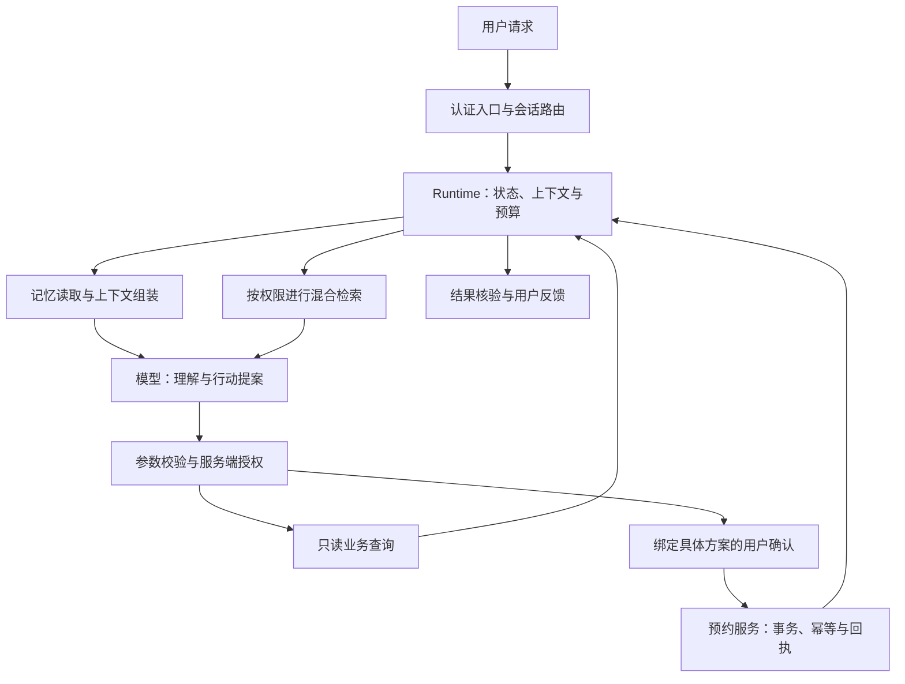

# AI Agent 工程实战：基础80问学习AI Agent

[返回课程总览](README.md) · [进入 AI Agent 基础](../AI%20Agent基础/readme.md)

**把 Agent 项目讲清楚，最终要回答三个问题：信息凭什么可信，动作凭什么执行，结果凭什么算完成。** 一个助手能流畅地介绍课程，不能证明它能查询真实名额；能调预约接口，也不能证明它能在超时重试后只生成一笔订单。

这门教程以课程预约助手为贯穿案例，把 80 个工程问题组织成 12 节实验。目标读者是具备 Python 或 Java 基础、理解 HTTP 与数据库、希望进入 AI 应用或 Agent 工程岗位的开发者。每节都要求留下可复查的产物，最终形成一条从用户请求到业务回执的完整链路。

Rocky认为，Agent 工程师的能力应体现在失败时系统如何继续工作：证据不够时能否承认未知，记忆冲突时能否保持用户意图，结果未送达时能否查清业务是否已经执行。框架和模型会变，这些判断会一直有用。

## 课程边界与先修准备

先完成一个单用户、单业务的最小闭环，再扩展模型与数据规模。本文的教学助手支持：查询课程规则、查询场次、读取与更正偏好、收集预约条件、请求确认、提交一次预约、在响应丢失后查询同一结果。支付、跨机构排课和自动退款不在首版范围内。

建议准备一个 Python 环境、Git、SQLite，以及后续检索实验所用的 PostgreSQL/pgvector。连接真实模型时再配置凭证，不把密钥放在仓库。本文附带的控制层示例只依赖 Python 标准库，可先验证关键逻辑；它不包含真实 LLM、Embedding、LangGraph、网关或完整用户认证，不能直接当作生产 Agent 部署。

需要补基础的读者，先掌握函数与异常、JSON Schema、HTTP 超时、SQL 事务与索引，再开始工具写入实验。能运行示例只证明练习代码通过，能解释失效条件并在自己项目中处理，才构成面试证据。

## 最终系统应是什么样

知识规则、用户偏好和预约事实有不同的权威位置。课程说明进入可更新的知识库；偏好进入带版本与范围的记忆；名额和预约结果保存在事务业务库。模型负责语言理解与候选行动，业务服务负责最终状态变更。



图中的回路用于获得新证据和修正状态。写入前的确认绑定用户、场次、参数与版本；授权检查不能仅存在于模型提示词中。简单知识问答可以在检索后结束，不需要绕完整个预约流程。

## 12 节课与学习节奏

每节建议安排一次机制学习、一次实验和一次口述复盘。已有后端经验的读者可用两到三周完成首轮；时间安排只是建议，不以天数代替验收。

| 课次 | 核心问题 | 必交产物 |
| --- | --- | --- |
| 1 | 哪些部分需要 Agent | 需求边界、模块图与权威数据表 |
| 2 | 一个请求怎样跑完 | 状态机、事件轨迹与取消策略 |
| 3 | 如何规划、路由与恢复 | 路由测试集、图定义与恢复实验 |
| 4 | 文档怎样变成证据 | 解析抽检、切分对照和入库契约 |
| 5 | 怎样做好混合检索 | 双路召回、RRF 与重排实验 |
| 6 | 怎样证明回答可靠 | 可回答性、引用与延迟评估 |
| 7 | 怎样正确地记住用户 | 读写分离、冲突与删除实验 |
| 8 | 工具、Skill 与协议怎样配合 | 工具 Schema、Skill 包与协议边界图 |
| 9 | 怎样限制错误行动与成本 | 注入测试、权限断言与预算策略 |
| 10 | 长期助手怎样持续运行 | Gateway/Runtime 分工与记忆维护方案 |
| 11 | 怎样完成一次可靠预约 | 确认、幂等、并发与故障恢复实验 |
| 12 | 怎样把项目变成面试证据 | 复现实验、指标卡和答辩记录 |

## 第 1 课：先定义业务，再选 Agent 形态

核心阅读：[第 1 题](../AI%20Agent基础/01_AIGC时代AI%20Agent基础高频考点.md#q-002)、[第 2 题](../AI%20Agent基础/01_AIGC时代AI%20Agent基础高频考点.md#q-003)、[第 3 题](../AI%20Agent基础/05_Agent记忆与上下文工程高频考点.md#q-002)、[第 6 题](../AI%20Agent基础/01_AIGC时代AI%20Agent基础高频考点.md#q-007)、[第 69 题](../AI%20Agent基础/01_AIGC时代AI%20Agent基础高频考点.md#q-031)、[第 70 题](../AI%20Agent基础/01_AIGC时代AI%20Agent基础高频考点.md#q-032)。

先列出十个真实风格的请求，例如“课程面向什么基础”“周六还有名额吗”“以后优先找晚课”“帮我预约下周的 Python 入门”。为每个请求标出所需事实、是否改变业务状态、失败代价和成功判据。只有问答的需求，不强行引入规划器；库存问题不能只检索课程介绍。

把知识、记忆和实时业务拆开：规则由知识库提供；用户自己确认的偏好由记忆提供；场次和库存由预约服务提供。遇到“这次要上午，平常还是晚课”时，当前选择与长期偏好应同时成立，各有作用范围。

**实验。** 不调用模型，手工给十个请求选择问答、RAG、工具或 Agent/Workflow 组合，并画出数据流。记录每个模块是否更新模型参数，区分 Prompt、RAG、微调和预训练。

**验收。** 对任一字段都能说出权威来源，对任一写操作都能说出授权和验收位置。若设计中的“预约成功”仅依据模型文本，先修正架构再进入下一课。

## 第 2 课：把一次生成变成一次可管理的运行

核心阅读：[第 4 题](../AI%20Agent基础/05_Agent记忆与上下文工程高频考点.md#q-004)、[第 5 题](../AI%20Agent基础/02_编码Agent与AgentOS工程高频考点.md#q-039)、[第 8 题](../AI%20Agent基础/07_企业级Agent平台与产品落地高频考点.md#q-004)、[第 9 题](../AI%20Agent基础/02_编码Agent与AgentOS工程高频考点.md#q-038)。

定义 `request_id、session_id、run_id` 的边界：同一次请求重试不应产生新的业务意图；一个会话可包含多个任务；一个任务可跨越多次模型与工具调用。状态至少区分运行中、等待工具、待确认、已完成、失败和取消。

为一次请求记录脱敏事件：输入接收、上下文版本、模型调用、工具提案、授权结果、工具回执、状态迁移和最终反馈。大对象使用受控引用，不在日志里无限复制原文；隐藏思维链不作为系统必须获得的运行数据。

**实验。** 用普通函数模拟查询工具，再加入一次超时、用户中断和客户端断线。观察三者是否被分别处理。断线后重新连接应查询已有 run，而不是默认重新创建预约。

**验收。** 能从事件轨迹恢复“当前在做什么、哪里已经成功、哪一步可以重试”。Workspace 的路径范围必须有执行层检查，抽象文件接口不能绕过它。

## 第 3 课：编排服从任务，恢复服从副作用

核心阅读：[第 10 题](../AI%20Agent基础/03_Agent设计模式与工作流编排高频考点.md#q-006)、[第 11 题](../AI%20Agent基础/03_Agent设计模式与工作流编排高频考点.md#q-011)、[第 12 题](../AI%20Agent基础/03_Agent设计模式与工作流编排高频考点.md#q-013)、[第 13 题](../AI%20Agent基础/03_Agent设计模式与工作流编排高频考点.md#q-025)、[第 14 题](../AI%20Agent基础/03_Agent设计模式与工作流编排高频考点.md#q-016)、[第 15 题](../AI%20Agent基础/07_企业级Agent平台与产品落地高频考点.md#q-029)、[第 16 题](../AI%20Agent基础/07_企业级Agent平台与产品落地高频考点.md#q-030)、[第 17 题](../AI%20Agent基础/03_Agent设计模式与工作流编排高频考点.md#q-026)、[第 18 题](../AI%20Agent基础/03_Agent设计模式与工作流编排高频考点.md#q-027)、[第 19 题](../AI%20Agent基础/03_Agent设计模式与工作流编排高频考点.md#q-024)、[第 80 题](../AI%20Agent基础/03_Agent设计模式与工作流编排高频考点.md#q-028)。

给课程规则查询使用轻量路径；给多条件筛选使用局部 ReAct；给预约使用固定状态机。复杂目标可先制定计划，但实际执行要允许按新证据修改。反思仅在能改善下一次行动的节点触发，不把每个工具响应都变成一轮自评。

建立意图集合 `knowledge_query、booking_query、booking_create、memory_read、memory_update、cancel、unknown`。规则处理明确命令，模型处理表达变化，服务端白名单决定处理器。多意图请求先拆解依赖，未知意图澄清；不要让用户文本选择任意类名或内网地址。

**LangGraph 实验。** 先用普通状态机完成流程，再选择需要持久化或条件转移的部分迁入图。State 保存槽位、确认版本和回执引用；Node 返回状态更新；Edge 描述控制路径。配置 checkpointer 与线程标识，再测试暂停恢复。恢复前后的副作用应使用相同幂等键。

**故障注入。** 在工具成功后、checkpoint 保存前停止进程；再次恢复，检查业务库有没有第二笔预约。另测确认节点恢复时，节点开头代码被重跑的情形。没有真实使用过 LangGraph，就把这部分写成实验计划，并如实说明当前实现。

**验收。** 能解释 Workflow 与 Runtime 谁负责重试、取消和权威状态；能用 trace 证明没有双重重试扩大副作用。

## 第 4 课：先修解析与切分，再讨论向量库

核心阅读：[第 20 题](../AI%20Agent基础/10_Agent_RAG与混合检索工程高频考点.md#q-001)、[第 24 题](../AI%20Agent基础/10_Agent_RAG与混合检索工程高频考点.md#q-005)、[第 26 题](../AI%20Agent基础/10_Agent_RAG与混合检索工程高频考点.md#q-007)、[第 27 题](../AI%20Agent基础/10_Agent_RAG与混合检索工程高频考点.md#q-008)、[第 28 题](../AI%20Agent基础/10_Agent_RAG与混合检索工程高频考点.md#q-009)、[第 29 题](../AI%20Agent基础/10_Agent_RAG与混合检索工程高频考点.md#q-010)、[第 30 题](../AI%20Agent基础/10_Agent_RAG与混合检索工程高频考点.md#q-011)、[第 31 题](../AI%20Agent基础/10_Agent_RAG与混合检索工程高频考点.md#q-012)、[第 32 题](../AI%20Agent基础/10_Agent_RAG与混合检索工程高频考点.md#q-013)、[第 33 题](../AI%20Agent基础/10_Agent_RAG与混合检索工程高频考点.md#q-014)、[第 34 题](../AI%20Agent基础/10_Agent_RAG与混合检索工程高频考点.md#q-015)。

准备三类小语料：带标题与表格的课程 Markdown、包含分页或扫描内容的 PDF、带注释和函数定义的代码文件。为每份文档标明版本、权限、更新时间、页码或行号，不把网页解析失败的残片直接作为高质量数据。

设计至少两组切分策略：固定预算切分作为基线；按标题/结构切分，过长部分再递归拆分。记录每块标题路径、顺序、父段和原文位置。为跨块限定条件构造问题，比较原始块、邻块扩展和父段回取的证据覆盖。

Embedding 选择先看中文、专业名词、长度限制和实际质量，再看部署成本。对归一化向量验证 L2 与余弦排序关系，对零向量显式拒绝或特殊处理；不要把相同维度误当作同一表示空间。

**实验。** 建立一份带标准证据位置的问题集，将索引开发集与最终测试集分开。切换模型时创建新版本索引，不覆盖旧版本后只跑一次查询就宣告成功。

**验收。** 抽样逐块回查原文，说明每个块为什么这样切；如果 PDF 读取顺序已经错误，应先修解析。RAG 与微调的选择能对应具体故障，而不是哪个概念更热门。

## 第 5 课：让 Hybrid RAG 有可解释的排名链路

核心阅读：[第 21 题](../AI%20Agent基础/10_Agent_RAG与混合检索工程高频考点.md#q-002)、[第 22 题](../AI%20Agent基础/10_Agent_RAG与混合检索工程高频考点.md#q-003)、[第 23 题](../AI%20Agent基础/10_Agent_RAG与混合检索工程高频考点.md#q-004)、[第 35 题](../AI%20Agent基础/10_Agent_RAG与混合检索工程高频考点.md#q-016)、[第 36 题](../AI%20Agent基础/10_Agent_RAG与混合检索工程高频考点.md#q-017)、[第 37 题](../AI%20Agent基础/10_Agent_RAG与混合检索工程高频考点.md#q-018)、[第 38 题](../AI%20Agent基础/10_Agent_RAG与混合检索工程高频考点.md#q-019)、[第 39 题](../AI%20Agent基础/10_Agent_RAG与混合检索工程高频考点.md#q-020)、[第 40 题](../AI%20Agent基础/10_Agent_RAG与混合检索工程高频考点.md#q-021)。

使用 PostgreSQL FTS 做词法路，pgvector 做语义路，先分别记录 TopN 及其排名。中文入库与查询使用相同分词方案。精确课程编号与错误码单独设测试组，语义改写设另一组，避免总分掩盖一条路径的缺陷。

将两路按 chunk_id 去重后执行 RRF，再送有限候选给重排器。候选数、RRF 常数、重排截断和最终证据数分别控制，不能把 TopK 当作一个贯穿全链路的万能参数。最终生成前再按需要扩展父段或邻块，并控制 Token 预算。

**可运行练习。** 附带示例的 RRF 输入是人工给定的排名，用于验证融合、去重与并列排序，不代表已经运行真实向量检索。完成它后，将人工排名替换为实际数据库结果，保留同一融合接口。

**对照实验。** 固定问题集，比较词法单路、向量单路、RRF、RRF 加重排。记录证据 Recall@K、nDCG 或 MRR、候选规模与耗时。FTS 的 rank 与向量距离不能直接相加；GIN 匹配成功也不等于排序已经正确。

**验收。** 给出一条被每个阶段保留或淘汰的证据，解释原因。若重排前没有授权过滤，先修安全边界，再比较检索分数。

## 第 6 课：回答质量要沿证据链验收

核心阅读：[第 41 题](../AI%20Agent基础/10_Agent_RAG与混合检索工程高频考点.md#q-022)、[第 42 题](../AI%20Agent基础/10_Agent_RAG与混合检索工程高频考点.md#q-023)、[第 43 题](../AI%20Agent基础/10_Agent_RAG与混合检索工程高频考点.md#q-024)、[第 44 题](../AI%20Agent基础/10_Agent_RAG与混合检索工程高频考点.md#q-025)、[第 45 题](../AI%20Agent基础/10_Agent_RAG与混合检索工程高频考点.md#q-026)、[第 46 题](../AI%20Agent基础/10_Agent_RAG与混合检索工程高频考点.md#q-027)。

用文档块表关联正文、元数据、向量与全文字段。关键 ACL 与版本条件不可只存在于提示词。召回、重排、父文档展开和缓存命中都要维持用户可见范围；即使 ANN 先扫描候选再过滤，也不允许未授权正文进入外部模型。

设计四类问题：有直接答案、需要跨段证据、资料冲突和没有答案。先把标准证据直接给生成器，测生成环节的上限；再恢复实际检索，检查质量损失来自哪一阶段。引用必须落到正确文档版本与位置。

**实验。** 给两个用户配置不同文档权限，查询相同问题，验证任何一方都看不到另一方正文。再更新或删除文档，检查向量、全文、父块与答案缓存是否一致失效。权限过滤后候选不足，使用补召回或降级，不能取消过滤。

**性能实验。** 分别记录改写、Embedding、两路召回、重排、首 Token 与完整响应时间。流式开关主要比较首字体验；完整耗时是否改善要独立测量。优化方案必须附质量回归，而非只报告“快了多少”。

**验收。** 无答案时能拒绝无依据的结论，证据冲突时能表达范围与不确定性。保留合理拒答率，避免用“全拒答”获得零幻觉的表面成绩。

## 第 7 课：让记忆可读、可改、可删除

核心阅读：[第 25 题](../AI%20Agent基础/10_Agent_RAG与混合检索工程高频考点.md#q-006)、[第 47 题](../AI%20Agent基础/05_Agent记忆与上下文工程高频考点.md#q-006)、[第 48 题](../AI%20Agent基础/05_Agent记忆与上下文工程高频考点.md#q-029)、[第 49 题](../AI%20Agent基础/05_Agent记忆与上下文工程高频考点.md#q-016)、[第 50 题](../AI%20Agent基础/05_Agent记忆与上下文工程高频考点.md#q-018)、[第 51 题](../AI%20Agent基础/05_Agent记忆与上下文工程高频考点.md#q-011)、[第 52 题](../AI%20Agent基础/05_Agent记忆与上下文工程高频考点.md#q-014)、[第 53 题](../AI%20Agent基础/05_Agent记忆与上下文工程高频考点.md#q-030)、[第 54 题](../AI%20Agent基础/05_Agent记忆与上下文工程高频考点.md#q-013)、[第 55 题](../AI%20Agent基础/05_Agent记忆与上下文工程高频考点.md#q-031)、[第 56 题](../AI%20Agent基础/05_Agent记忆与上下文工程高频考点.md#q-012)。

将消息日志、任务状态、会话摘要、结构化偏好和语义记忆分开。身份精确查询，偏好有作用范围，历史经历可语义检索。调用模型时保留最近完整交互与有效摘要，不因窗口裁剪丢掉一个仍待执行的工具调用。

为以下对话编写预期结果：“我平常喜欢晚课”“这次选上午”“以后都选上午”“你知道我偏好什么吗”“假设我喜欢周末课”“忘掉我的时间偏好”。这六句分别考验长期写入、临时覆盖、永久更正、只读查询、假设过滤和删除。

**实验。** 偏好记录包含用户、字段、值、范围、状态、版本和证据。读取函数不改变记录；写入需声明依据；更正将旧版本失效；删除同步清理索引，并用 tombstone 或等效机制防止后台摘要重新引入。Active 等状态是项目约定，按实际需要定义。

**摘要实验。** 用消息水位推进增量摘要，在摘要保存前后分别注入失败，检查是否重复或漏摘要。人工抽查金额、日期、当前目标与待确认事项，关键值回查结构化状态。

**验收。** 当前临时请求不会无意覆盖永久偏好；读取偏好不会写入猜测；已删除信息不会通过搜索、缓存或后台整理再次出现。语义相近的否定句不能直接归并。

## 第 8 课：区分动作接口、技能包与互操作协议

核心阅读：[第 57 题](../AI%20Agent基础/04_MCP与A2A协议高频考点.md#q-006)、[第 58 题](../AI%20Agent基础/02_编码Agent与AgentOS工程高频考点.md#q-017)、[第 59 题](../AI%20Agent基础/05_Agent记忆与上下文工程高频考点.md#q-026)、[第 60 题](../AI%20Agent基础/04_MCP与A2A协议高频考点.md#q-011)、[第 61 题](../AI%20Agent基础/04_MCP与A2A协议高频考点.md#q-012)、[第 62 题](../AI%20Agent基础/04_MCP与A2A协议高频考点.md#q-004)。

先设计 `search_courses、get_availability、prepare_booking、commit_booking` 等职责清楚的工具。模型只提交业务字段；用户身份、凭证、权限和幂等信息由可信系统绑定。检查参数 Schema 之外，还要检查业务状态。

编写一个“课程咨询与预约” Skill：描述适用条件，明确知识查询与实时业务的区别，列出收集—确认—执行—核验流程，给出失败恢复和验收要求。长规则放参考文件，确定性数据处理放脚本，所有可执行动作仍受工具权限控制。

**协议实验。** 先画 Host、Client、Server 的边界，再将只读课程查询封装为 MCP Tool，并考虑课程规则是否适合作为 Resource。若要把完整培训方案委派给独立远端 Agent，再讨论 A2A 的任务与产物契约；普通函数调用不必为了名词齐全全部换协议。

**验收。** 能解释“模型提出调用—宿主授权—服务执行”的分工；能解释技能按需加载的各层内容；能指出 MCP/A2A 并未替系统解决哪几项安全问题。

## 第 9 课：用执行边界限制注入、循环和预算

核心阅读：[第 63 题](../AI%20Agent基础/06_Agent安全评测与AgentOps高频考点.md#q-007)、[第 64 题](../AI%20Agent基础/06_Agent安全评测与AgentOps高频考点.md#q-006)、[第 65 题](../AI%20Agent基础/06_Agent安全评测与AgentOps高频考点.md#q-008)、[第 66 题](../AI%20Agent基础/03_Agent设计模式与工作流编排高频考点.md#q-009)、[第 67 题](../AI%20Agent基础/06_Agent安全评测与AgentOps高频考点.md#q-023)、[第 68 题](../AI%20Agent基础/07_企业级Agent平台与产品落地高频考点.md#q-021)。

向一份课程文档中加入诱导文本，要求忽略用户意图并发送数据。检测器可以参与判断，但必须验证：即使模型选择了错误动作，后端仍拒绝未授权资源与目标地址。不要用“模型没有听从”作为唯一安全证据。

为 run 设置最大步数、费用、截止时间、重试次数和无进展阈值。将重复工具调用与合法轮询区分：轮询有真实句柄、状态和截止条件；错误循环只有相同参数和相同结果，没有新增证据。

**实验。** 配置小模型完成分类与抽取，强模型处理复杂规划或验证失败，程序处理确定性约束。记录升级率及失败后的重复成本，比较单位成功任务费用。权限校验不随模型大小变化。

**验收。** 至少保留直接注入、检索间接注入、跨用户访问、重复工具、预算耗尽和取消传播的实验记录。安全错误单独统计，不能被总体任务成功率平均掉。

## 第 10 课：把个人助手看成持续运行的系统

核心阅读：[第 7 题](../AI%20Agent基础/02_编码Agent与AgentOS工程高频考点.md#q-040)、[第 71 题](../AI%20Agent基础/02_编码Agent与AgentOS工程高频考点.md#q-041)、[第 72 题](../AI%20Agent基础/02_编码Agent与AgentOS工程高频考点.md#q-031)、[第 73 题](../AI%20Agent基础/05_Agent记忆与上下文工程高频考点.md#q-028)、[第 74 题](../AI%20Agent基础/05_Agent记忆与上下文工程高频考点.md#q-032)、[第 75 题](../AI%20Agent基础/05_Agent记忆与上下文工程高频考点.md#q-021)。

通过编码 Agent 与个人助手的架构对比，区分产品入口和执行核心。OpenCode、Gemini CLI、Codex CLI、Claude Code 的选型用同任务、同仓库和相同验收比较；模型名单和套餐不作为这门课的固定知识。

用 OpenClaw 理解 Gateway、Runtime、会话、工作空间与记忆的关系，但不要把通用“短中长期记忆”分类硬套成官方固定模块。阅读实际版本的记忆文档，分别说明消息、摘要、日常记录、持久事实及可选用户资料如何进入上下文。

**实验。** 以 Markdown 为可维护记忆，SQLite FTS5 为词法索引，建立内容哈希与索引水位。修改文件、删除段落、模拟索引损坏，再从合法文件重建。中文匹配先确定 tokenizer 或预处理方式；向量索引属于另一个职责。

**验收。** 能解释主数据与索引谁是权威，能说明持久文件不等于每轮全部注入。后台总结只提升经审核的信息，不能把历史授权无期限延长。

## 第 11 课：用事务和幂等完成一次预约

核心阅读：[第 76 题](../AI%20Agent基础/07_企业级Agent平台与产品落地高频考点.md#q-028)、[第 77 题](../AI%20Agent基础/07_企业级Agent平台与产品落地高频考点.md#q-009)、[第 78 题](../AI%20Agent基础/07_企业级Agent平台与产品落地高频考点.md#q-031)、[第 79 题](../AI%20Agent基础/07_企业级Agent平台与产品落地高频考点.md#q-019)。

业务服务负责名额、价格、约束和最终结果。网关负责入口路由与通用策略，Nacos 负责服务发现与配置等能力；业务请求一般不会由 Nacos 代为执行。MongoDB、PostgreSQL、Redis 只是可选组合，首先定义每类数据的权威写入点。

将确认与提交分开。确认绑定具体方案、用户和版本，后续改字段必须重新确认。真正提交时重新检查名额，依靠事务与并发条件更新保证不会超卖，依靠幂等键保证同一意图重试返回原结果。

**运行控制层实验。** 打开[配套实验代码](examples/agent_course_assistant.py)，从仓库根目录执行：

```bash
python3 "热门AI学习核心课程与教程/examples/agent_course_assistant.py"
```

示例会在临时目录建立 SQLite 数据库，执行 RRF 排名、只读记忆查询、偏好更正与删除，以及预约确认与幂等提交。它通过重新打开数据库模拟请求方丢失响应后的重试；还会拒绝参数变化、身份变化和过期方案。测试结果输出 JSON，临时数据随后清理。

**接入真实系统时继续补齐。** 示例中的 user_id 代表已经通过认证的调用者；HTTP 服务必须从真实会话绑定身份，不能从模型参数取值。还需密钥与隐私管理、业务级唯一约束、跨进程并发压测、取消补偿和监控。SQL 示例与 pgvector 参数应在你部署的实际版本上验证执行计划。

**验收。** 在“提交成功—响应未到达”的窗口恢复，只产生一笔预约；使用同一幂等键却修改参数必须失败；确认过期或库存改变必须重新收集有效确认。业务库、运行状态与最终回答对得上。

## 第 12 课：把项目转化为可复查的面试表达

先用两分钟说明用户问题、业务约束、模块分工和本人职责，再沿一条请求讲清数据如何进入、模型如何提议、后端如何执行与验收。随后用失败样本解释为什么需要某项设计，而不是逐个报框架名称。

最低交付包建议包含需求与数据契约、运行架构图、代码及运行方式、固定测试集、检索对照、权限与恢复实验、成本延迟表、失败清单和版本记录。所有数字必须来自真实测量；教学样例、离线实验和线上结果分别标明。

| 检验对象 | 应报告的证据 | 不足以证明完成的材料 |
| --- | --- | --- |
| 知识问答 | 证据召回、正确引用、无答案处理 | 只展示几个流畅回答 |
| 记忆 | 读写边界、版本、更正和删除实验 | 只显示一条成功记住的偏好 |
| 执行 | 业务回执、幂等重试、库存约束 | 模型回复“已经预约” |
| 安全 | 越权被执行层拒绝的记录 | 只有拒绝越权的提示词 |
| 性能 | TTFT、P95、超时率、单位成功成本 | 只报告最快一次耗时 |
| 框架使用 | 实际 State、节点、恢复与代码边界 | 把自写流程称为框架项目经验 |

准备三个现场追问：“为什么不用更简单的流程”“哪一种故障还没解决”“如果模型更换，哪些部分无需改变”。能回答这些问题，才说明模块边界与实验结论确实掌握在自己手里。

## 80 问逐题学习索引

下表直接链接到知识章节的完整答案。复习时先口述，再打开答案检查遗漏，最后回到对应实验验证理解。每题中的“你的项目”都需要用自己的真实实现和证据回答。

| 题号 | 面试问题与完整答案 |
| --- | --- |
| 1 | [什么是 Agent？它和普通的大模型聊天机器人有什么区别？](../AI%20Agent基础/01_AIGC时代AI%20Agent基础高频考点.md#q-002) |
| 2 | [一个完整的 Agent 系统通常包含哪些组件？各自负责什么？](../AI%20Agent基础/01_AIGC时代AI%20Agent基础高频考点.md#q-003) |
| 3 | [提示词工程、上下文工程和 Harness Engineering 有什么区别？](../AI%20Agent基础/05_Agent记忆与上下文工程高频考点.md#q-002) |
| 4 | [上下文工程具体要做哪些事？为什么不能把所有历史信息直接交给模型？](../AI%20Agent基础/05_Agent记忆与上下文工程高频考点.md#q-004) |
| 5 | [Harness 通常需要管理哪些内容？Workspace 和抽象文件系统分别起什么作用？](../AI%20Agent基础/02_编码Agent与AgentOS工程高频考点.md#q-039) |
| 6 | [从大模型问答到工具调用，再到 Agent，主要增加了哪些能力？](../AI%20Agent基础/01_AIGC时代AI%20Agent基础高频考点.md#q-007) |
| 7 | [你了解哪些 Coding Agent？OpenCode、Gemini CLI、Codex CLI 和 Claude Code 有什么区别？](../AI%20Agent基础/02_编码Agent与AgentOS工程高频考点.md#q-040) |
| 8 | [Agent Runtime 的核心职责是什么？](../AI%20Agent基础/07_企业级Agent平台与产品落地高频考点.md#q-004) |
| 9 | [用户发来一个请求后，Agent 从接收请求到完成任务，整体经过哪些步骤？](../AI%20Agent基础/02_编码Agent与AgentOS工程高频考点.md#q-038) |
| 10 | [ReAct 的执行流程是什么？适合什么场景？](../AI%20Agent基础/03_Agent设计模式与工作流编排高频考点.md#q-006) |
| 11 | [Plan and Execute 和 ReAct 有什么区别？什么时候适合先规划再执行？](../AI%20Agent基础/03_Agent设计模式与工作流编排高频考点.md#q-011) |
| 12 | [Reflexion 主要解决什么问题？适合在哪些节点加入反思？](../AI%20Agent基础/03_Agent设计模式与工作流编排高频考点.md#q-013) |
| 13 | [一个复杂任务里，怎么结合规划、执行和反思这几种机制？](../AI%20Agent基础/03_Agent设计模式与工作流编排高频考点.md#q-025) |
| 14 | [CoT 和 ToT 分别是什么？它们和 ReAct 有什么区别？](../AI%20Agent基础/03_Agent设计模式与工作流编排高频考点.md#q-016) |
| 15 | [用户意图识别怎么做？规则匹配、LLM 判断和混合方案怎么选？](../AI%20Agent基础/07_企业级Agent平台与产品落地高频考点.md#q-029) |
| 16 | [意图识别完成后，怎么把请求路由到不同的业务处理器？](../AI%20Agent基础/07_企业级Agent平台与产品落地高频考点.md#q-030) |
| 17 | [Workflow 和 Agent Runtime 是什么关系？](../AI%20Agent基础/03_Agent设计模式与工作流编排高频考点.md#q-026) |
| 18 | [LangGraph 的 State、Node、Edge 分别是什么？怎么配合完成流程编排？](../AI%20Agent基础/03_Agent设计模式与工作流编排高频考点.md#q-027) |
| 19 | [Agent 执行到一半中断了，怎么保存状态并继续执行？](../AI%20Agent基础/03_Agent设计模式与工作流编排高频考点.md#q-024) |
| 20 | [什么是 RAG？从文档入库到生成回答，完整流程是什么？](../AI%20Agent基础/10_Agent_RAG与混合检索工程高频考点.md#q-001) |
| 21 | [向量检索和关键词全文检索有什么区别？各自擅长解决什么问题？](../AI%20Agent基础/10_Agent_RAG与混合检索工程高频考点.md#q-002) |
| 22 | [为什么需要混合检索？只用向量检索会有什么问题？](../AI%20Agent基础/10_Agent_RAG与混合检索工程高频考点.md#q-003) |
| 23 | [pgvector 和 PostgreSQL FTS 分别负责什么？](../AI%20Agent基础/10_Agent_RAG与混合检索工程高频考点.md#q-004) |
| 24 | [向量数据库怎么选？你会考虑哪些因素？](../AI%20Agent基础/10_Agent_RAG与混合检索工程高频考点.md#q-005) |
| 25 | [用户身份、偏好这类明确字段，适合用向量检索吗？](../AI%20Agent基础/10_Agent_RAG与混合检索工程高频考点.md#q-006) |
| 26 | [Embedding 模型怎么选？调用云端 API 和本地部署有什么取舍？](../AI%20Agent基础/10_Agent_RAG与混合检索工程高频考点.md#q-007) |
| 27 | [余弦相似度、欧几里得距离和曼哈顿距离有什么区别？](../AI%20Agent基础/10_Agent_RAG与混合检索工程高频考点.md#q-008) |
| 28 | [RAG 和模型微调有什么区别？什么情况下分别使用？](../AI%20Agent基础/10_Agent_RAG与混合检索工程高频考点.md#q-009) |
| 29 | [文档切分有哪些常见策略？你在项目里采用了哪一种？](../AI%20Agent基础/10_Agent_RAG与混合检索工程高频考点.md#q-010) |
| 30 | [递归字符切分是怎么工作的？块大小、重叠大小和分隔符顺序怎么设置？](../AI%20Agent基础/10_Agent_RAG与混合检索工程高频考点.md#q-011) |
| 31 | [Chunk 太大或太小分别有什么问题？重叠部分主要解决什么问题？](../AI%20Agent基础/10_Agent_RAG与混合检索工程高频考点.md#q-012) |
| 32 | [Markdown、PDF 和代码文件的切分方式有什么不同？](../AI%20Agent基础/10_Agent_RAG与混合检索工程高频考点.md#q-013) |
| 33 | [什么是相邻块扩展？为什么召回命中块后，还要补充前后的内容？](../AI%20Agent基础/10_Agent_RAG与混合检索工程高频考点.md#q-014) |
| 34 | [什么是父子文档检索？它和相邻块扩展有什么区别？](../AI%20Agent基础/10_Agent_RAG与混合检索工程高频考点.md#q-015) |
| 35 | [介绍一下你项目里的 Hybrid RAG 流程，双路召回后怎么得到最终的 TopK？](../AI%20Agent基础/10_Agent_RAG与混合检索工程高频考点.md#q-016) |
| 36 | [PostgreSQL 全文检索怎么实现？tsvector、tsquery 和 GIN 索引分别起什么作用？](../AI%20Agent基础/10_Agent_RAG与混合检索工程高频考点.md#q-017) |
| 37 | [PostgreSQL 做中文全文检索，需要怎么处理分词？](../AI%20Agent基础/10_Agent_RAG与混合检索工程高频考点.md#q-018) |
| 38 | [ts_rank 和 ts_rank_cd 在检索中起什么作用？](../AI%20Agent基础/10_Agent_RAG与混合检索工程高频考点.md#q-019) |
| 39 | [RRF 是什么？为什么不直接把向量分数和全文检索分数相加？](../AI%20Agent基础/10_Agent_RAG与混合检索工程高频考点.md#q-020) |
| 40 | [Rerank 主要解决什么问题？为什么放在召回和融合之后？](../AI%20Agent基础/10_Agent_RAG与混合检索工程高频考点.md#q-021) |
| 41 | [元数据过滤用来解决什么问题？文档类型和访问权限怎么参与检索？](../AI%20Agent基础/10_Agent_RAG与混合检索工程高频考点.md#q-022) |
| 42 | [RAG 文档块表怎么设计？为什么要保存原文、元数据、向量和全文检索字段？](../AI%20Agent基础/10_Agent_RAG与混合检索工程高频考点.md#q-023) |
| 43 | [RAG 回答不准确，你会从哪些环节排查？](../AI%20Agent基础/10_Agent_RAG与混合检索工程高频考点.md#q-024) |
| 44 | [知识库没有检索到可靠内容时，系统应该怎么处理？](../AI%20Agent基础/10_Agent_RAG与混合检索工程高频考点.md#q-025) |
| 45 | [什么是大模型幻觉？提示词、RAG 和输出校验分别怎么降低幻觉？](../AI%20Agent基础/10_Agent_RAG与混合检索工程高频考点.md#q-026) |
| 46 | [RAG 延迟高时怎么优化？流式输出能不能真正降低处理耗时？](../AI%20Agent基础/10_Agent_RAG与混合检索工程高频考点.md#q-027) |
| 47 | [你为什么要把记忆分成短期、中期、长期偏好和跨对话语义记忆？](../AI%20Agent基础/05_Agent记忆与上下文工程高频考点.md#q-006) |
| 48 | [完整聊天记录怎么保存？调用模型时，怎么选取最近的对话？](../AI%20Agent基础/05_Agent记忆与上下文工程高频考点.md#q-029) |
| 49 | [滑动窗口和增量摘要怎么配合，避免上下文越来越长？](../AI%20Agent基础/05_Agent记忆与上下文工程高频考点.md#q-016) |
| 50 | [系统提示词、用户偏好、会话摘要、最近对话和检索结果，怎么组装成上下文？](../AI%20Agent基础/05_Agent记忆与上下文工程高频考点.md#q-018) |
| 51 | [怎么从对话里提取用户偏好？怎么区分长期偏好和一次性的描述？](../AI%20Agent基础/05_Agent记忆与上下文工程高频考点.md#q-011) |
| 52 | [当前用户输入和历史记忆发生冲突时，以哪个为准？为什么？](../AI%20Agent基础/05_Agent记忆与上下文工程高频考点.md#q-014) |
| 53 | [长期记忆中的 Active、Outdated、Conflicted、Deleted 分别表示什么？](../AI%20Agent基础/05_Agent记忆与上下文工程高频考点.md#q-030) |
| 54 | [跨对话语义记忆怎么做去重、相似归并和召回降权？](../AI%20Agent基础/05_Agent记忆与上下文工程高频考点.md#q-013) |
| 55 | [用户问“你知道我偏好什么吗”，为什么可能被误当成记忆写入？你怎么解决？](../AI%20Agent基础/05_Agent记忆与上下文工程高频考点.md#q-031) |
| 56 | [记忆读取和记忆写入的处理流程分别是什么？为什么要分开设计？](../AI%20Agent基础/05_Agent记忆与上下文工程高频考点.md#q-012) |
| 57 | [Function Calling 是怎么工作的？模型和后端系统分别负责哪些步骤？](../AI%20Agent基础/04_MCP与A2A协议高频考点.md#q-006) |
| 58 | [什么是 Skill？一个 Skill 通常包含哪些内容，应该怎么编写？](../AI%20Agent基础/02_编码Agent与AgentOS工程高频考点.md#q-017) |
| 59 | [Skill 为什么采用按需加载？名称、描述、正文和脚本分别什么时候加载？](../AI%20Agent基础/05_Agent记忆与上下文工程高频考点.md#q-026) |
| 60 | [什么是 MCP？MCP Client 和 MCP Server 分别负责什么？](../AI%20Agent基础/04_MCP与A2A协议高频考点.md#q-011) |
| 61 | [MCP 中的 Tools、Resources 和 Prompts 有什么区别？](../AI%20Agent基础/04_MCP与A2A协议高频考点.md#q-012) |
| 62 | [MCP 和 A2A 有什么区别？分别适合什么交互场景？](../AI%20Agent基础/04_MCP与A2A协议高频考点.md#q-004) |
| 63 | [什么是提示词注入？直接注入和间接注入有什么区别？](../AI%20Agent基础/06_Agent安全评测与AgentOps高频考点.md#q-007) |
| 64 | [怎么防范提示词注入？输入处理、提示词约束和工具权限分别怎么做？](../AI%20Agent基础/06_Agent安全评测与AgentOps高频考点.md#q-006) |
| 65 | [Agent 的工具调用权限应该由谁判断？为什么不能交给模型决定？](../AI%20Agent基础/06_Agent安全评测与AgentOps高频考点.md#q-008) |
| 66 | [Agent 一直思考或重复调用工具，怎么防止它陷入循环？](../AI%20Agent基础/03_Agent设计模式与工作流编排高频考点.md#q-009) |
| 67 | [怎么控制 Agent 的 Token 消耗和整体调用成本？](../AI%20Agent基础/06_Agent安全评测与AgentOps高频考点.md#q-023) |
| 68 | [大小模型怎么分工？哪些任务适合小模型，哪些需要更强的模型？](../AI%20Agent基础/07_企业级Agent平台与产品落地高频考点.md#q-021) |
| 69 | [预训练、微调和提示词工程有什么区别？](../AI%20Agent基础/01_AIGC时代AI%20Agent基础高频考点.md#q-031) |
| 70 | [提示词问答、RAG、工具调用和 Agent，这几种应用方式有什么区别？](../AI%20Agent基础/01_AIGC时代AI%20Agent基础高频考点.md#q-032) |
| 71 | [OpenClaw 这类个人助手型 Agent，和普通聊天产品有什么区别？](../AI%20Agent基础/02_编码Agent与AgentOS工程高频考点.md#q-041) |
| 72 | [OpenClaw 的 Gateway 和 Runtime 分别负责什么？为什么分成两层？](../AI%20Agent基础/02_编码Agent与AgentOS工程高频考点.md#q-031) |
| 73 | [OpenClaw 的短期、中期和长期记忆分别保存什么？](../AI%20Agent基础/05_Agent记忆与上下文工程高频考点.md#q-028) |
| 74 | [Agent 怎么通过定期总结，把历史记录转化为长期记忆？](../AI%20Agent基础/05_Agent记忆与上下文工程高频考点.md#q-032) |
| 75 | [为什么用 Markdown 保存记忆，再用 SQLite 建立索引？FTS5 起什么作用？](../AI%20Agent基础/05_Agent记忆与上下文工程高频考点.md#q-021) |
| 76 | [介绍一下你的 Agent 项目：解决什么业务问题，包含哪些核心模块？](../AI%20Agent基础/07_企业级Agent平台与产品落地高频考点.md#q-028) |
| 77 | [为什么选择 MongoDB、PostgreSQL、Redis 这样的存储组合？各自保存什么数据？](../AI%20Agent基础/07_企业级Agent平台与产品落地高频考点.md#q-009) |
| 78 | [Agent 怎么调用 Spring Cloud 微服务？统一网关和 Nacos 在链路里分别起什么作用？](../AI%20Agent基础/07_企业级Agent平台与产品落地高频考点.md#q-031) |
| 79 | [课程预约这类多轮业务怎么设计？信息收集、校验、确认和执行怎么衔接？](../AI%20Agent基础/07_企业级Agent平台与产品落地高频考点.md#q-019) |
| 80 | [你实际使用了 LangGraph 框架吗？哪些流程由 LangGraph 编排，哪些由 Agent Runtime 自己处理？](../AI%20Agent基础/03_Agent设计模式与工作流编排高频考点.md#q-028) |

## 进一步阅读

- [LangGraph Graph API](https://docs.langchain.com/oss/python/langgraph/graph-api)：State、Node、Edge 与状态更新。
- [LangGraph Interrupts](https://docs.langchain.com/oss/python/langgraph/interrupts)：暂停恢复与重放边界。
- [pgvector](https://github.com/pgvector/pgvector) 与 [PostgreSQL 全文检索](https://www.postgresql.org/docs/current/textsearch-controls.html)：两条召回路径的具体机制。
- [Agent Skills 规范](https://agentskills.io/specification)、[MCP 规范](https://modelcontextprotocol.io/specification/2025-11-25/architecture) 与 [A2A 规范](https://a2a-protocol.org/latest/specification/)：能力包与互操作边界。
- [OpenClaw 记忆文档](https://docs.openclaw.ai/concepts/memory)：以具体实现校准个人助手的存储与召回理解。

[返回课程总览](README.md) · [进入 AI Agent 基础](../AI%20Agent基础/readme.md)
